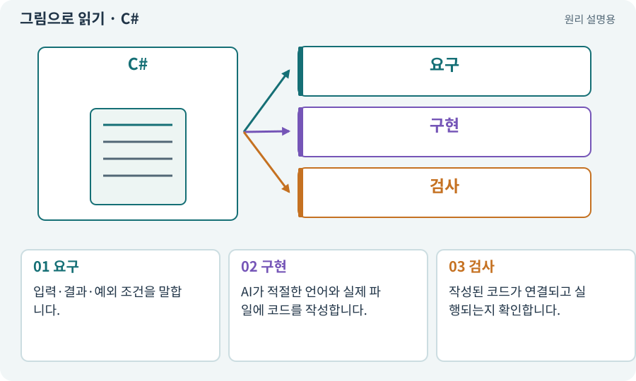

# C#·Python·스크립트

**분야:** 코드·데이터·저장·검사

C#과 Python은 프로그램을 표현하는 언어입니다. 이 프로젝트는 Unity의 게임 로직에 C#, 개발 하네스의 실행·파일·검사 관리에 Python을 사용합니다. 문법을 직접 입력할 필요는 없습니다. 구현과 실행은 AI에게 맡깁니다.

**찾아오는 이름:** C#·Python·스크립트, C#, Csharp, C Sharp, Python, 파이썬, 스크립트, script

## 익숙한 것에 비유하면

같은 요구를 서로 다른 기계가 읽는 언어로 적는 것입니다. 무엇을 해야 하는지는 사람이 정하고 AI가 해당 언어로 구현합니다.



개념도입니다. 실제 Unity 화면이나 검사 결과가 아닙니다. 그림의 순서·색은 역할을 구분하며 실제 설정값은 프로젝트에서 확인합니다.

## 이렇게 작동합니다

### 1. 요구

입력·결과·예외 조건을 말합니다.

### 2. 구현

AI가 적절한 언어와 실제 파일에 코드를 작성합니다.

### 3. 검사

작성된 코드가 연결되고 실행되는지 확인합니다.

## 우리 RPG에서는 이렇게 만나요

“가방이 꽉 차면 줍기를 거절하고 바닥 아이템은 남겨 줘”라는 규칙은 자연어입니다. AI가 C#으로 구현하고 NUnit 테스트로 반례까지 검사합니다.

## 이것과 혼동하지 마세요

언어를 모른다고 실행 결과를 검증할 필요가 없어지는 것은 아닙니다. 기대 결과와 실제 결과를 판단해야 합니다.

## 이해했는지 한 번 생각해 보기

Python 파일을 만들었다고 APK에 포함해야 하나요?

<details><summary>답과 이유</summary>

아닙니다. 여기서 Python은 제작용 하네스이며 게임 런타임과 분리합니다.

</details>

## 내 프로젝트에서 확인하고 싶다면

아래 요청은 읽기 전용으로 실제 대상을 확인하는 선택 요청입니다. 코드나 설정을 직접 편집할 필요는 없습니다.

```text
현재 프로젝트에서 C#·Python·스크립트 관련 요소가 어떻게 사용되는지 읽기 전용으로 확인해 줘. 실제 대상과 설정을 찾아 쉬운 말과 작은 예로 설명해 줘. 특히 다음 혼동을 구분해 줘: 언어를 모른다고 실행 결과를 검증할 필요가 없어지는 것은 아닙니다. 기대 결과와 실제 결과를 판단해야 합니다. 아직 코드·설정·파일은 바꾸지 말고, 확인할 수 없는 내용은 따로 알려 줘.
```

## 이어지는 개념

[MonoBehaviour와 컴포넌트 스크립트](mono.md) · [컴파일·어셈블리·도메인 리로드](compile.md) · [개발 하네스](harness.md) · [단위·통합·회귀 테스트](test.md)

## 이 개념을 사용하는 실습

[09 · 클릭한 곳까지 벽을 돌아가기](../index.html#lesson-009) · [38 · 테스트 결과와 실제 플레이 구분하기](../index.html#lesson-038) · [75 · 다운로드 용량과 진행률 보여 주기](../index.html#lesson-075) · [77 · 앱을 바꾸지 않고 외형 업데이트하기](../index.html#lesson-077) · [98 · 3D 팩을 2D 팩과 따로 내려받기](../index.html#lesson-098) · [114 · 테스트를 실행하고 결과 읽기](../index.html#lesson-114) · [125 · 하네스로 작은 전리품 화면 만들기](../index.html#lesson-125) · [127 · 내 반복 업무에 맞게 도구 개조하기](../index.html#lesson-127) · [130 · 첫 확장 작업을 하네스에 연결하기](../index.html#lesson-130) · [153 · 대장간 고해상도팩 선택 다운로드하기](../index.html#lesson-153)

## 참고와 설명의 범위

기본 도구 동작은 아래 공식 자료를 참고했습니다. 비유·그림·RPG의 예시 수치와 정책은 이해를 위한 자체 예제입니다. 실제 API·지원 기능은 설치 버전과 계정에서 확인합니다.

- [Microsoft · C# 클래스](https://learn.microsoft.com/en-us/dotnet/csharp/fundamentals/types/classes)

그림·계산 예제·조작 모형은 자체 제작한 설명입니다. 실제 Unity 화면, 서비스 생성 결과, 성능 실측 또는 게임 테스트 결과가 아닙니다. 자료 확인: 2026년 9월 26일.
