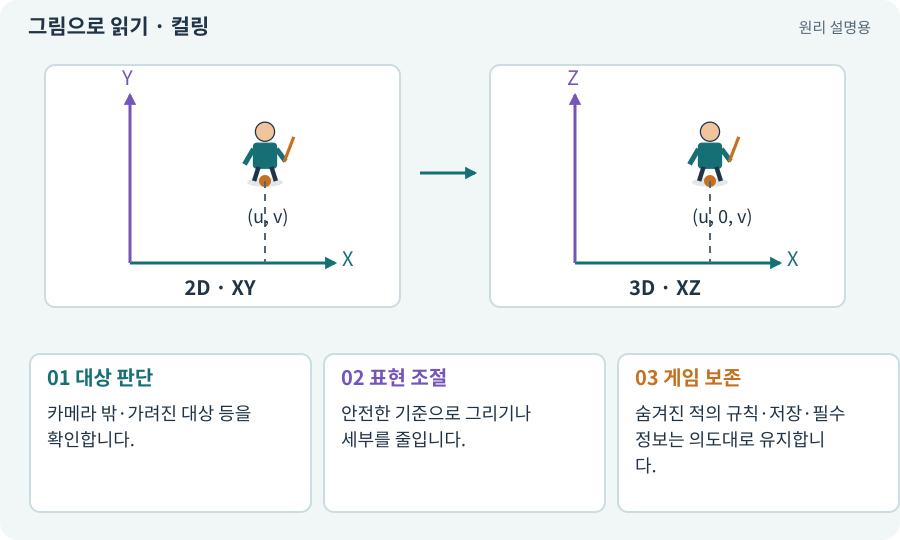

# 컬링·카메라 가림·LOD

**분야:** 입력·UI·소리·성능

컬링은 그리지 않아도 되는 대상을 제외하는 과정이고, LOD는 거리 등에 따라 표현의 세부 수준을 바꾸는 방식입니다. 카메라가 캐릭터를 벽으로 가리는 문제와 구분합니다.

**찾아오는 이름:** 컬링·카메라 가림·LOD, 컬링, Culling, Occlusion, 가림 처리, LOD, 시야 밖

## 익숙한 것에 비유하면

방송 화면 밖의 소품은 자세히 보여 줄 필요가 없고 먼 배경은 단순하게 표현할 수 있다는 생각입니다.



개념도입니다. 실제 Unity 화면이나 검사 결과가 아닙니다. 그림의 순서·색은 역할을 구분하며 실제 설정값은 프로젝트에서 확인합니다.

## 이렇게 작동합니다

### 1. 대상 판단

카메라 밖·가려진 대상 등을 확인합니다.

### 2. 표현 조절

안전한 기준으로 그리기나 세부를 줄입니다.

### 3. 게임 보존

숨겨진 적의 규칙·저장·필수 정보는 의도대로 유지합니다.

## 우리 RPG에서는 이렇게 만나요

3D 카메라 앞 벽을 반투명하게 해 캐릭터를 보이게 하는 것은 읽기 개선입니다. 그 벽의 충돌까지 없애면 게임 규칙이 바뀝니다.

## 이것과 혼동하지 마세요

안 보이는 적을 비활성화하면 타이머·AI·보상이 달라질 수 있습니다. 표시 최적화와 실행 정지를 구분합니다.

## 이해했는지 한 번 생각해 보기

카메라 밖으로 갔다가 적 체력이 회복되면?

<details><summary>답과 이유</summary>

컬링 대신 객체 전체를 재초기화하는지 확인합니다.

</details>

## 내 프로젝트에서 확인하고 싶다면

아래 요청은 읽기 전용으로 실제 대상을 확인하는 선택 요청입니다. 코드나 설정을 직접 편집할 필요는 없습니다.

```text
현재 프로젝트에서 컬링·카메라 가림·LOD 관련 요소가 어떻게 사용되는지 읽기 전용으로 확인해 줘. 실제 대상과 설정을 찾아 쉬운 말과 작은 예로 설명해 줘. 특히 다음 혼동을 구분해 줘: 안 보이는 적을 비활성화하면 타이머·AI·보상이 달라질 수 있습니다. 표시 최적화와 실행 정지를 구분합니다. 아직 코드·설정·파일은 바꾸지 말고, 확인할 수 없는 내용은 따로 알려 줘.
```

## 이어지는 개념

[카메라·직교·원근](camera.md) · [렌더링·Renderer](render.md) · [수명주기·초기화·정리](lifecycle.md) · [메시·정점·삼각형·노멀](mesh.md)

## 이 개념을 사용하는 실습

[35 · 앞뒤 가림과 PC 조작 다듬기](../index.html#lesson-035) · [95 · 3D 조명과 환경을 읽기 좋게 만들기](../index.html#lesson-095) · [96 · 3D 카메라 가림과 터치 조작 다듬기](../index.html#lesson-096)

## 참고와 설명의 범위

기본 도구 동작은 아래 공식 자료를 참고했습니다. 비유·그림·RPG의 예시 수치와 정책은 이해를 위한 자체 예제입니다. 실제 API·지원 기능은 설치 버전과 계정에서 확인합니다.

- [Unity · 타깃 기기 프로파일링](https://docs.unity3d.com/6000.3/Documentation/Manual/profiling-target-device.html)

그림·계산 예제·조작 모형은 자체 제작한 설명입니다. 실제 Unity 화면, 서비스 생성 결과, 성능 실측 또는 게임 테스트 결과가 아닙니다. 자료 확인: 2026년 9월 26일.
