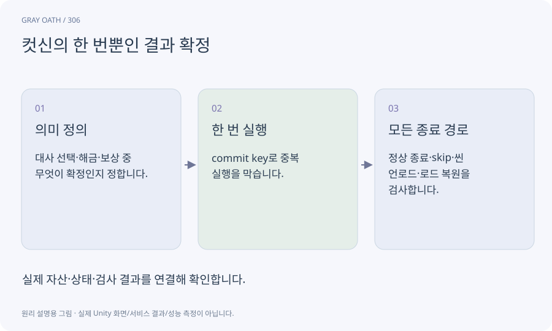

# 컷신의 한 번뿐인 결과 확정

연출을 끝까지 보거나 건너뛰거나 중단해도 이야기 상태를 정해진 시점에 한 번만 바꾸는 계약입니다.

## 익숙한 비유

서약 장면의 영상 길이와 실제 서약서에 서명한 사실을 따로 관리하는 것입니다.



## 작동 원리

### 1. 의미 정의

대사 선택·해금·보상 중 무엇이 확정인지 정합니다.

### 2. 한 번 실행

commit key로 중복 실행을 막습니다.

### 3. 모든 종료 경로

정상 종료·skip·씬 언로드·로드 복원을 검사합니다.

## 게임 속 예

촌장이 의뢰를 주는 컷신을 건너뛰어도 의뢰는 한 번 시작합니다. 다른 엔딩을 보여 주는 연출을 잘못 커밋하지 않도록 선택 사실을 먼저 고정합니다.

## 혼동하지 않기

무조건 종료 때 보상을 주면 취소·실패와 완료를 혼동할 수 있습니다.

## 확인 질문

시작하자마자 취소해도 보상을 주나요?

의미 계약에 달렸습니다. 이 장면의 시작/선택/완료 중 어느 시점이 확정인지 명시해야 합니다.

## 내 프로젝트에서 확인하기

```text
현재 GrayOathRPG3D에서 컷신의 한 번뿐인 결과 확정을 사용하는 실제 대상과 동작을 읽기 전용으로 확인해 줘. 쉬운 말과 작은 사례로 설명하고 무조건 종료 때 보상을 주면 취소·실패와 완료를 혼동할 수 있습니다. 이 문제를 어떻게 막는지 보여 줘. 코드·데이터·설정은 아직 수정하지 마.
```

## 관련 해설

[idempotency](idempotency.md) · [ending-state](ending-state.md) · [timeline](timeline.md)

## 공식 참고

- [Unity · Timeline](https://docs.unity3d.com/Packages/com.unity.timeline@1.8/manual/index.html)
