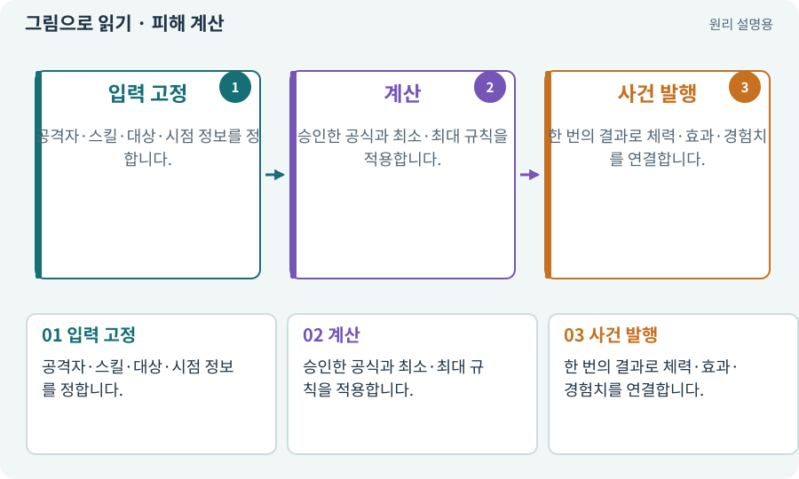

# 피해 계산·스냅샷·피해 사건

**분야:** 지도·적 AI·전투 규칙

피해 계산은 공격력·방어·스킬·상태 등의 입력으로 체력 감소량을 정하는 규칙입니다. 스냅샷은 공격 시작이나 타격 시점 중 선택한 순간의 값을 고정해 사용하기 위한 기록입니다.

**찾아오는 이름:** 피해 계산·스냅샷·피해 사건, 피해 계산, DamageCalculator, AttackSnapshot, damageKind, 피해 사건, DamageEvent

## 익숙한 것에 비유하면

계산서를 쓸 때 어느 시점 가격을 적용할지 정하는 것입니다. 주문 후 가격표가 바뀌었다고 마음대로 계산을 바꾸면 혼란스럽습니다.



개념도입니다. 실제 Unity 화면이나 검사 결과가 아닙니다. 그림의 순서·색은 역할을 구분하며 실제 설정값은 프로젝트에서 확인합니다.

## 이렇게 작동합니다

### 1. 입력 고정

공격자·스킬·대상·시점 정보를 정합니다.

### 2. 계산

승인한 공식과 최소·최대 규칙을 적용합니다.

### 3. 사건 발행

한 번의 결과로 체력·효과·경험치를 연결합니다.

## 우리 RPG에서는 이렇게 만나요

설명용 공식 max(1,공격력−방어력)에서 12−5는 7입니다. 실제 게임 공식은 따로 명시합니다. 시각 효과와 애니메이션이 각각 피해를 한 번 더 주면 안 됩니다.

## 이것과 혼동하지 마세요

공격 시작값을 쓸지 타격 순간값을 쓸지는 설계 선택입니다. 코드마다 섞지 않습니다.

## 이해했는지 한 번 생각해 보기

칼 이펙트를 두 겹으로 만들면 피해도 두 배가 되나요?

<details><summary>답과 이유</summary>

아니요. 표시 수와 피해 사건 수는 분리합니다.

</details>

## 내 프로젝트에서 확인하고 싶다면

아래 요청은 읽기 전용으로 실제 대상을 확인하는 선택 요청입니다. 코드나 설정을 직접 편집할 필요는 없습니다.

```text
현재 프로젝트에서 피해 계산·스냅샷·피해 사건 관련 요소가 어떻게 사용되는지 읽기 전용으로 확인해 줘. 실제 대상과 설정을 찾아 쉬운 말과 작은 예로 설명해 줘. 특히 다음 혼동을 구분해 줘: 공격 시작값을 쓸지 타격 순간값을 쓸지는 설계 선택입니다. 코드마다 섞지 않습니다. 아직 코드·설정·파일은 바꾸지 말고, 확인할 수 없는 내용은 따로 알려 줘.
```

## 이어지는 개념

[Hitbox·Hurtbox·Body](hitbox.md) · [능력치·클램프·정수·부동소수점](stats.md) · [공격 ID·사건 ID·중복 피해 방지](event-id.md) · [스냅샷·기준선·baseline](snapshot.md)

## 이 개념을 사용하는 실습

[12 · 체력과 피해를 눈으로 확인하기](../index.html#lesson-012) · [13 · 적을 클릭해 접근하고 공격하기](../index.html#lesson-013) · [23 · 장비를 바꾸고 능력치 확인하기](../index.html#lesson-023) · [38 · 테스트 결과와 실제 플레이 구분하기](../index.html#lesson-038) · [70 · 피격 강조와 보스 예고 셰이더 만들기](../index.html#lesson-070) · [82 · 게임 규칙은 재사용하고 공간만 바꾸기](../index.html#lesson-082) · [89 · 같은 전투 규칙을 3D에 연결하기](../index.html#lesson-089) · [112 · 네 역할을 순서대로 실행하기](../index.html#lesson-112) · [134 · 화상·냉기·표식으로 전투 확장하기](../index.html#lesson-134) · [145 · 지원 동료 하나 만들기](../index.html#lesson-145)

## 참고와 설명의 범위

이 항목의 비유·그림·RPG 수치·운영 규칙은 개념을 이해하기 위한 자체 설계 예제입니다. 특정 도구가 이 규칙을 자동으로 구현한다는 뜻은 아닙니다.


그림·계산 예제·조작 모형은 자체 제작한 설명입니다. 실제 Unity 화면, 서비스 생성 결과, 성능 실측 또는 게임 테스트 결과가 아닙니다. 자료 확인: 2026년 9월 26일.
