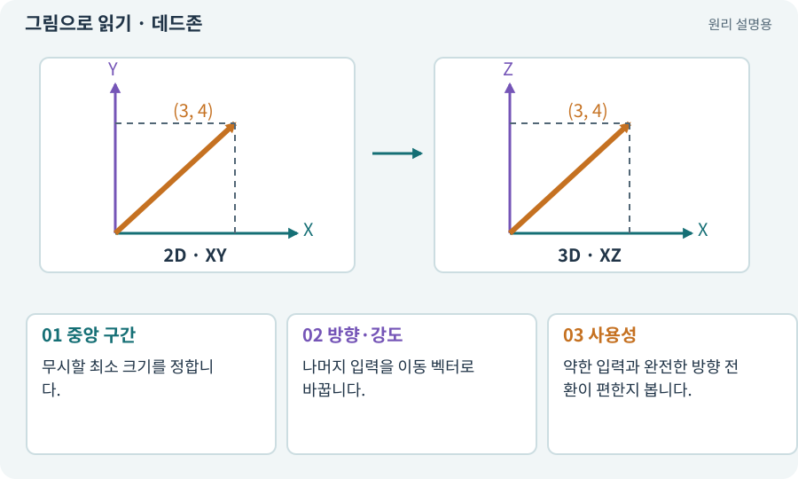

# 데드존·입력 강도

**분야:** 입력·UI·소리·성능

데드존은 조이스틱 중앙 근처의 작은 움직임을 입력으로 보지 않는 범위입니다. 손 떨림이나 장치의 미세 신호 때문에 캐릭터가 저절로 움직이는 것을 줄입니다.

**찾아오는 이름:** 데드존·입력 강도, 데드존, Deadzone, Dead Zone, 입력 강도

## 익숙한 것에 비유하면

문손잡이가 아주 조금 흔들려도 문을 연 것으로 보지 않는 여유 구간입니다.



개념도입니다. 실제 Unity 화면이나 검사 결과가 아닙니다. 그림의 순서·색은 역할을 구분하며 실제 설정값은 프로젝트에서 확인합니다.

## 이렇게 작동합니다

### 1. 중앙 구간

무시할 최소 크기를 정합니다.

### 2. 방향·강도

나머지 입력을 이동 벡터로 바꿉니다.

### 3. 사용성

약한 입력과 완전한 방향 전환이 편한지 봅니다.

## 우리 RPG에서는 이렇게 만나요

너무 큰 데드존은 조이스틱을 많이 움직여도 반응하지 않아 답답하고, 너무 작으면 손을 뗐는데도 미세 이동할 수 있습니다.

## 이것과 혼동하지 마세요

모든 입력을 길이 1로 정규화하면 조이스틱을 조금 움직여도 최대 속도가 됩니다. 의도한 강도는 보존합니다.

## 이해했는지 한 번 생각해 보기

중앙에서 손을 놓았는데 캐릭터가 꿈틀거리면?

<details><summary>답과 이유</summary>

데드존·포인터 해제·가상 장치 값 초기화를 확인합니다.

</details>

## 내 프로젝트에서 확인하고 싶다면

아래 요청은 읽기 전용으로 실제 대상을 확인하는 선택 요청입니다. 코드나 설정을 직접 편집할 필요는 없습니다.

```text
현재 프로젝트에서 데드존·입력 강도 관련 요소가 어떻게 사용되는지 읽기 전용으로 확인해 줘. 실제 대상과 설정을 찾아 쉬운 말과 작은 예로 설명해 줘. 특히 다음 혼동을 구분해 줘: 모든 입력을 길이 1로 정규화하면 조이스틱을 조금 움직여도 최대 속도가 됩니다. 의도한 강도는 보존합니다. 아직 코드·설정·파일은 바꾸지 말고, 확인할 수 없는 내용은 따로 알려 줘.
```

## 이어지는 개념

[벡터·방향·정규화](vector.md) · [멀티터치·가상 조이스틱](multitouch.md) · [Input System·Action·Binding](input-system.md) · [이동 모터와 단일 위치 책임](motor.md)

## 이 개념을 사용하는 실습

다른 개념을 이해하기 위한 보충 해설입니다.

## 참고와 설명의 범위

기본 도구 동작은 아래 공식 자료를 참고했습니다. 비유·그림·RPG의 예시 수치와 정책은 이해를 위한 자체 예제입니다. 실제 API·지원 기능은 설치 버전과 계정에서 확인합니다.

- [Unity Input System · UI 지원](https://docs.unity3d.com/Packages/com.unity.inputsystem@1.17/manual/UISupport.html)

그림·계산 예제·조작 모형은 자체 제작한 설명입니다. 실제 Unity 화면, 서비스 생성 결과, 성능 실측 또는 게임 테스트 결과가 아닙니다. 자료 확인: 2026년 9월 26일.
