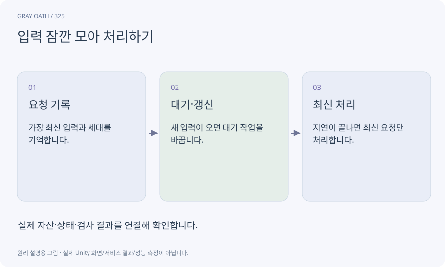

# 입력 잠깐 모아 처리하기

연속된 입력마다 비싼 처리를 하지 않고 짧은 안정 구간 뒤 마지막 요청을 처리하는 방식입니다. 즉시 반응해야 하는 전투 입력과는 다르게 사용합니다.

## 익숙한 비유

검색어를 한 글자마다 멀리 물어보지 않고 잠깐 입력이 끝나면 묻는 방식입니다.



## 작동 원리

### 1. 요청 기록

가장 최신 입력과 세대를 기억합니다.

### 2. 대기·갱신

새 입력이 오면 대기 작업을 바꿉니다.

### 3. 최신 처리

지연이 끝나면 최신 요청만 처리합니다.

## 게임 속 예

퀘스트 목록 검색에 사용합니다. 이전 검색 결과가 늦게 오면 세대를 비교해 버립니다.

## 혼동하지 않기

공격·회피 입력에 같은 긴 지연을 넣으면 조작감이 나빠집니다.

## 확인 질문

취소한 검색 결과가 나중에 표시되면?

요청 세대·취소 상태를 결과 적용 직전에 다시 확인합니다.

## 내 프로젝트에서 확인하기

```text
현재 GrayOathRPG3D에서 입력 잠깐 모아 처리하기을 사용하는 실제 대상과 동작을 읽기 전용으로 확인해 줘. 쉬운 말과 작은 사례로 설명하고 공격·회피 입력에 같은 긴 지연을 넣으면 조작감이 나빠집니다. 이 문제를 어떻게 막는지 보여 줘. 코드·데이터·설정은 아직 수정하지 마.
```

## 관련 해설

[cancellation](cancellation.md) · [request-id](request-id.md) · [ui-toolkit](ui-toolkit.md)

## 공식 참고

- [Unity · UI Toolkit EditorWindow](https://docs.unity3d.com/6000.3/Documentation/Manual/UIE-HowTo-CreateEditorWindow.html)
