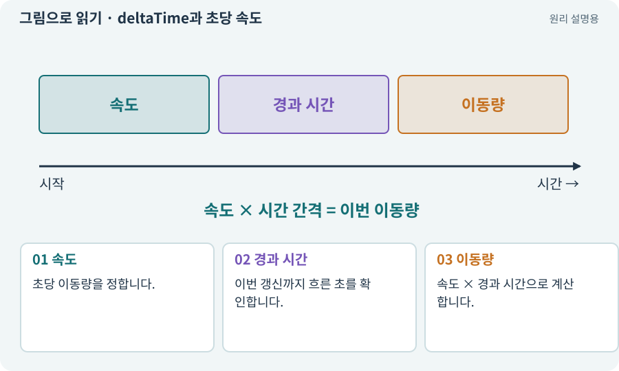

# deltaTime과 초당 속도

**분야:** 오브젝트·좌표·움직임

deltaTime은 이전 갱신 이후 흐른 시간을 초로 나타냅니다. 초당 속도에 이 시간을 곱하면 한 번의 갱신에서 이동할 거리를 계산할 수 있습니다.

**찾아오는 이름:** deltaTime과 초당 속도, deltaTime, Time.deltaTime, 시간 간격, 프레임 독립

## 익숙한 것에 비유하면

“걸음 한 번마다 10cm”가 아니라 “1초에 3m”로 약속하는 방식입니다. 갱신 횟수가 달라도 같은 시간에 비슷한 거리를 이동하게 합니다.



개념도입니다. 실제 Unity 화면이나 검사 결과가 아닙니다. 그림의 순서·색은 역할을 구분하며 실제 설정값은 프로젝트에서 확인합니다.

## 이렇게 작동합니다

### 1. 속도

초당 이동량을 정합니다.

### 2. 경과 시간

이번 갱신까지 흐른 초를 확인합니다.

### 3. 이동량

속도 × 경과 시간으로 계산합니다.

## 1초 동안 얼마나 움직였는지 비교해 보세요

속도 3유닛/초일 때 60fps에서는 프레임마다 약 0.05유닛, 30fps에서는 약 0.1유닛 움직이면 모두 1초 뒤 3유닛입니다. 한 프레임마다 고정 0.1유닛을 더하면 60fps에서는 6유닛, 30fps에서는 3유닛이 됩니다.

deltaTime은 이동량 자체가 아니라 이번 시간 간격입니다. 어떤 함수가 속도를 받는지, 변위를 받는지 구분해야 합니다. 속도 입력에 시간을 중복 곱하면 이동이 너무 느려질 수 있습니다.

아래 비교는 일정한 FPS를 가정한 개념 모형입니다. 실제 프레임 간격은 흔들릴 수 있으며 충돌 안정성·최대 이동량·FixedUpdate도 따로 고려해야 합니다.

| 목표 FPS | 이동량/프레임 | 1초 총량 |
| --- | --- | --- |
| 30 | 3/30=0.1 | 3유닛 |
| 60 | 3/60=0.05 | 3유닛 |
| 120 | 3/120=0.025 | 3유닛 |

## 직접 값을 바꾸며 보기

[웹 해설의 조작 모형 열기](../index.html#tech-delta-time). 조작은 설명용 모형만 바꿉니다. 실제 프로젝트·AI·진행 체크·게임 테스트는 실행하거나 변경하지 않습니다.

## 우리 RPG에서는 이렇게 만나요

설명용 속도 3m/s라면 60FPS의 1/60초 동안 0.05m, 30FPS의 1/30초 동안 0.1m 이동합니다. 1초 합계는 둘 다 3m입니다. 실제 충돌·긴 멈춤의 처리는 별도입니다.

## 이것과 혼동하지 마세요

deltaTime을 두 번 곱하거나 물리 속도 API에 잘못 적용하면 속도가 틀어집니다. API가 속도와 변위 중 무엇을 받는지 확인합니다.

## 이해했는지 한 번 생각해 보기

매 프레임 0.1m를 더하면 30FPS와 60FPS가 같을까요?

<details><summary>답과 이유</summary>

아닙니다. 1초 이동량이 3m와 6m가 됩니다.

</details>

## 내 프로젝트에서 확인하고 싶다면

아래 요청은 읽기 전용으로 실제 대상을 확인하는 선택 요청입니다. 코드나 설정을 직접 편집할 필요는 없습니다.

```text
현재 프로젝트에서 deltaTime과 초당 속도 관련 요소가 어떻게 사용되는지 읽기 전용으로 확인해 줘. 실제 대상과 설정을 찾아 쉬운 말과 작은 예로 설명해 줘. 특히 다음 혼동을 구분해 줘: deltaTime을 두 번 곱하거나 물리 속도 API에 잘못 적용하면 속도가 틀어집니다. API가 속도와 변위 중 무엇을 받는지 확인합니다. 아직 코드·설정·파일은 바꾸지 말고, 확인할 수 없는 내용은 따로 알려 줘.
```

## 이어지는 개념

[벡터·방향·정규화](vector.md) · [FPS·프레임 시간·ms](frame-time.md) · [Update·FixedUpdate·LateUpdate](fixed-update.md) · [게임 시간·실시간·일시정지](time-scale.md)

## 이 개념을 사용하는 실습

[60 · Scenario로 스타일과 동작 유지하기](../index.html#lesson-060)

## 참고와 설명의 범위

기본 도구 동작은 아래 공식 자료를 참고했습니다. 비유·그림·RPG의 예시 수치와 정책은 이해를 위한 자체 예제입니다. 실제 API·지원 기능은 설치 버전과 계정에서 확인합니다.

- [Unity · GameObject와 컴포넌트](https://docs.unity3d.com/6000.3/Documentation/Manual/GameObjects.html)

그림·계산 예제·조작 모형은 자체 제작한 설명입니다. 실제 Unity 화면, 서비스 생성 결과, 성능 실측 또는 게임 테스트 결과가 아닙니다. 자료 확인: 2026년 9월 26일.
