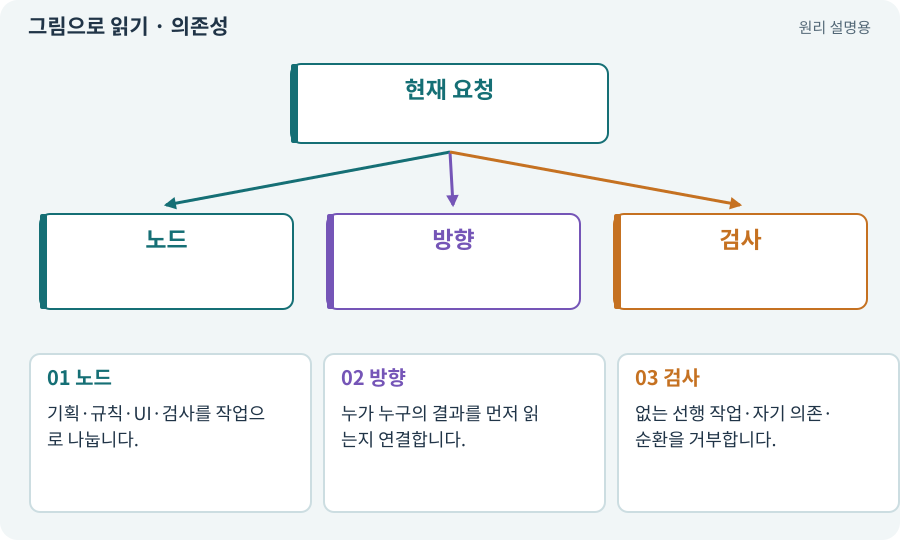

# 의존성·DAG·위상 정렬

**분야:** AI·스킬·훅·하네스 운영

의존성은 어떤 작업이 다른 결과를 먼저 필요로 하는 관계입니다. DAG는 순환이 없는 방향 그래프이고, 위상 정렬은 그 관계를 지키는 실행 순서를 만드는 방법입니다.

**찾아오는 이름:** 의존성·DAG·위상 정렬, 의존성, DAG, depends_on, 위상 정렬, 선행 작업, 의존 그래프

## 익숙한 것에 비유하면

바닥을 깔기 전에 배관을 넣어야 하는 공사 순서입니다. A가 B를 기다리고 B가 A를 기다리면 시작할 수 없습니다.



개념도입니다. 실제 Unity 화면이나 검사 결과가 아닙니다. 그림의 순서·색은 역할을 구분하며 실제 설정값은 프로젝트에서 확인합니다.

## 이렇게 작동합니다

### 1. 노드

기획·규칙·UI·검사를 작업으로 나눕니다.

### 2. 방향

누가 누구의 결과를 먼저 읽는지 연결합니다.

### 3. 검사

없는 선행 작업·자기 의존·순환을 거부합니다.

## 순서를 정하는 선과 정보를 주고받는 선

DAG는 방향이 있고 순환하지 않는 그래프입니다. 작업 B가 A의 결과를 필요로 하면 A→B로 표현합니다. A가 B를, B가 A를 기다리면 시작할 수 없는 순환이므로 계획을 고쳐야 합니다.

선행 작업이 끝났다고 파일을 동시에 고쳐도 되는 것은 아닙니다. 작업 의존성과 파일 소유권·Editor 자원 잠금을 함께 확인합니다.

아래 모형은 작은 작업 그래프입니다. 순환 추가를 켜면 위상 정렬을 거부하는 이유를 볼 수 있습니다. 실제 여러 에이전트를 실행하는 도구는 아닙니다.

| 관계 | 뜻 | 처리 |
| --- | --- | --- |
| A→B | A 결과가 B에 필요 | A 완료 후 B 준비 |
| A와 C 독립 | 입력 의존 없음 | 자원 충돌도 확인 |
| A→B→A | 서로 기다림 | 계획 검증에서 거부 |

## 직접 값을 바꾸며 보기

[웹 해설의 조작 모형 열기](../index.html#tech-dependency). 조작은 설명용 모형만 바꿉니다. 실제 프로젝트·AI·진행 체크·게임 테스트는 실행하거나 변경하지 않습니다.

## 우리 RPG에서는 이렇게 만나요

제작 UI는 거래 규칙 계약을 먼저 읽고 구현해야 합니다. 서로 파일을 동시에 고쳐 해결할 문제가 아니라 인터페이스와 순서를 먼저 정할 수 있습니다.

## 이것과 혼동하지 마세요

의존 관계가 없다고 무조건 병렬 실행해도 되는 것은 아닙니다. 파일·Editor 소유권도 확인합니다.

## 이해했는지 한 번 생각해 보기

A→B→A 관계가 있으면?

<details><summary>답과 이유</summary>

계획의 순환을 제거하거나 공통 계약 작업으로 분리한 뒤 실행합니다.

</details>

## 내 프로젝트에서 확인하고 싶다면

아래 요청은 읽기 전용으로 실제 대상을 확인하는 선택 요청입니다. 코드나 설정을 직접 편집할 필요는 없습니다.

```text
현재 프로젝트에서 의존성·DAG·위상 정렬 관련 요소가 어떻게 사용되는지 읽기 전용으로 확인해 줘. 실제 대상과 설정을 찾아 쉬운 말과 작은 예로 설명해 줘. 특히 다음 혼동을 구분해 줘: 의존 관계가 없다고 무조건 병렬 실행해도 되는 것은 아닙니다. 파일·Editor 소유권도 확인합니다. 아직 코드·설정·파일은 바꾸지 말고, 확인할 수 없는 내용은 따로 알려 줘.
```

## 이어지는 개념

[작업표·완료 조건·계획](task.md) · [스케줄러·순차·병렬](scheduler.md) · [파일 소유권·읽기 범위·쓰기 범위](ownership.md) · [어댑터·인터페이스·의존성 분리](adapter.md)

## 이 개념을 사용하는 실습

[73 · 주소로 에셋 불러오기](../index.html#lesson-073) · [78 · 선택: Google Play 에셋 전달 사용하기](../index.html#lesson-078) · [98 · 3D 팩을 2D 팩과 따로 내려받기](../index.html#lesson-098) · [99 · 2D와 3D 사이에 진행 가져오기](../index.html#lesson-099) · [109 · 요청을 검사 가능한 작업표로 바꾸기](../index.html#lesson-109) · [120 · 자연어 요청을 계획으로 바꾸기](../index.html#lesson-120) · [129 · 기존 2D 게임에서 확장팩 시작하기](../index.html#lesson-129) · [130 · 첫 확장 작업을 하네스에 연결하기](../index.html#lesson-130) · [146 · 대장장이 구조 퀘스트 만들기](../index.html#lesson-146)

## 참고와 설명의 범위

이 항목의 비유·그림·RPG 수치·운영 규칙은 개념을 이해하기 위한 자체 설계 예제입니다. 특정 도구가 이 규칙을 자동으로 구현한다는 뜻은 아닙니다.


그림·계산 예제·조작 모형은 자체 제작한 설명입니다. 실제 Unity 화면, 서비스 생성 결과, 성능 실측 또는 게임 테스트 결과가 아닙니다. 자료 확인: 2026년 9월 26일.
