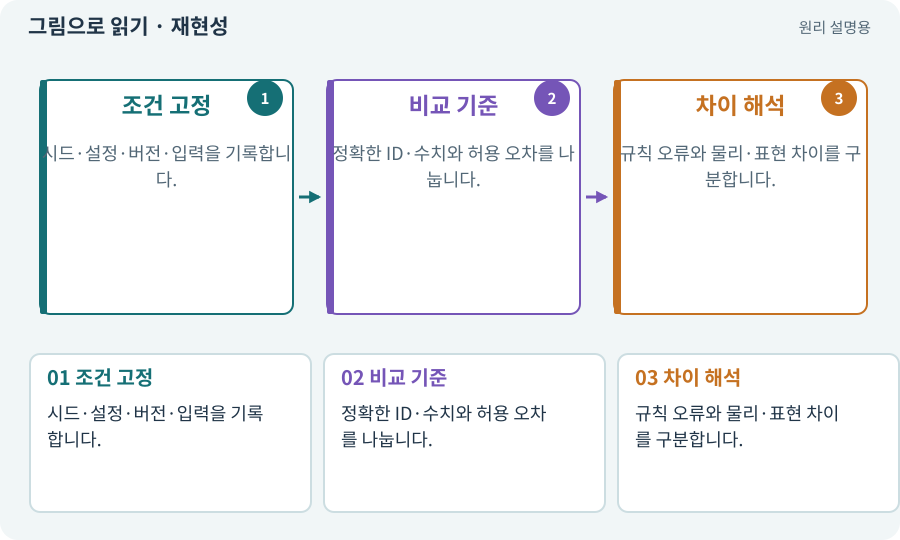

# 재현성·결정성·동등성

**분야:** 코드·데이터·저장·검사

결정성은 같은 입력에서 같은 결과가 나오는 성질, 재현성은 조건을 기록해 같은 실험을 다시 할 수 있는 정도입니다. 동등성 검사는 두 구현이 어떤 기준에서 같아야 하는지 비교합니다.

**찾아오는 이름:** 재현성·결정성·동등성, 결정성, 재현성, 동등성, deterministic, parity, 허용 오차

## 익숙한 것에 비유하면

같은 재료와 계량법으로 요리를 다시 만들거나 다른 주방의 결과를 같은 기준으로 비교하는 것입니다.



개념도입니다. 실제 Unity 화면이나 검사 결과가 아닙니다. 그림의 순서·색은 역할을 구분하며 실제 설정값은 프로젝트에서 확인합니다.

## 이렇게 작동합니다

### 1. 조건 고정

시드·설정·버전·입력을 기록합니다.

### 2. 비교 기준

정확한 ID·수치와 허용 오차를 나눕니다.

### 3. 차이 해석

규칙 오류와 물리·표현 차이를 구분합니다.

## 우리 RPG에서는 이렇게 만나요

2D·3D 피해 계산은 같은 숫자여야 하지만 실제 물리 이동 위치는 명시한 오차 안에서 비교할 수 있습니다. 화면 픽셀까지 같은 게임은 아닙니다.

## 이것과 혼동하지 마세요

결정적 논리 지도와 전체 물리 시뮬레이션의 결정성은 다른 범위입니다.

## 이해했는지 한 번 생각해 보기

같은 seed면 두 기기의 모든 프레임도 같을까요?

<details><summary>답과 이유</summary>

아닙니다. 시간·물리·순서·구현 차이를 따로 통제해야 합니다.

</details>

## 내 프로젝트에서 확인하고 싶다면

아래 요청은 읽기 전용으로 실제 대상을 확인하는 선택 요청입니다. 코드나 설정을 직접 편집할 필요는 없습니다.

```text
현재 프로젝트에서 재현성·결정성·동등성 관련 요소가 어떻게 사용되는지 읽기 전용으로 확인해 줘. 실제 대상과 설정을 찾아 쉬운 말과 작은 예로 설명해 줘. 특히 다음 혼동을 구분해 줘: 결정적 논리 지도와 전체 물리 시뮬레이션의 결정성은 다른 범위입니다. 아직 코드·설정·파일은 바꾸지 말고, 확인할 수 없는 내용은 따로 알려 줘.
```

## 이어지는 개념

[시드·난수·PRNG](rng.md) · [순수 함수·불변 조건·결정적 계산](pure-function.md) · [스냅샷·기준선·baseline](snapshot.md) · [불변 조건·경계값·속성 검사](invariant.md)

## 이 개념을 사용하는 실습

[100 · 두 버전이 같은 게임인지 비교하기](../index.html#lesson-100)

## 참고와 설명의 범위

이 항목의 비유·그림·RPG 수치·운영 규칙은 개념을 이해하기 위한 자체 설계 예제입니다. 특정 도구가 이 규칙을 자동으로 구현한다는 뜻은 아닙니다.


그림·계산 예제·조작 모형은 자체 제작한 설명입니다. 실제 Unity 화면, 서비스 생성 결과, 성능 실측 또는 게임 테스트 결과가 아닙니다. 자료 확인: 2026년 9월 26일.
