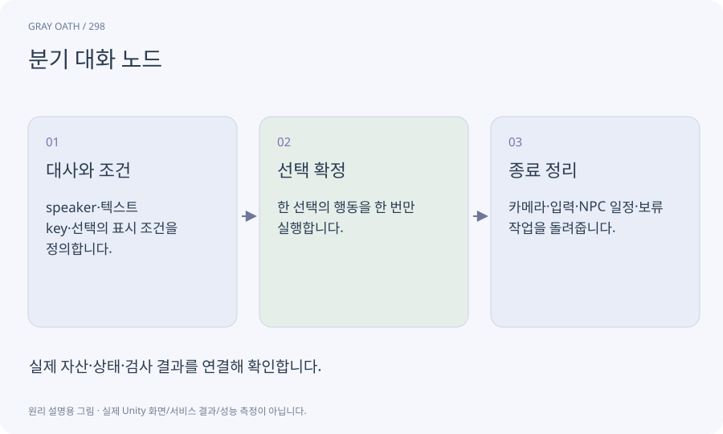

# 분기 대화 노드

말하는 사람·대사·선택지·조건·결과를 데이터로 묶은 대화 단위입니다. 같은 문장이라도 세계 상태와 선택 이력에 따라 다른 다음 노드로 이어질 수 있습니다.

## 익숙한 비유

선택에 따라 다음 쪽이 바뀌는 대화책입니다.



## 작동 원리

### 1. 대사와 조건

speaker·텍스트 key·선택의 표시 조건을 정의합니다.

### 2. 선택 확정

한 선택의 행동을 한 번만 실행합니다.

### 3. 종료 정리

카메라·입력·NPC 일정·보류 작업을 돌려줍니다.

## 게임 속 예

다온에게 단서를 보여 주면 해제법을 얻고, 아직 단서가 없으면 수색 안내를 받습니다. 선택 연타로 보상이 두 번 나가지 않게 합니다.

## 혼동하지 않기

보여 주지 않는 선택지가 이야기 진행에 꼭 필요한 유일한 길이면 막힘이 생길 수 있습니다.

## 확인 질문

대화를 건너뛰면 내용에 연결된 행동도 건너뛰나요?

연출과 의미 행동을 분리하고 선택/커밋 규칙에 따라 일관되게 처리합니다.

## 내 프로젝트에서 확인하기

```text
현재 GrayOathRPG3D에서 분기 대화 노드을 사용하는 실제 대상과 동작을 읽기 전용으로 확인해 줘. 쉬운 말과 작은 사례로 설명하고 보여 주지 않는 선택지가 이야기 진행에 꼭 필요한 유일한 길이면 막힘이 생길 수 있습니다. 이 문제를 어떻게 막는지 보여 줘. 코드·데이터·설정은 아직 수정하지 마.
```

## 관련 해설

[predicate-dsl](predicate-dsl.md) · [cutscene-commit](cutscene-commit.md) · [localization](localization.md)

## 공식 참고

- [Unity · UI Toolkit EditorWindow](https://docs.unity3d.com/6000.3/Documentation/Manual/UIE-HowTo-CreateEditorWindow.html)
