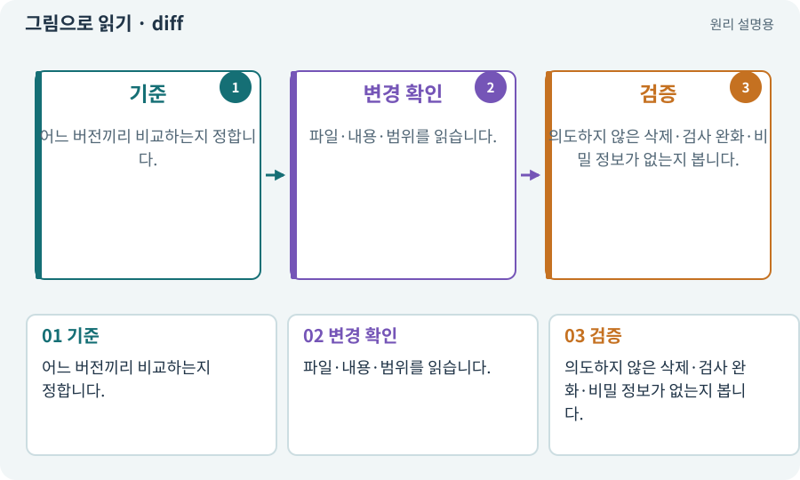

# diff·패치·변경 검토

**분야:** AI·스킬·훅·하네스 운영

diff는 두 버전의 무엇이 추가·삭제·수정됐는지 보여 주는 비교입니다. 패치는 그 변경을 적용할 자료입니다. 엔진의 버그 수정 릴리스인 패치와 문맥이 다릅니다.

**찾아오는 이름:** diff·패치·변경 검토, diff, 패치 제안, 변경 내역, 소스 차이, patch

## 익숙한 것에 비유하면

원본 문서와 교정쇄를 대조해 바뀐 줄만 표시하는 것입니다.



개념도입니다. 실제 Unity 화면이나 검사 결과가 아닙니다. 그림의 순서·색은 역할을 구분하며 실제 설정값은 프로젝트에서 확인합니다.

## 이렇게 작동합니다

### 1. 기준

어느 버전끼리 비교하는지 정합니다.

### 2. 변경 확인

파일·내용·범위를 읽습니다.

### 3. 검증

의도하지 않은 삭제·검사 완화·비밀 정보가 없는지 봅니다.

## 우리 RPG에서는 이렇게 만나요

전리품 필터만 요청했는데 저장 전체나 Android 설정이 바뀌었다면 이유를 확인합니다. 테스트 기대값만 낮춰서 PASS를 만든 변경도 찾습니다.

## 이것과 혼동하지 마세요

diff가 작으면 무조건 안전하거나 크면 무조건 잘못이라는 뜻은 아닙니다. 의미를 봅니다.

## 이해했는지 한 번 생각해 보기

코드보다 테스트만 바뀌며 실패가 사라졌다면?

<details><summary>답과 이유</summary>

정말 명세가 바뀐 것인지 오류를 숨긴 것인지 검토해야 합니다.

</details>

## 내 프로젝트에서 확인하고 싶다면

아래 요청은 읽기 전용으로 실제 대상을 확인하는 선택 요청입니다. 코드나 설정을 직접 편집할 필요는 없습니다.

```text
현재 프로젝트에서 diff·패치·변경 검토 관련 요소가 어떻게 사용되는지 읽기 전용으로 확인해 줘. 실제 대상과 설정을 찾아 쉬운 말과 작은 예로 설명해 줘. 특히 다음 혼동을 구분해 줘: diff가 작으면 무조건 안전하거나 크면 무조건 잘못이라는 뜻은 아닙니다. 의미를 봅니다. 아직 코드·설정·파일은 바꾸지 말고, 확인할 수 없는 내용은 따로 알려 줘.
```

## 이어지는 개념

[후보·스테이징·변경 적용](candidate.md) · [QA·비평·독립 검토](review.md) · [Git·저장소·커밋](git.md) · [회귀·기준선·수정 전후 비교](regression.md)

## 이 개념을 사용하는 실습

[81 · 2D 게임을 남기고 3D 작업 시작하기](../index.html#lesson-081) · [133 · 첫 기능의 실패를 고쳐 다음 기준 만들기](../index.html#lesson-133) · [154 · 확장 기능을 켠 휴대폰 성능 고치기](../index.html#lesson-154)

## 참고와 설명의 범위

기본 도구 동작은 아래 공식 자료를 참고했습니다. 비유·그림·RPG의 예시 수치와 정책은 이해를 위한 자체 예제입니다. 실제 API·지원 기능은 설치 버전과 계정에서 확인합니다.

- [Git · worktree](https://git-scm.com/docs/git-worktree)

그림·계산 예제·조작 모형은 자체 제작한 설명입니다. 실제 Unity 화면, 서비스 생성 결과, 성능 실측 또는 게임 테스트 결과가 아닙니다. 자료 확인: 2026년 9월 26일.
