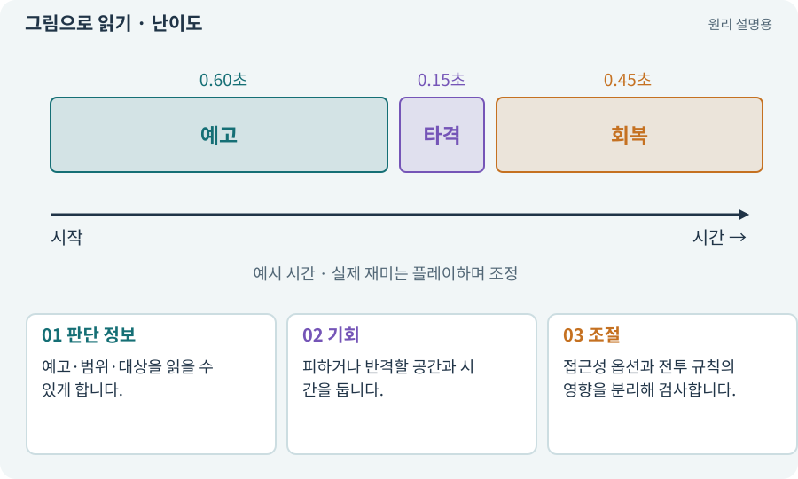

# 난이도·접근성·공정성

**분야:** 지도·적 AI·전투 규칙

난이도는 요구하는 판단·조작·자원 관리의 부담입니다. 공정성은 플레이어가 위험을 읽고 자신의 행동 결과를 납득할 수 있는가에 관련됩니다. 무적 시간은 특정 피해를 무시하는 명시적 구간입니다.

**찾아오는 이름:** 난이도·접근성·공정성, 난이도, 공정성, 반응 시간, 무적 시간, 회피 대시

## 익숙한 것에 비유하면

퍼즐을 어렵게 만드는 것과 조명이 안 보여 문제를 읽지 못하게 하는 것은 다릅니다.



개념도입니다. 실제 Unity 화면이나 검사 결과가 아닙니다. 그림의 순서·색은 역할을 구분하며 실제 설정값은 프로젝트에서 확인합니다.

## 이렇게 작동합니다

### 1. 판단 정보

예고·범위·대상을 읽을 수 있게 합니다.

### 2. 기회

피하거나 반격할 공간과 시간을 둡니다.

### 3. 조절

접근성 옵션과 전투 규칙의 영향을 분리해 검사합니다.

## 우리 RPG에서는 이렇게 만나요

대시에 0.15초 무적을 주는 것은 설명용 정책 예입니다. 벽 통과까지 허용한다는 뜻은 아닙니다. 어떤 피해 종류를 막을지와 정확한 경계를 검사합니다.

## 이것과 혼동하지 마세요

모바일의 작은 버튼 때문에 실패하는 상황을 의도한 전투 난이도로 방치하지 않습니다.

## 이해했는지 한 번 생각해 보기

위험 색을 못 구분하는 사람에게 체력을 더 주면 충분한가요?

<details><summary>답과 이유</summary>

위험 정보를 형태·테두리·소리 등으로도 전달하는 접근성이 먼저 필요합니다.

</details>

## 내 프로젝트에서 확인하고 싶다면

아래 요청은 읽기 전용으로 실제 대상을 확인하는 선택 요청입니다. 코드나 설정을 직접 편집할 필요는 없습니다.

```text
현재 프로젝트에서 난이도·접근성·공정성 관련 요소가 어떻게 사용되는지 읽기 전용으로 확인해 줘. 실제 대상과 설정을 찾아 쉬운 말과 작은 예로 설명해 줘. 특히 다음 혼동을 구분해 줘: 모바일의 작은 버튼 때문에 실패하는 상황을 의도한 전투 난이도로 방치하지 않습니다. 아직 코드·설정·파일은 바꾸지 말고, 확인할 수 없는 내용은 따로 알려 줘.
```

## 이어지는 개념

[접근성·가독성·피드백](accessibility.md) · [공격 예고·선행동작·회복](telegraph.md) · [입력 버퍼·취소·우선순위](input-buffer.md) · [이동 모터와 단일 위치 책임](motor.md)

## 이 개념을 사용하는 실습

[51 · 전투 전체의 압박 조절하기](../index.html#lesson-051) · [53 · 입력은 빠르게, 취소 규칙은 명확하게](../index.html#lesson-053) · [135 · 벽을 통과하지 않는 회피 만들기](../index.html#lesson-135)

## 참고와 설명의 범위

이 항목의 비유·그림·RPG 수치·운영 규칙은 개념을 이해하기 위한 자체 설계 예제입니다. 특정 도구가 이 규칙을 자동으로 구현한다는 뜻은 아닙니다.


그림·계산 예제·조작 모형은 자체 제작한 설명입니다. 실제 Unity 화면, 서비스 생성 결과, 성능 실측 또는 게임 테스트 결과가 아닙니다. 자료 확인: 2026년 9월 26일.
