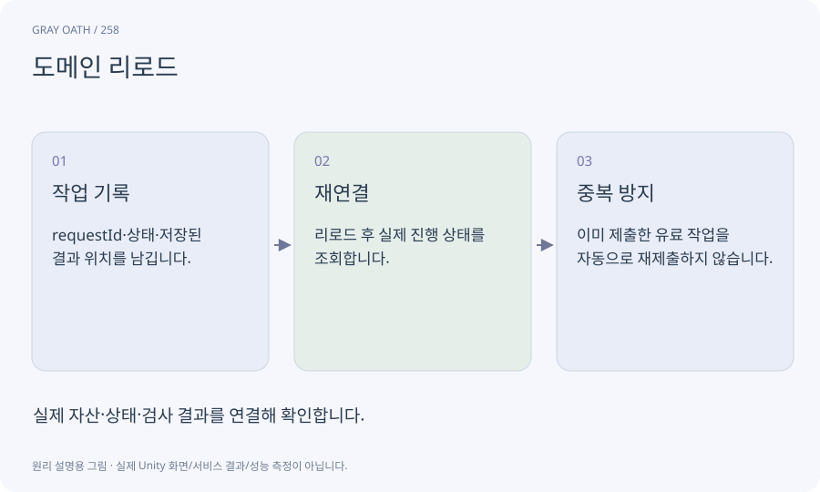

# 도메인 리로드

스크립트 환경이 다시 준비되면서 관리 객체나 정적 상태가 초기화되는 과정입니다. Editor 도구의 임시 값과 진행 중 작업이 이전과 같다고 가정하면 안 됩니다.

## 익숙한 비유

접수 창구 프로그램을 재시작하는 상황입니다. 접수 번호를 장부에 남겨야 이미 보낸 요청을 또 보내지 않습니다.



## 작동 원리

### 1. 작업 기록

requestId·상태·저장된 결과 위치를 남깁니다.

### 2. 재연결

리로드 후 실제 진행 상태를 조회합니다.

### 3. 중복 방지

이미 제출한 유료 작업을 자동으로 재제출하지 않습니다.

## 게임 속 예

Meshy 생성 대기 중 C#이 컴파일돼 창이 다시 열려도 저장된 taskId로 상태를 조회합니다. 응답을 잃었다고 새 생성 요청부터 보내지 않습니다.

## 혼동하지 않기

도메인 리로드를 끄는 옵션이 모든 수명주기 문제를 해결하는 것은 아닙니다.

## 확인 질문

창의 진행률이 초기화됐으면 서버 작업도 취소됐나요?

아닙니다. 실제 작업 ID로 확인하고 알 수 없으면 확인 필요 상태로 남깁니다.

## 내 프로젝트에서 확인하기

```text
현재 GrayOathRPG3D에서 도메인 리로드을 사용하는 실제 대상과 동작을 읽기 전용으로 확인해 줘. 쉬운 말과 작은 사례로 설명하고 도메인 리로드를 끄는 옵션이 모든 수명주기 문제를 해결하는 것은 아닙니다. 이 문제를 어떻게 막는지 보여 줘. 코드·데이터·설정은 아직 수정하지 마.
```

## 관련 해설

[editor-job](editor-job.md) · [process](process.md) · [lifecycle](lifecycle.md)

## 공식 참고

- [Unity · UI Toolkit EditorWindow](https://docs.unity3d.com/6000.3/Documentation/Manual/UIE-HowTo-CreateEditorWindow.html)
