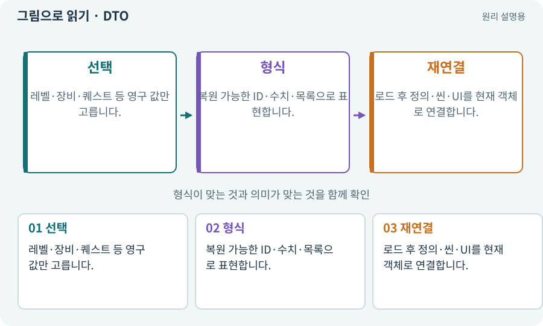

# DTO·저장 데이터와 런타임 상태

**분야:** 코드·데이터·저장·검사

DTO는 저장이나 전송을 위해 필요한 값을 단순하게 묶은 데이터 구조입니다. 실행 중 컴포넌트·이벤트 구독·화면 객체를 그대로 담지 않도록 경계를 만듭니다.

**찾아오는 이름:** DTO·저장 데이터와 런타임 상태, DTO, Data Transfer Object, SaveData, 저장 DTO

## 익숙한 것에 비유하면

이삿짐 목록에는 물건 ID와 수량을 적지, 현재 그 물건을 들고 있는 사람까지 저장하지 않는 것과 같습니다.



개념도입니다. 실제 Unity 화면이나 검사 결과가 아닙니다. 그림의 순서·색은 역할을 구분하며 실제 설정값은 프로젝트에서 확인합니다.

## 이렇게 작동합니다

### 1. 선택

레벨·장비·퀘스트 등 영구 값만 고릅니다.

### 2. 형식

복원 가능한 ID·수치·목록으로 표현합니다.

### 3. 재연결

로드 후 정의·씬·UI를 현재 객체로 연결합니다.

## 우리 RPG에서는 이렇게 만나요

2D와 3D 사이에서 진행을 옮길 때 같은 SaveDTO를 쓰면 캐릭터 모델이 달라도 아이템 소유권을 보존할 수 있습니다.

## 이것과 혼동하지 마세요

DTO가 있다고 원자 저장·버전 이전·중복 검사가 자동 해결되지는 않습니다.

## 이해했는지 한 번 생각해 보기

Animator 상태 참조를 DTO에 넣어야 하나요?

<details><summary>답과 이유</summary>

영구 진행에 필요한지부터 판단합니다. 보통 현재 씬 객체 참조와 분리합니다.

</details>

## 내 프로젝트에서 확인하고 싶다면

아래 요청은 읽기 전용으로 실제 대상을 확인하는 선택 요청입니다. 코드나 설정을 직접 편집할 필요는 없습니다.

```text
현재 프로젝트에서 DTO·저장 데이터와 런타임 상태 관련 요소가 어떻게 사용되는지 읽기 전용으로 확인해 줘. 실제 대상과 설정을 찾아 쉬운 말과 작은 예로 설명해 줘. 특히 다음 혼동을 구분해 줘: DTO가 있다고 원자 저장·버전 이전·중복 검사가 자동 해결되지는 않습니다. 아직 코드·설정·파일은 바꾸지 말고, 확인할 수 없는 내용은 따로 알려 줘.
```

## 이어지는 개념

[직렬화·역직렬화](serialization.md) · [어댑터·인터페이스·의존성 분리](adapter.md) · [저장 이전·마이그레이션](migration.md) · [영구 진행·탐험 세션·런타임 상태](session.md)

## 이 개념을 사용하는 실습

[25 · 게임을 껐다 켜도 장비 유지하기](../index.html#lesson-025) · [31 · 퀘스트를 받아 엔딩까지 이어가기](../index.html#lesson-031) · [38 · 테스트 결과와 실제 플레이 구분하기](../index.html#lesson-038) · [82 · 게임 규칙은 재사용하고 공간만 바꾸기](../index.html#lesson-082) · [99 · 2D와 3D 사이에 진행 가져오기](../index.html#lesson-099)

## 참고와 설명의 범위

기본 도구 동작은 아래 공식 자료를 참고했습니다. 비유·그림·RPG의 예시 수치와 정책은 이해를 위한 자체 예제입니다. 실제 API·지원 기능은 설치 버전과 계정에서 확인합니다.

- [Python · JSON](https://docs.python.org/3/library/json.html)

그림·계산 예제·조작 모형은 자체 제작한 설명입니다. 실제 Unity 화면, 서비스 생성 결과, 성능 실측 또는 게임 테스트 결과가 아닙니다. 자료 확인: 2026년 9월 26일.
