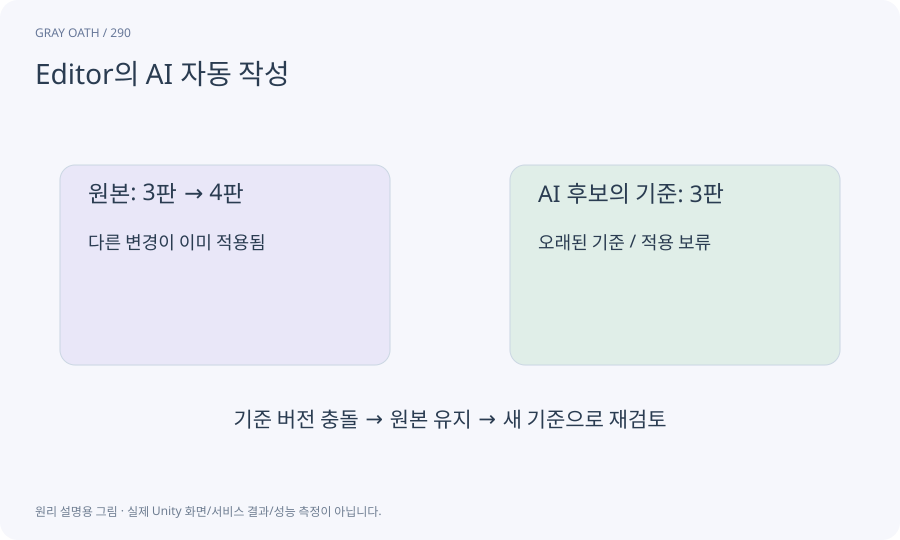

# Editor의 AI 자동 작성

편집기에서 자연어 요구를 입력하면 AI가 퀘스트·대화 등의 데이터 초안을 만드는 기능입니다. 게임 실행 중 플레이어에게 생성 AI를 호출하는 구조와 다릅니다.

## 익숙한 비유

작가에게 초고를 맡기고 편집자가 검수해 출판하는 과정입니다.



## 작동 원리

### 1. 요구·문맥 준비

허용 NPC/아이템/사실·범위·현재 revision을 보냅니다.

### 2. 데이터 초안

구조화된 결과를 받아 스키마와 의미를 검사합니다.

### 3. 검토 후 적용

차이와 영향을 보여 주고 승인한 후보만 저장합니다.

## 게임 속 예

“밤에 돌다리에서 사라진 등불 의뢰를 만들어 줘”라고 요청하면 등록된 인물과 목표로 초안을 만들고 사람은 두 해결 경로를 읽어 승인합니다.

## 혼동하지 않기

AI가 성공이라고 쓴 말이나 JSON이 파싱된 것만으로 게임 자산에 바로 반영하지 않습니다.

## 확인 질문

Editor에 API 키를 저장해 앱에 넣어도 되나요?

안 됩니다. 키는 로컬 제작용 중계에 두고 Runtime·자산·버전 관리에 포함하지 않습니다.

## 내 프로젝트에서 확인하기

```text
현재 GrayOathRPG3D에서 Editor의 AI 자동 작성을 사용하는 실제 대상과 동작을 읽기 전용으로 확인해 줘. 쉬운 말과 작은 사례로 설명하고 AI가 성공이라고 쓴 말이나 JSON이 파싱된 것만으로 게임 자산에 바로 반영하지 않습니다. 이 문제를 어떻게 막는지 보여 줘. 코드·데이터·설정은 아직 수정하지 마.
```

## 관련 해설

[editor-job](editor-job.md) · [staging](staging.md) · [optimistic-revision](optimistic-revision.md)

## 공식 참고

- [Claude Code · Programmatic use](https://code.claude.com/docs/en/headless)
- [Unity · UI Toolkit EditorWindow](https://docs.unity3d.com/6000.3/Documentation/Manual/UIE-HowTo-CreateEditorWindow.html)
