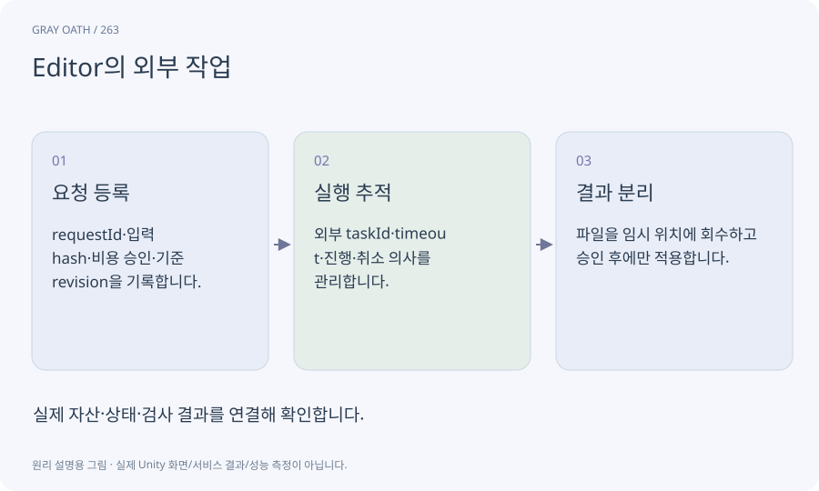

# Editor의 외부 작업

AI나 Meshy처럼 즉시 끝나지 않는 작업을 요청·진행·취소·완료·실패 상태로 관리하는 기록입니다. 창이 살아있는지와 작업이 살아있는지는 별개입니다.

## 익숙한 비유

배달 주문 번호입니다. 앱을 닫아도 주문은 남을 수 있으므로 번호로 실제 상태를 확인합니다.



## 작동 원리

### 1. 요청 등록

requestId·입력 hash·비용 승인·기준 revision을 기록합니다.

### 2. 실행 추적

외부 taskId·timeout·진행·취소 의사를 관리합니다.

### 3. 결과 분리

파일을 임시 위치에 회수하고 승인 후에만 적용합니다.

## 게임 속 예

취소를 누른 뒤 성공 응답이 도착해도 작업대는 자산에 적용하지 않습니다. 이미 쓴 비용까지 자동 환불된다고 표시하지 않습니다.

## 혼동하지 않기

요청 실패인지 응답만 잃었는지 모를 때 새 유료 요청을 곧바로 반복하면 중복 지출이 생깁니다.

## 확인 질문

재시작 후 상태를 모르겠으면 실패로 지우나요?

기록을 보존하고 실제 taskId를 조회합니다. 비용도 미상으로 남기고 새 지출을 멈춥니다.

## 내 프로젝트에서 확인하기

```text
현재 GrayOathRPG3D에서 Editor의 외부 작업을 사용하는 실제 대상과 동작을 읽기 전용으로 확인해 줘. 쉬운 말과 작은 사례로 설명하고 요청 실패인지 응답만 잃었는지 모를 때 새 유료 요청을 곧바로 반복하면 중복 지출이 생깁니다. 이 문제를 어떻게 막는지 보여 줘. 코드·데이터·설정은 아직 수정하지 마.
```

## 관련 해설

[request-id](request-id.md) · [cancellation](cancellation.md) · [budget](budget.md) · [domain-reload](domain-reload.md)

## 공식 참고

- [Claude Code · Programmatic use](https://code.claude.com/docs/en/headless)
- [Meshy · Asset Retention](https://docs.meshy.ai/en/api/asset-retention)
