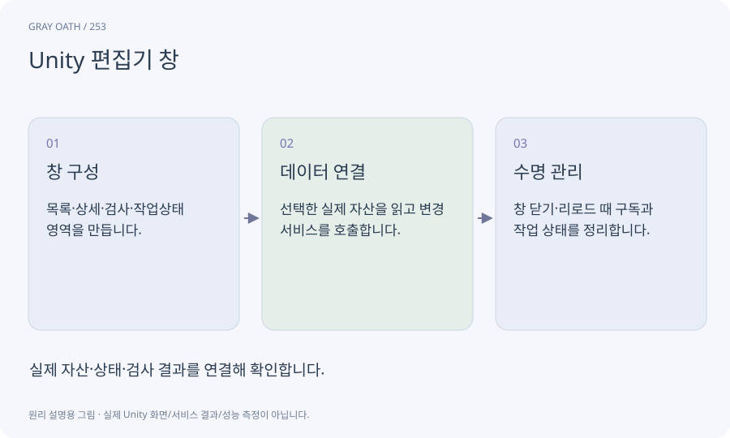

# Unity 편집기 창

Unity를 만드는 도구 안에 프로젝트 전용 창을 추가하는 기능입니다. 게임 화면의 UI와 다르며 배포 게임에 들어가면 안 되는 제작 기능을 담습니다.

## 익숙한 비유

영화 촬영장의 조정실입니다. 관객이 보는 화면이 아니라 제작자가 내용을 준비하는 공간입니다.



## 작동 원리

### 1. 창 구성

목록·상세·검사·작업상태 영역을 만듭니다.

### 2. 데이터 연결

선택한 실제 자산을 읽고 변경 서비스를 호출합니다.

### 3. 수명 관리

창 닫기·리로드 때 구독과 작업 상태를 정리합니다.

## 게임 속 예

Quest Editor에서 AI 초안을 검토하고 저장합니다. 플레이어가 게임에서 보는 퀘스트 저널은 별도의 Runtime UI입니다.

## 혼동하지 않기

Editor 창이 열렸다는 것만으로 자산 저장이나 Player 빌드 기능까지 만들어진 것은 아닙니다.

## 확인 질문

퀘스트 편집기를 Android 앱에 넣어야 하나요?

아닙니다. 제작 도구는 Editor 전용이고 앱에는 검증된 데이터와 실행 코드만 넣습니다.

## 내 프로젝트에서 확인하기

```text
현재 GrayOathRPG3D에서 Unity 편집기 창을 사용하는 실제 대상과 동작을 읽기 전용으로 확인해 줘. 쉬운 말과 작은 사례로 설명하고 Editor 창이 열렸다는 것만으로 자산 저장이나 Player 빌드 기능까지 만들어진 것은 아닙니다. 이 문제를 어떻게 막는지 보여 줘. 코드·데이터·설정은 아직 수정하지 마.
```

## 관련 해설

[ui-toolkit](ui-toolkit.md) · [assembly](assembly.md) · [domain-reload](domain-reload.md)

## 공식 참고

- [Unity · UI Toolkit EditorWindow](https://docs.unity3d.com/6000.3/Documentation/Manual/UIE-HowTo-CreateEditorWindow.html)
