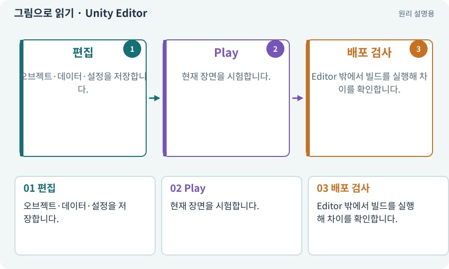

# Unity Editor

**분야:** 시작·도구·작업 공간

게임을 제작하고 시험하는 편집 프로그램입니다. Scene·Game·Hierarchy·Inspector·Console 같은 창을 포함합니다.

**찾아오는 이름:** Unity Editor, Editor, 에디터

## 익숙한 것에 비유하면

요리의 조리대입니다. 조리대에서 맛본 음식과 포장해 손님에게 전달한 음식은 같은 재료를 써도 최종 상태를 따로 확인합니다.



개념도입니다. 실제 Unity 화면이나 검사 결과가 아닙니다. 그림의 순서·색은 역할을 구분하며 실제 설정값은 프로젝트에서 확인합니다.

## 이렇게 작동합니다

### 1. 편집

오브젝트·데이터·설정을 저장합니다.

### 2. Play

현재 장면을 시험합니다.

### 3. 배포 검사

Editor 밖에서 빌드를 실행해 차이를 확인합니다.

## 우리 RPG에서는 이렇게 만나요

Editor에서는 마우스로 조이스틱을 눌러 볼 수 있지만 두 손가락 터치, 발열, 앱 중단 복귀는 Android 기기에서 확인해야 합니다.

## 이것과 혼동하지 마세요

Editor Play 성공은 Windows 배포물이나 Android 앱 성공과 동일하지 않습니다.

## 이해했는지 한 번 생각해 보기

Editor에서만 잘되면 출시해도 될까요?

<details><summary>답과 이유</summary>

아니요. 최종 빌드의 파일 포함·성능·저장 경로·기기 입력을 따로 검사합니다.

</details>

## 내 프로젝트에서 확인하고 싶다면

아래 요청은 읽기 전용으로 실제 대상을 확인하는 선택 요청입니다. 코드나 설정을 직접 편집할 필요는 없습니다.

```text
현재 프로젝트에서 Unity Editor 관련 요소가 어떻게 사용되는지 읽기 전용으로 확인해 줘. 실제 대상과 설정을 찾아 쉬운 말과 작은 예로 설명해 줘. 특히 다음 혼동을 구분해 줘: Editor Play 성공은 Windows 배포물이나 Android 앱 성공과 동일하지 않습니다. 아직 코드·설정·파일은 바꾸지 말고, 확인할 수 없는 내용은 따로 알려 줘.
```

## 이어지는 개념

[씬과 씬 전환](scene.md) · [Play 모드·편집 모드·런타임](play.md) · [Console·로그·스택 추적](console.md) · [게임 빌드·개발 빌드·배포](build.md)

## 이 개념을 사용하는 실습

[01 · 빈 2D 프로젝트 만들기](../index.html#lesson-001) · [03 · AI와 실행 중인 Unity 연결하기](../index.html#lesson-003) · [04 · 되돌릴 수 있는 작업 습관 만들기](../index.html#lesson-004) · [05 · 말로 스프라이트 하나 만들기](../index.html#lesson-005) · [06 · 시작 메뉴와 테스트 공간 연결하기](../index.html#lesson-006) · [10 · 모바일 조이스틱과 버튼 배치하기](../index.html#lesson-010) · [11 · PC와 휴대폰에서 처음 실행하기](../index.html#lesson-011) · [25 · 게임을 껐다 켜도 장비 유지하기](../index.html#lesson-025) · [38 · 테스트 결과와 실제 플레이 구분하기](../index.html#lesson-038) · [39 · 다른 PC와 Android 에서 실행할 파일 만들기](../index.html#lesson-039) · [56 · Unity AI로 캐릭터 움직임 만들기](../index.html#lesson-056) · [65 · 스프라이트를 정리해 실제 캐릭터에 넣기](../index.html#lesson-065) · [67 · 내 게임의 아트 제작 경로 선택하기](../index.html#lesson-067) · [73 · 주소로 에셋 불러오기](../index.html#lesson-073) · [74 · 추가 외형을 서버에서 받게 준비하기](../index.html#lesson-074) · [79 · 추가 기능을 하나의 게임으로 합치기](../index.html#lesson-079) · [87 · 같은 캐릭터를 실제 3D 모델로 만들기](../index.html#lesson-087) · [97 · 선택: 3D 모델에서 2D 시트 만들기](../index.html#lesson-097) · [98 · 3D 팩을 2D 팩과 따로 내려받기](../index.html#lesson-098) · [101 · 3D Android 성능 다시 측정하기](../index.html#lesson-101) · [102 · 네 배포물을 구분해 만들기](../index.html#lesson-102) · [107 · 원본을 보호하고 허용 경로 정하기](../index.html#lesson-107) · [117 · Unity 작업을 한 창구로 모으기](../index.html#lesson-117) · [124 · 현재 컴퓨터의 Unity 명령 등록하기](../index.html#lesson-124) · [125 · 하네스로 작은 전리품 화면 만들기](../index.html#lesson-125) · [129 · 기존 2D 게임에서 확장팩 시작하기](../index.html#lesson-129) · [130 · 첫 확장 작업을 하네스에 연결하기](../index.html#lesson-130) · [132 · 필터를 실제 던전과 모바일에 연결하기](../index.html#lesson-132) · [157 · 하네스가 실패해도 기록 지키기](../index.html#lesson-157)

## 참고와 설명의 범위

기본 도구 동작은 아래 공식 자료를 참고했습니다. 비유·그림·RPG의 예시 수치와 정책은 이해를 위한 자체 예제입니다. 실제 API·지원 기능은 설치 버전과 계정에서 확인합니다.

- [Unity · 2D 게임 제작 흐름](https://docs.unity3d.com/6000.3/Documentation/Manual/2d-game-creation-wokflow.html)
- [Unity · Pipeline과 CLI 연결](https://docs.unity.com/en-us/unity-cli/unity-pipeline/unity-pipeline-package)

그림·계산 예제·조작 모형은 자체 제작한 설명입니다. 실제 Unity 화면, 서비스 생성 결과, 성능 실측 또는 게임 테스트 결과가 아닙니다. 자료 확인: 2026년 9월 26일.
