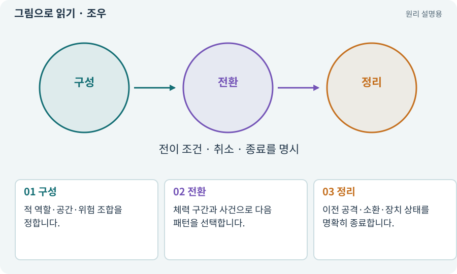

# 조우·전투 감독·페이즈

**분야:** 지도·적 AI·전투 규칙

조우는 하나의 전투 상황에 배치된 적·공간·보상·위험의 묶음입니다. 전투 감독은 전체 압박을 조절하고, 보스 페이즈는 체력·사건 등에 따라 달라지는 행동 구간입니다.

**찾아오는 이름:** 조우·전투 감독·페이즈, 조우, Encounter, 전투 감독, 페이즈, phase, 보스 패턴

## 익숙한 것에 비유하면

오케스트라에서 각 악기가 연주해도 전체 리듬과 강약은 따로 조율하는 것과 같습니다.



개념도입니다. 실제 Unity 화면이나 검사 결과가 아닙니다. 그림의 순서·색은 역할을 구분하며 실제 설정값은 프로젝트에서 확인합니다.

## 이렇게 작동합니다

### 1. 구성

적 역할·공간·위험 조합을 정합니다.

### 2. 전환

체력 구간과 사건으로 다음 패턴을 선택합니다.

### 3. 정리

이전 공격·소환·장치 상태를 명확히 종료합니다.

## 우리 RPG에서는 이렇게 만나요

보스 체력이 큰 피해로 70%에서 20%가 되면 여러 페이즈 경계를 한꺼번에 넘습니다. 두 패턴을 동시에 발행하지 않도록 전환 정책을 검사합니다.

## 이것과 혼동하지 마세요

적 수를 늘리는 것만으로 재미가 늘지는 않습니다. 회피 공간·예고·반격 기회가 있어야 합니다.

## 이해했는지 한 번 생각해 보기

새 페이즈에서 예전 공격도 계속 떨어지면?

<details><summary>답과 이유</summary>

진행 중 공격을 완료할지 취소할지 정책과 수명주기 처리를 확인합니다.

</details>

## 내 프로젝트에서 확인하고 싶다면

아래 요청은 읽기 전용으로 실제 대상을 확인하는 선택 요청입니다. 코드나 설정을 직접 편집할 필요는 없습니다.

```text
현재 프로젝트에서 조우·전투 감독·페이즈 관련 요소가 어떻게 사용되는지 읽기 전용으로 확인해 줘. 실제 대상과 설정을 찾아 쉬운 말과 작은 예로 설명해 줘. 특히 다음 혼동을 구분해 줘: 적 수를 늘리는 것만으로 재미가 늘지는 않습니다. 회피 공간·예고·반격 기회가 있어야 합니다. 아직 코드·설정·파일은 바꾸지 말고, 확인할 수 없는 내용은 따로 알려 줘.
```

## 이어지는 개념

[동시 공격 제한·공격 토큰](attack-token.md) · [공격 예고·선행동작·회복](telegraph.md) · [상태 기계·FSM](state-machine.md) · [밸런스·위험과 보상·플레이테스트](balance.md)

## 이 개념을 사용하는 실습

[29 · 방마다 적과 상자 배치하기](../index.html#lesson-029) · [30 · 예고를 보고 피하는 보스 만들기](../index.html#lesson-030) · [40 · 작은 RPG를 처음부터 끝까지 플레이하기](../index.html#lesson-040) · [51 · 전투 전체의 압박 조절하기](../index.html#lesson-051) · [90 · 적의 판단을 3D 공간에 연결하기](../index.html#lesson-090) · [136 · 방패병과 화염술사 정예 추가하기](../index.html#lesson-136) · [143 · 새 랜덤 지역 봉인된 대장간 만들기](../index.html#lesson-143) · [147 · 용광로 감시자와 3단계 전투 만들기](../index.html#lesson-147)

## 참고와 설명의 범위

이 항목의 비유·그림·RPG 수치·운영 규칙은 개념을 이해하기 위한 자체 설계 예제입니다. 특정 도구가 이 규칙을 자동으로 구현한다는 뜻은 아닙니다.


그림·계산 예제·조작 모형은 자체 제작한 설명입니다. 실제 Unity 화면, 서비스 생성 결과, 성능 실측 또는 게임 테스트 결과가 아닙니다. 자료 확인: 2026년 9월 26일.
