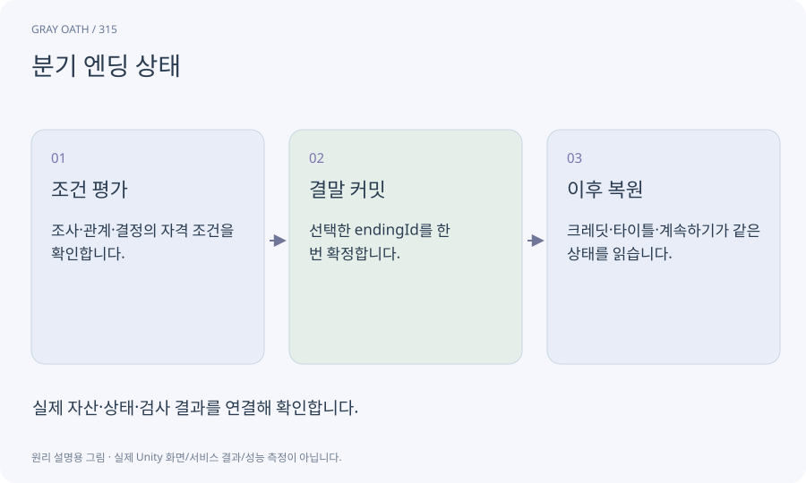

# 분기 엔딩 상태

이야기의 선택과 조건을 평가해 어떤 결말이 확정됐는지 남기는 상태입니다. 마지막 영상 파일을 선택하는 것보다 세계·보상·이후 플레이를 함께 결정합니다.

## 익숙한 비유

시험 답지의 마지막 줄이 아니라 앞의 선택들이 모여 완성되는 판정표입니다.



## 작동 원리

### 1. 조건 평가

조사·관계·결정의 자격 조건을 확인합니다.

### 2. 결말 커밋

선택한 endingId를 한 번 확정합니다.

### 3. 이후 복원

크레딧·타이틀·계속하기가 같은 상태를 읽습니다.

## 회색 서약의 세 결말

위 조건은 이 게임의 설계이며 원작의 엔딩을 재현한 것이 아닙니다. 최종 데이터에서 필요한 facts를 확정한 뒤 가능/불가/동료 부재를 각각 시험합니다.

| 결말 | 자격 조건의 예 | 필수 검사 |

|---|---|---|

| 봉인 | M09 최소 조사·최종 선택 | 세계 fact·크레딧·계속하기 |

| 공존 | 기록 보존·지식·협력 | 부족할 때 선택 비활성/대체 설명 |

| 단절 | 대가 안내·최종 선택 | 돌이킬 수 없음 경고·별도 안전 저장 |

## 게임 속 예

봉인·공존·단절 세 결말에서 공존은 필요한 지식을 얻었을 때 선택할 수 있습니다. 부족하면 이유와 가능한 다른 결말을 안내합니다.

## 혼동하지 않기

컷신이 재생됐다는 이유로 결말 상태를 추정하면 skip·재실행에 따라 결과가 달라질 수 있습니다.

## 확인 질문

엔딩 뒤 계속하기는 어느 지점인가요?

이 제품은 명시한 엔딩 후 탐험 또는 결말 전 보존 슬롯 정책을 UI에서 분명히 표시합니다.

## 내 프로젝트에서 확인하기

```text
현재 GrayOathRPG3D에서 분기 엔딩 상태을 사용하는 실제 대상과 동작을 읽기 전용으로 확인해 줘. 쉬운 말과 작은 사례로 설명하고 컷신이 재생됐다는 이유로 결말 상태를 추정하면 skip·재실행에 따라 결과가 달라질 수 있습니다. 이 문제를 어떻게 막는지 보여 줘. 코드·데이터·설정은 아직 수정하지 마.
```

## 관련 해설

[world-state](world-state.md) · [cutscene-commit](cutscene-commit.md) · [checkpoint](checkpoint.md)

## 공식 참고

- [Unity · Timeline](https://docs.unity3d.com/Packages/com.unity.timeline@1.8/manual/index.html)
