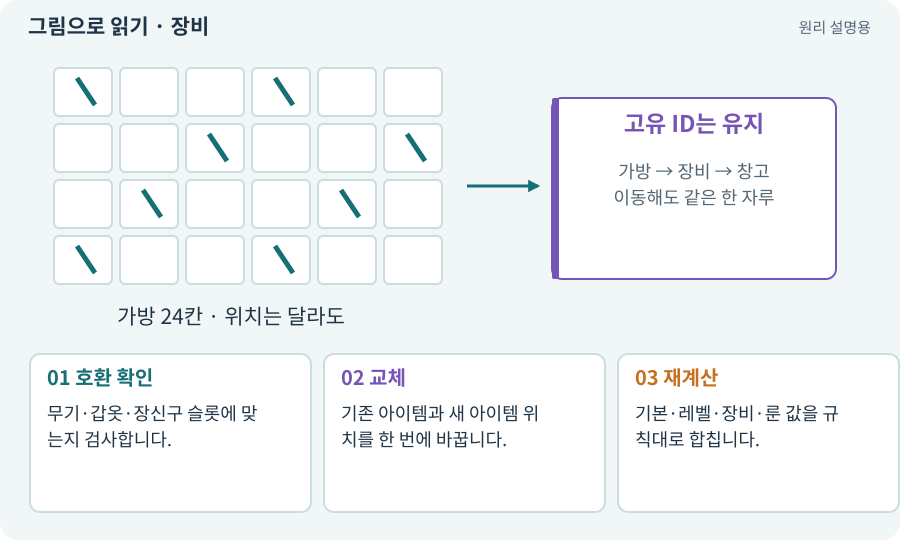

# 장비·슬롯·재계산

**분야:** 코드·데이터·저장·검사

장비 시스템은 특정 슬롯에 아이템을 배치하고 그 결과로 능력치를 계산합니다. 재계산은 현재 기본값과 실제 장비 목록에서 매번 결과를 만드는 방식입니다.

**찾아오는 이름:** 장비·슬롯·재계산, 장착, 장비 슬롯, Equipment, 재계산, 능력치 재계산, 룬

## 익숙한 것에 비유하면

저울에 현재 올라간 물건만 다시 재는 것입니다. 올렸다 내릴 때 숫자를 계속 더하고 빼다가 오차가 남는 방식을 피합니다.



개념도입니다. 실제 Unity 화면이나 검사 결과가 아닙니다. 그림의 순서·색은 역할을 구분하며 실제 설정값은 프로젝트에서 확인합니다.

## 이렇게 작동합니다

### 1. 호환 확인

무기·갑옷·장신구 슬롯에 맞는지 검사합니다.

### 2. 교체

기존 아이템과 새 아이템 위치를 한 번에 바꿉니다.

### 3. 재계산

기본·레벨·장비·룬 값을 규칙대로 합칩니다.

## 우리 RPG에서는 이렇게 만나요

기본 공격력 12에 +4 검을 장착하면 16, 해제하면 12입니다. 100번 반복해도 412가 되지 않아야 합니다. 비율 보너스의 적용 순서도 명시합니다.

## 이것과 혼동하지 마세요

게임플레이의 “장비 빌드”와 앱 실행 파일을 만드는 “빌드”는 다른 문맥입니다.

## 이해했는지 한 번 생각해 보기

가방이 꽉 찬데 장비를 해제하면?

<details><summary>답과 이유</summary>

갈 곳이 없으면 해제를 거부하거나 명시한 교환 규칙을 적용해야 합니다.

</details>

## 내 프로젝트에서 확인하고 싶다면

아래 요청은 읽기 전용으로 실제 대상을 확인하는 선택 요청입니다. 코드나 설정을 직접 편집할 필요는 없습니다.

```text
현재 프로젝트에서 장비·슬롯·재계산 관련 요소가 어떻게 사용되는지 읽기 전용으로 확인해 줘. 실제 대상과 설정을 찾아 쉬운 말과 작은 예로 설명해 줘. 특히 다음 혼동을 구분해 줘: 게임플레이의 “장비 빌드”와 앱 실행 파일을 만드는 “빌드”는 다른 문맥입니다. 아직 코드·설정·파일은 바꾸지 말고, 확인할 수 없는 내용은 따로 알려 줘.
```

## 이어지는 개념

[능력치·클램프·정수·부동소수점](stats.md) · [아이템 인스턴스와 소유권](item-instance.md) · [트랜잭션·거래의 한 번 적용](transaction.md) · [캐릭터 빌드·로드아웃](build-loadout.md)

## 이 개념을 사용하는 실습

[20 · 같은 검 두 자루를 다른 물건으로 다루기](../index.html#lesson-020) · [23 · 장비를 바꾸고 능력치 확인하기](../index.html#lesson-023) · [24 · 보기 편한 인벤토리 화면 만들기](../index.html#lesson-024) · [25 · 게임을 껐다 켜도 장비 유지하기](../index.html#lesson-025) · [27 · 회복하고 물약을 사는 마을 만들기](../index.html#lesson-027) · [31 · 퀘스트를 받아 엔딩까지 이어가기](../index.html#lesson-031) · [32 · 길 안내와 처음 하는 사람의 동선 만들기](../index.html#lesson-032) · [40 · 작은 RPG를 처음부터 끝까지 플레이하기](../index.html#lesson-040) · [92 · 무기를 손에 쥐고 전리품 표시하기](../index.html#lesson-092) · [99 · 2D와 3D 사이에 진행 가져오기](../index.html#lesson-099) · [100 · 두 버전이 같은 게임인지 비교하기](../index.html#lesson-100) · [101 · 3D Android 성능 다시 측정하기](../index.html#lesson-101) · [129 · 기존 2D 게임에서 확장팩 시작하기](../index.html#lesson-129) · [138 · 장비를 분해해 재료 얻기](../index.html#lesson-138) · [140 · 개인 창고와 즐겨찾기 만들기](../index.html#lesson-140) · [141 · 소켓 한 칸에 룬 장착하기](../index.html#lesson-141) · [151 · 도감과 장비 비교로 새 기능 찾기](../index.html#lesson-151) · [158 · 룬 교체 버그를 역할로 수정하기](../index.html#lesson-158)

## 참고와 설명의 범위

이 항목의 비유·그림·RPG 수치·운영 규칙은 개념을 이해하기 위한 자체 설계 예제입니다. 특정 도구가 이 규칙을 자동으로 구현한다는 뜻은 아닙니다.


그림·계산 예제·조작 모형은 자체 제작한 설명입니다. 실제 Unity 화면, 서비스 생성 결과, 성능 실측 또는 게임 테스트 결과가 아닙니다. 자료 확인: 2026년 9월 26일.
