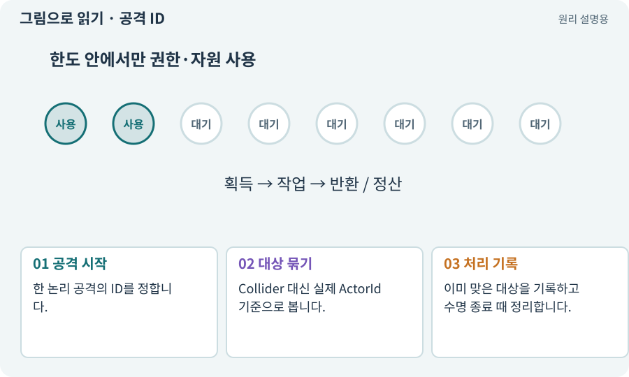

# 공격 ID·사건 ID·중복 피해 방지

**분야:** 코드·데이터·저장·검사

한 번의 공격이나 지급 사건을 식별하는 값입니다. 같은 공격에서 여러 Collider를 찾거나 여러 콜백이 와도 같은 대상에 중복 효과를 주지 않도록 돕습니다.

**찾아오는 이름:** 공격 ID·사건 ID·중복 피해 방지, 공격 ID, 사건 ID, 이벤트 ID, attackId, eventId, 히트 중복

## 익숙한 것에 비유하면

한 주문서에 도장을 찍어 같은 영수증이 두 번 처리되지 않게 하는 것입니다.



개념도입니다. 실제 Unity 화면이나 검사 결과가 아닙니다. 그림의 순서·색은 역할을 구분하며 실제 설정값은 프로젝트에서 확인합니다.

## 이렇게 작동합니다

### 1. 공격 시작

한 논리 공격의 ID를 정합니다.

### 2. 대상 묶기

Collider 대신 실제 ActorId 기준으로 봅니다.

### 3. 처리 기록

이미 맞은 대상을 기록하고 수명 종료 때 정리합니다.

## 우리 RPG에서는 이렇게 만나요

회전 공격을 한 바퀴 동안 한 번만 맞힐지 일정 간격마다 맞힐지 먼저 정합니다. 여러 틱을 허용한다면 공격 ID만이 아니라 틱 구분도 필요합니다.

## 이것과 혼동하지 마세요

모든 공격을 같은 ID로 재사용하면 새 공격까지 무시될 수 있습니다.

## 이해했는지 한 번 생각해 보기

Hurtbox가 두 개여도 피해 한 번만 주려면?

<details><summary>답과 이유</summary>

공격 ID와 실제 대상 ID의 조합을 기준으로 중복을 검사합니다.

</details>

## 내 프로젝트에서 확인하고 싶다면

아래 요청은 읽기 전용으로 실제 대상을 확인하는 선택 요청입니다. 코드나 설정을 직접 편집할 필요는 없습니다.

```text
현재 프로젝트에서 공격 ID·사건 ID·중복 피해 방지 관련 요소가 어떻게 사용되는지 읽기 전용으로 확인해 줘. 실제 대상과 설정을 찾아 쉬운 말과 작은 예로 설명해 줘. 특히 다음 혼동을 구분해 줘: 모든 공격을 같은 ID로 재사용하면 새 공격까지 무시될 수 있습니다. 아직 코드·설정·파일은 바꾸지 말고, 확인할 수 없는 내용은 따로 알려 줘.
```

## 이어지는 개념

[ID·고유 식별자·버전](identifier.md) · [Hitbox·Hurtbox·Body](hitbox.md) · [피해 계산·스냅샷·피해 사건](damage.md) · [멱등성·재시도해도 한 번](idempotency.md)

## 이 개념을 사용하는 실습

[13 · 적을 클릭해 접근하고 공격하기](../index.html#lesson-013) · [34 · 걷기·공격·피격·사망 움직임 연결하기](../index.html#lesson-034) · [48 · 적이 나를 보고 놓치게 만들기](../index.html#lesson-048) · [49 · 여러 근접 적의 공격 나누기](../index.html#lesson-049) · [91 · 보스 예고를 3D 바닥에 맞추기](../index.html#lesson-091) · [134 · 화상·냉기·표식으로 전투 확장하기](../index.html#lesson-134) · [137 · 기름·폭발통·밸브로 공간 활용하기](../index.html#lesson-137) · [141 · 소켓 한 칸에 룬 장착하기](../index.html#lesson-141) · [149 · 상태와 보스 효과를 같은 데이터로 맞추기](../index.html#lesson-149) · [150 · 소리가 없어도 읽히는 전투 만들기](../index.html#lesson-150)

## 참고와 설명의 범위

이 항목의 비유·그림·RPG 수치·운영 규칙은 개념을 이해하기 위한 자체 설계 예제입니다. 특정 도구가 이 규칙을 자동으로 구현한다는 뜻은 아닙니다.


그림·계산 예제·조작 모형은 자체 제작한 설명입니다. 실제 Unity 화면, 서비스 생성 결과, 성능 실측 또는 게임 테스트 결과가 아닙니다. 자료 확인: 2026년 9월 26일.
