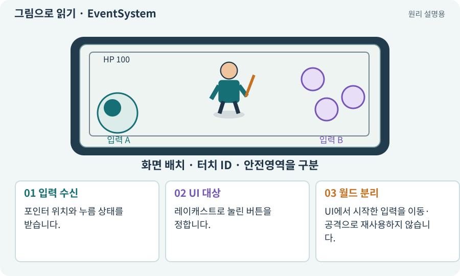

# EventSystem·UI 입력·클릭 차단

**분야:** 입력·UI·소리·성능

EventSystem과 UI 입력 모듈은 포인터·선택·클릭 등을 UI에 전달합니다. 화면 위 UI를 눌렀을 때 그 아래 월드에도 같은 클릭이 전달될지 별도 정책이 필요합니다.

**찾아오는 이름:** EventSystem·UI 입력·클릭 차단, EventSystem, InputSystemUIInputModule, UI 입력 모듈, UI 클릭, GraphicRaycaster

## 익숙한 것에 비유하면

책상 위 서류 버튼을 눌렀는데 그 아래 지도의 이동 지점까지 선택되는 일을 막는 것입니다.



개념도입니다. 실제 Unity 화면이나 검사 결과가 아닙니다. 그림의 순서·색은 역할을 구분하며 실제 설정값은 프로젝트에서 확인합니다.

## 이렇게 작동합니다

### 1. 입력 수신

포인터 위치와 누름 상태를 받습니다.

### 2. UI 대상

레이캐스트로 눌린 버튼을 정합니다.

### 3. 월드 분리

UI에서 시작한 입력을 이동·공격으로 재사용하지 않습니다.

## 우리 RPG에서는 이렇게 만나요

가방 버튼을 누르자 캐릭터가 뒤쪽 바닥으로 이동하면 UI와 월드 입력의 경계가 없습니다. 포인터 시작 대상과 누름부터 놓기까지를 확인합니다.

## 이것과 혼동하지 마세요

UI를 눌렀다는 이유로 다른 손가락의 조이스틱 이동까지 전부 막지 않습니다.

## 이해했는지 한 번 생각해 보기

공격 버튼을 눌렀는데 이동 목표도 생기면?

<details><summary>답과 이유</summary>

같은 포인터 이벤트가 월드 클릭으로 재처리되는지 확인합니다.

</details>

## 내 프로젝트에서 확인하고 싶다면

아래 요청은 읽기 전용으로 실제 대상을 확인하는 선택 요청입니다. 코드나 설정을 직접 편집할 필요는 없습니다.

```text
현재 프로젝트에서 EventSystem·UI 입력·클릭 차단 관련 요소가 어떻게 사용되는지 읽기 전용으로 확인해 줘. 실제 대상과 설정을 찾아 쉬운 말과 작은 예로 설명해 줘. 특히 다음 혼동을 구분해 줘: UI를 눌렀다는 이유로 다른 손가락의 조이스틱 이동까지 전부 막지 않습니다. 아직 코드·설정·파일은 바꾸지 말고, 확인할 수 없는 내용은 따로 알려 줘.
```

## 이어지는 개념

[Input System·Action·Binding](input-system.md) · [멀티터치·가상 조이스틱](multitouch.md) · [포인터 ID·누름·해제·캡처](pointer-id.md) · [UI·HUD·UGUI](ui.md) · [Raycast·Linecast·Cast](raycast.md)

## 이 개념을 사용하는 실습

[09 · 클릭한 곳까지 벽을 돌아가기](../index.html#lesson-009) · [10 · 모바일 조이스틱과 버튼 배치하기](../index.html#lesson-010) · [26 · 새 게임·이어하기·마을 연결하기](../index.html#lesson-026) · [86 · 3D에서도 클릭한 곳까지 돌아가기](../index.html#lesson-086) · [93 · 3D 마을과 퀘스트 연결하기](../index.html#lesson-093)

## 참고와 설명의 범위

기본 도구 동작은 아래 공식 자료를 참고했습니다. 비유·그림·RPG의 예시 수치와 정책은 이해를 위한 자체 예제입니다. 실제 API·지원 기능은 설치 버전과 계정에서 확인합니다.

- [Unity Input System · UI 지원](https://docs.unity3d.com/Packages/com.unity.inputsystem@1.17/manual/UISupport.html)

그림·계산 예제·조작 모형은 자체 제작한 설명입니다. 실제 Unity 화면, 서비스 생성 결과, 성능 실측 또는 게임 테스트 결과가 아닙니다. 자료 확인: 2026년 9월 26일.
