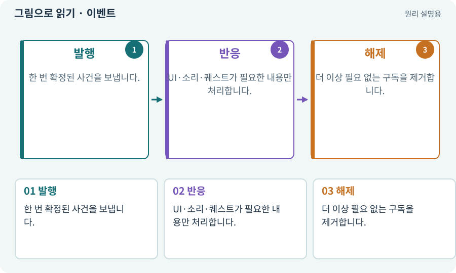

# 이벤트·콜백·구독·이벤트 버스

**분야:** 코드·데이터·저장·검사

이벤트는 어떤 일이 일어났다는 알림입니다. 구독자는 관심 있는 알림을 받아 콜백을 실행합니다. 이벤트 버스는 여러 기능 사이의 알림 전달을 모으는 구조입니다.

**찾아오는 이름:** 이벤트·콜백·구독·이벤트 버스, 이벤트, Event, Callback, 콜백, 구독, Event Bus, 이벤트 버스

## 익숙한 것에 비유하면

방송국이 “문 열림”을 알리면 경비와 안내판이 각자 반응하는 것입니다. 방송국이 모든 세부 작업을 직접 알 필요는 없습니다.



개념도입니다. 실제 Unity 화면이나 검사 결과가 아닙니다. 그림의 순서·색은 역할을 구분하며 실제 설정값은 프로젝트에서 확인합니다.

## 이렇게 작동합니다

### 1. 발행

한 번 확정된 사건을 보냅니다.

### 2. 반응

UI·소리·퀘스트가 필요한 내용만 처리합니다.

### 3. 해제

더 이상 필요 없는 구독을 제거합니다.

## 우리 RPG에서는 이렇게 만나요

EnemyDied 한 사건에서 경험치·전리품·소리가 연결될 수 있습니다. 씬을 왕복할 때 구독이 두 번 쌓이면 보상이나 소리가 중복될 수 있습니다.

## 이것과 혼동하지 마세요

모든 것을 전역 이벤트로 만들면 흐름을 추적하기 어려워집니다. 소유권·발행 시점·순서를 명시합니다.

## 이해했는지 한 번 생각해 보기

마을을 두 번 오간 뒤 보상이 두 번 나오면?

<details><summary>답과 이유</summary>

중복 구독·해제 누락과 사건 중복 발행을 확인합니다.

</details>

## 내 프로젝트에서 확인하고 싶다면

아래 요청은 읽기 전용으로 실제 대상을 확인하는 선택 요청입니다. 코드나 설정을 직접 편집할 필요는 없습니다.

```text
현재 프로젝트에서 이벤트·콜백·구독·이벤트 버스 관련 요소가 어떻게 사용되는지 읽기 전용으로 확인해 줘. 실제 대상과 설정을 찾아 쉬운 말과 작은 예로 설명해 줘. 특히 다음 혼동을 구분해 줘: 모든 것을 전역 이벤트로 만들면 흐름을 추적하기 어려워집니다. 소유권·발행 시점·순서를 명시합니다. 아직 코드·설정·파일은 바꾸지 말고, 확인할 수 없는 내용은 따로 알려 줘.
```

## 이어지는 개념

[수명주기·초기화·정리](lifecycle.md) · [공격 ID·사건 ID·중복 피해 방지](event-id.md) · [트랜잭션·거래의 한 번 적용](transaction.md) · [참조·null·Missing Reference](reference.md)

## 이 개념을 사용하는 실습

[12 · 체력과 피해를 눈으로 확인하기](../index.html#lesson-012) · [14 · 나를 발견하고 공격하는 적 만들기](../index.html#lesson-014) · [17 · 적을 잡아 레벨 올리기](../index.html#lesson-017) · [18 · 베기·마력탄·회전 공격 만들기](../index.html#lesson-018) · [21 · 몬스터가 장비를 떨어뜨리게 하기](../index.html#lesson-021) · [22 · 장비를 주워 24칸 가방에 넣기](../index.html#lesson-022) · [24 · 보기 편한 인벤토리 화면 만들기](../index.html#lesson-024) · [26 · 새 게임·이어하기·마을 연결하기](../index.html#lesson-026) · [32 · 길 안내와 처음 하는 사람의 동선 만들기](../index.html#lesson-032) · [46 · 랜덤 지도 위를 실제로 걷기](../index.html#lesson-046) · [47 · 실패하는 시드를 찾고 복구하기](../index.html#lesson-047) · [48 · 적이 나를 보고 놓치게 만들기](../index.html#lesson-048) · [51 · 전투 전체의 압박 조절하기](../index.html#lesson-051) · [54 · 느낌을 근거로 밸런스 고치기](../index.html#lesson-054) · [61 · Ludo.ai로 키 포즈를 지정해 움직임 만들기](../index.html#lesson-061) · [62 · OpenAI 이미지로 게임 자산 만들기](../index.html#lesson-062) · [63 · Grok 이미지로 같은 자산 시험하기](../index.html#lesson-063) · [67 · 내 게임의 아트 제작 경로 선택하기](../index.html#lesson-067) · [68 · 피격 불꽃과 먼지 만들기](../index.html#lesson-068) · [69 · 베기와 폭발을 시트 애니메이션으로 만들기](../index.html#lesson-069) · [71 · 카메라·소리·피해 숫자 맞추기](../index.html#lesson-071) · [72 · 모바일 효과를 줄여도 위험은 남기기](../index.html#lesson-072) · [75 · 다운로드 용량과 진행률 보여 주기](../index.html#lesson-075) · [76 · 연결이 끊겨도 게임 계속하기](../index.html#lesson-076) · [92 · 무기를 손에 쥐고 전리품 표시하기](../index.html#lesson-092) · [93 · 3D 마을과 퀘스트 연결하기](../index.html#lesson-093) · [118 · 모의 응답 대신 실제 Claude 연결하기](../index.html#lesson-118) · [132 · 필터를 실제 던전과 모바일에 연결하기](../index.html#lesson-132) · [134 · 화상·냉기·표식으로 전투 확장하기](../index.html#lesson-134) · [137 · 기름·폭발통·밸브로 공간 활용하기](../index.html#lesson-137) · [139 · 재료로 장비 제작하기](../index.html#lesson-139) · [141 · 소켓 한 칸에 룬 장착하기](../index.html#lesson-141) · [144 · 이번 탐험에만 남는 유물 고르기](../index.html#lesson-144) · [145 · 지원 동료 하나 만들기](../index.html#lesson-145) · [146 · 대장장이 구조 퀘스트 만들기](../index.html#lesson-146) · [149 · 상태와 보스 효과를 같은 데이터로 맞추기](../index.html#lesson-149) · [150 · 소리가 없어도 읽히는 전투 만들기](../index.html#lesson-150) · [153 · 대장간 고해상도팩 선택 다운로드하기](../index.html#lesson-153) · [154 · 확장 기능을 켠 휴대폰 성능 고치기](../index.html#lesson-154) · [155 · 기록을 보고 제작 경제와 전투 조정하기](../index.html#lesson-155) · [156 · 기능 조합에서 숨은 오류 찾기](../index.html#lesson-156) · [158 · 룬 교체 버그를 역할로 수정하기](../index.html#lesson-158)

## 참고와 설명의 범위

기본 도구 동작은 아래 공식 자료를 참고했습니다. 비유·그림·RPG의 예시 수치와 정책은 이해를 위한 자체 예제입니다. 실제 API·지원 기능은 설치 버전과 계정에서 확인합니다.

- [Unity · 컴포넌트](https://docs.unity3d.com/6000.3/Documentation/Manual/Components.html)

그림·계산 예제·조작 모형은 자체 제작한 설명입니다. 실제 Unity 화면, 서비스 생성 결과, 성능 실측 또는 게임 테스트 결과가 아닙니다. 자료 확인: 2026년 9월 26일.
