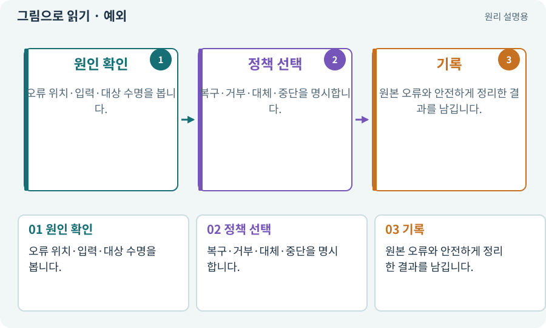

# 예외·null·오류 처리

**분야:** 비동기·다운로드·빌드·버전 관리

예외는 정상 경로로 계속하기 어려운 상황을 알리는 실행 신호입니다. null은 참조할 대상이 없음을 나타낼 수 있습니다. 왜 없는지와 어떻게 복구할지를 구분해야 합니다.

**찾아오는 이름:** 예외·null·오류 처리, 예외, Exception, exception, NullReferenceException, null, null reference, 오류 처리

## 익숙한 것에 비유하면

예약한 좌석표를 찾았는데 실제 좌석이 없는 상황입니다. 오류 메시지를 숨긴다고 앉을 곳이 생기지 않습니다.



개념도입니다. 실제 Unity 화면이나 검사 결과가 아닙니다. 그림의 순서·색은 역할을 구분하며 실제 설정값은 프로젝트에서 확인합니다.

## 이렇게 작동합니다

### 1. 원인 확인

오류 위치·입력·대상 수명을 봅니다.

### 2. 정책 선택

복구·거부·대체·중단을 명시합니다.

### 3. 기록

원본 오류와 안전하게 정리한 결과를 남깁니다.

## 우리 RPG에서는 이렇게 만나요

씬 이동 후 파괴된 UI를 늦은 콜백이 사용하면 참조 오류가 날 수 있습니다. 모든 예외를 빈 catch로 무시하지 않고 현재 요청 유효성·해제 시점을 고칩니다.

## 이것과 혼동하지 마세요

null 검사를 늘리는 것만으로 빠진 Inspector 참조나 잘못된 초기화 순서가 해결되지는 않습니다.

## 이해했는지 한 번 생각해 보기

catch로 오류를 무시했더니 조용해졌다면 PASS인가요?

<details><summary>답과 이유</summary>

기능·데이터가 정상인지 따로 확인하고 원인을 수정해야 합니다.

</details>

## 내 프로젝트에서 확인하고 싶다면

아래 요청은 읽기 전용으로 실제 대상을 확인하는 선택 요청입니다. 코드나 설정을 직접 편집할 필요는 없습니다.

```text
현재 프로젝트에서 예외·null·오류 처리 관련 요소가 어떻게 사용되는지 읽기 전용으로 확인해 줘. 실제 대상과 설정을 찾아 쉬운 말과 작은 예로 설명해 줘. 특히 다음 혼동을 구분해 줘: null 검사를 늘리는 것만으로 빠진 Inspector 참조나 잘못된 초기화 순서가 해결되지는 않습니다. 아직 코드·설정·파일은 바꾸지 말고, 확인할 수 없는 내용은 따로 알려 줘.
```

## 이어지는 개념

[참조·null·Missing Reference](reference.md) · [수명주기·초기화·정리](lifecycle.md) · [취소 신호·늦은 완료·정리](cancellation.md) · [디버깅·로그·중단점](debug.md)

## 이 개념을 사용하는 실습

[23 · 장비를 바꾸고 능력치 확인하기](../index.html#lesson-023) · [50 · 석궁수가 거리를 유지하게 만들기](../index.html#lesson-050) · [85 · 3D 캐릭터를 한 모터로 움직이기](../index.html#lesson-085) · [112 · 네 역할을 순서대로 실행하기](../index.html#lesson-112)

## 참고와 설명의 범위

기본 도구 동작은 아래 공식 자료를 참고했습니다. 비유·그림·RPG의 예시 수치와 정책은 이해를 위한 자체 예제입니다. 실제 API·지원 기능은 설치 버전과 계정에서 확인합니다.

- [Microsoft · C# 클래스](https://learn.microsoft.com/en-us/dotnet/csharp/fundamentals/types/classes)

그림·계산 예제·조작 모형은 자체 제작한 설명입니다. 실제 Unity 화면, 서비스 생성 결과, 성능 실측 또는 게임 테스트 결과가 아닙니다. 자료 확인: 2026년 9월 26일.
