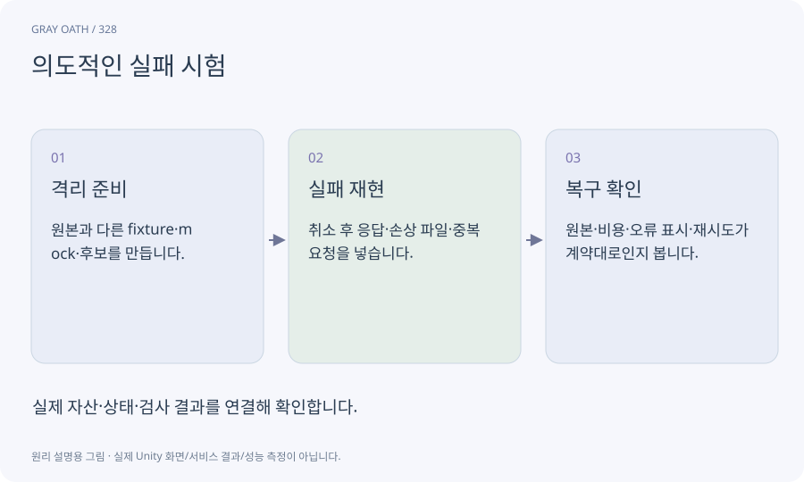

# 의도적인 실패 시험

정상 경로를 벗어난 입력·중단·지연을 격리된 환경에서 일부러 만들어 복구와 원본 보존을 확인하는 검사입니다.

## 익숙한 비유

소방훈련처럼 실제 위험을 만들지 않고 대처 경로를 연습하는 것입니다.



## 작동 원리

### 1. 격리 준비

원본과 다른 fixture·mock·후보를 만듭니다.

### 2. 실패 재현

취소 후 응답·손상 파일·중복 요청을 넣습니다.

### 3. 복구 확인

원본·비용·오류 표시·재시도가 계약대로인지 봅니다.

## 게임 속 예

실제 Meshy에 중복 유료 요청을 보내지 않고 모의 timeout과 늦은 성공으로 작업대가 재결제하지 않는지 시험합니다.

## 혼동하지 않기

교육용으로 주입한 버그를 실제 제품에 원래 있던 결함이라고 보고하지 않습니다.

## 확인 질문

실패한 파일은 테스트 후 지워도 되나요?

재현과 수정 전후 근거를 보존하며 민감정보는 제외합니다. 정상 원본을 덮지 않습니다.

## 내 프로젝트에서 확인하기

```text
현재 GrayOathRPG3D에서 의도적인 실패 시험을 사용하는 실제 대상과 동작을 읽기 전용으로 확인해 줘. 쉬운 말과 작은 사례로 설명하고 교육용으로 주입한 버그를 실제 제품에 원래 있던 결함이라고 보고하지 않습니다. 이 문제를 어떻게 막는지 보여 줘. 코드·데이터·설정은 아직 수정하지 마.
```

## 관련 해설

[fixture](fixture.md) · [editor-job](editor-job.md) · [rollback](rollback.md)

## 공식 참고

- [Claude Code · Hooks](https://code.claude.com/docs/en/hooks)
