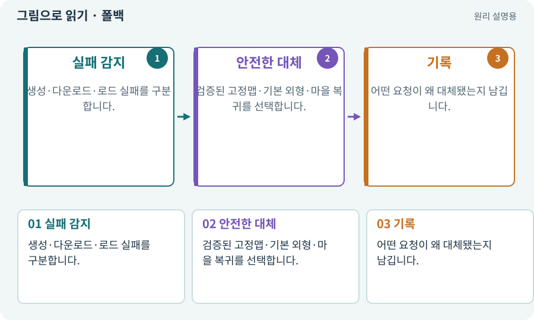

# 폴백·안전한 대체 경로

**분야:** 비동기·다운로드·빌드·버전 관리

폴백은 요청한 기능이나 자산을 사용할 수 없을 때 미리 준비한 대안으로 진행하는 경로입니다. 원래 작업의 실패를 성공으로 바꿔 기록하는 것이 아닙니다.

**찾아오는 이름:** 폴백·안전한 대체 경로, 폴백, Fallback, fallback, 고정맵 복구, 대체 자산, 기본 외형

## 익숙한 것에 비유하면

기차가 끊겼을 때 미리 정한 버스를 이용하되 기차를 탔다고 보고하지 않는 것입니다.



개념도입니다. 실제 Unity 화면이나 검사 결과가 아닙니다. 그림의 순서·색은 역할을 구분하며 실제 설정값은 프로젝트에서 확인합니다.

## 이렇게 작동합니다

### 1. 실패 감지

생성·다운로드·로드 실패를 구분합니다.

### 2. 안전한 대체

검증된 고정맵·기본 외형·마을 복귀를 선택합니다.

### 3. 기록

어떤 요청이 왜 대체됐는지 남깁니다.

## 우리 RPG에서는 이렇게 만나요

랜덤맵을 제한 횟수 안에 만들지 못하면 고정 던전으로 들어갈 수 있습니다. 이 실행은 “랜덤 생성 성공”이 아니라 “고정맵 복구 성공”으로 기록합니다.

## 이것과 혼동하지 마세요

폴백 자체도 입력·저장·포털·보상을 검증해야 합니다. 덜 중요한 경로라고 방치하지 않습니다.

## 이해했는지 한 번 생각해 보기

다운로드 실패 후 기본 외형으로 보이면 다운로드 PASS인가요?

<details><summary>답과 이유</summary>

아닙니다. 다운로드 실패와 기본 외형의 정상 동작을 나눕니다.

</details>

## 내 프로젝트에서 확인하고 싶다면

아래 요청은 읽기 전용으로 실제 대상을 확인하는 선택 요청입니다. 코드나 설정을 직접 편집할 필요는 없습니다.

```text
현재 프로젝트에서 폴백·안전한 대체 경로 관련 요소가 어떻게 사용되는지 읽기 전용으로 확인해 줘. 실제 대상과 설정을 찾아 쉬운 말과 작은 예로 설명해 줘. 특히 다음 혼동을 구분해 줘: 폴백 자체도 입력·저장·포털·보상을 검증해야 합니다. 덜 중요한 경로라고 방치하지 않습니다. 아직 코드·설정·파일은 바꾸지 말고, 확인할 수 없는 내용은 따로 알려 줘.
```

## 이어지는 개념

[오프라인·기본 자산·선택 팩](offline.md) · [절차적·무작위 지형 생성](generation.md) · [증거·검사 상태·미실행](evidence.md) · [재시도·백오프·복구](retry.md)

## 이 개념을 사용하는 실습

[33 · 기본 캐릭터·몬스터·타일 아트 만들기](../index.html#lesson-033) · [67 · 내 게임의 아트 제작 경로 선택하기](../index.html#lesson-067) · [75 · 다운로드 용량과 진행률 보여 주기](../index.html#lesson-075) · [76 · 연결이 끊겨도 게임 계속하기](../index.html#lesson-076) · [80 · 나만의 2D RPG 완성하기](../index.html#lesson-080) · [92 · 무기를 손에 쥐고 전리품 표시하기](../index.html#lesson-092) · [99 · 2D와 3D 사이에 진행 가져오기](../index.html#lesson-099) · [143 · 새 랜덤 지역 봉인된 대장간 만들기](../index.html#lesson-143) · [153 · 대장간 고해상도팩 선택 다운로드하기](../index.html#lesson-153) · [156 · 기능 조합에서 숨은 오류 찾기](../index.html#lesson-156)

## 참고와 설명의 범위

이 항목의 비유·그림·RPG 수치·운영 규칙은 개념을 이해하기 위한 자체 설계 예제입니다. 특정 도구가 이 규칙을 자동으로 구현한다는 뜻은 아닙니다.


그림·계산 예제·조작 모형은 자체 제작한 설명입니다. 실제 Unity 화면, 서비스 생성 결과, 성능 실측 또는 게임 테스트 결과가 아닙니다. 자료 확인: 2026년 9월 26일.
