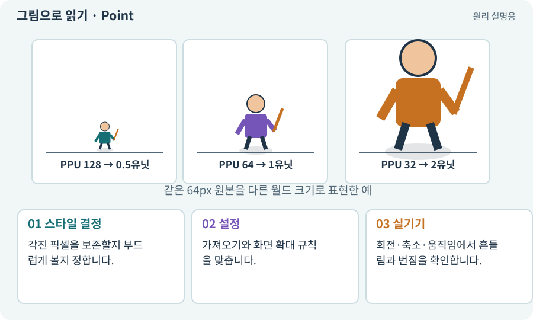

# Point·Bilinear 필터와 픽셀 아트

**분야:** 그림·애니메이션·화면 만들기

필터 모드는 텍스처를 확대·축소하거나 중간 위치에서 읽을 때 픽셀 색을 고르는 방식입니다. Point는 가장 가까운 값을, Bilinear는 주변 값을 섞는 방식입니다.

**찾아오는 이름:** Point·Bilinear 필터와 픽셀 아트, Point, Bilinear, Trilinear, Filter Mode, 필터 모드, 픽셀 아트

## 익숙한 것에 비유하면

모자이크를 칸 그대로 확대할지 경계를 부드럽게 섞을지의 차이입니다.



개념도입니다. 실제 Unity 화면이나 검사 결과가 아닙니다. 그림의 순서·색은 역할을 구분하며 실제 설정값은 프로젝트에서 확인합니다.

## 이렇게 작동합니다

### 1. 스타일 결정

각진 픽셀을 보존할지 부드럽게 볼지 정합니다.

### 2. 설정

가져오기와 화면 확대 규칙을 맞춥니다.

### 3. 실기기

회전·축소·움직임에서 흔들림과 번짐을 확인합니다.

## 우리 RPG에서는 이렇게 만나요

Point를 써도 화면에서 불규칙한 배율로 확대하면 픽셀 크기가 균일하지 않아 보일 수 있습니다. PPU·카메라·화면 배율을 함께 봅니다.

## 이것과 혼동하지 마세요

Bilinear가 항상 나쁘거나 Point가 모든 2D 게임에 맞는 것은 아닙니다. 아트 스타일과 출력 조건에 맞춥니다.

## 이해했는지 한 번 생각해 보기

Point인데도 이동할 때 픽셀이 떨리는 이유는?

<details><summary>답과 이유</summary>

서브픽셀 위치와 카메라·확대 배율이 맞지 않을 수 있습니다.

</details>

## 내 프로젝트에서 확인하고 싶다면

아래 요청은 읽기 전용으로 실제 대상을 확인하는 선택 요청입니다. 코드나 설정을 직접 편집할 필요는 없습니다.

```text
현재 프로젝트에서 Point·Bilinear 필터와 픽셀 아트 관련 요소가 어떻게 사용되는지 읽기 전용으로 확인해 줘. 실제 대상과 설정을 찾아 쉬운 말과 작은 예로 설명해 줘. 특히 다음 혼동을 구분해 줘: Bilinear가 항상 나쁘거나 Point가 모든 2D 게임에 맞는 것은 아닙니다. 아트 스타일과 출력 조건에 맞춥니다. 아직 코드·설정·파일은 바꾸지 말고, 확인할 수 없는 내용은 따로 알려 줘.
```

## 이어지는 개념

[PPU: 픽셀과 월드 크기](ppu.md) · [픽셀 퍼펙트와 화면 배율](scale-pixel.md) · [밉맵·텍스처 압축](mipmap.md) · [패딩·여백·필터링 번짐](padding.md)

## 이 개념을 사용하는 실습

[33 · 기본 캐릭터·몬스터·타일 아트 만들기](../index.html#lesson-033) · [58 · PixelLab로 방향별 픽셀 캐릭터 만들기](../index.html#lesson-058) · [59 · Retro Diffusion으로 캐릭터와 타일 만들기](../index.html#lesson-059) · [65 · 스프라이트를 정리해 실제 캐릭터에 넣기](../index.html#lesson-065)

## 참고와 설명의 범위

기본 도구 동작은 아래 공식 자료를 참고했습니다. 비유·그림·RPG의 예시 수치와 정책은 이해를 위한 자체 예제입니다. 실제 API·지원 기능은 설치 버전과 계정에서 확인합니다.

- [Unity · Sprite](https://docs.unity3d.com/6000.3/Documentation/Manual/sprite/sprite-landing.html)

그림·계산 예제·조작 모형은 자체 제작한 설명입니다. 실제 Unity 화면, 서비스 생성 결과, 성능 실측 또는 게임 테스트 결과가 아닙니다. 자료 확인: 2026년 9월 26일.
