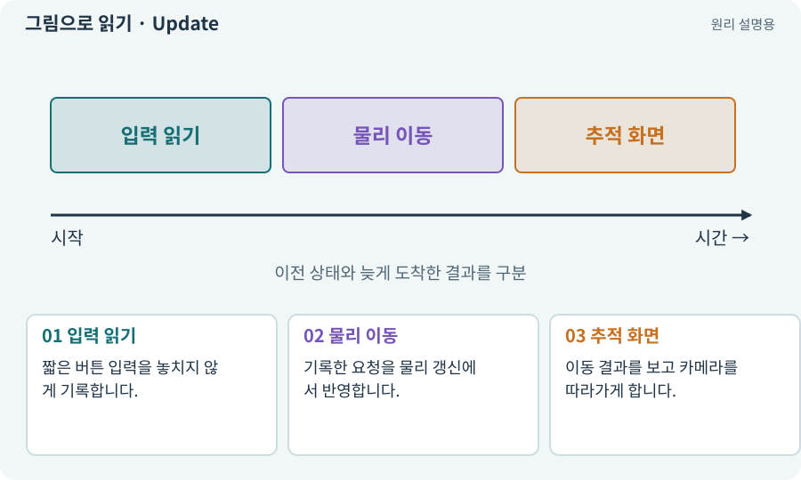

# Update·FixedUpdate·LateUpdate

**분야:** 오브젝트·좌표·움직임

Update는 화면 프레임을 따라, FixedUpdate는 고정 시간 간격의 물리 갱신을 따라 호출됩니다. LateUpdate는 Update 이후의 후처리로 사용됩니다. 정확한 횟수는 프레임 상황과 설정에 따라 달라집니다.

**찾아오는 이름:** Update·FixedUpdate·LateUpdate, Update, FixedUpdate, LateUpdate, 고정 틱, 물리 틱

## 익숙한 것에 비유하면

입력 메모를 받는 사람, 일정 박자에 움직이는 기계, 마지막으로 카메라를 맞추는 사람의 순서를 구분합니다.



개념도입니다. 실제 Unity 화면이나 검사 결과가 아닙니다. 그림의 순서·색은 역할을 구분하며 실제 설정값은 프로젝트에서 확인합니다.

## 이렇게 작동합니다

### 1. 입력 읽기

짧은 버튼 입력을 놓치지 않게 기록합니다.

### 2. 물리 이동

기록한 요청을 물리 갱신에서 반영합니다.

### 3. 추적 화면

이동 결과를 보고 카메라를 따라가게 합니다.

## 우리 RPG에서는 이렇게 만나요

한 화면 프레임 사이에 FixedUpdate가 0번 또는 여러 번 실행될 수 있습니다. “매 프레임 물리 한 번”이라고 가정하면 타이밍 오류가 납니다.

## 이것과 혼동하지 마세요

카메라를 늦게 갱신한다고 모든 떨림이 해결되지는 않습니다. 보간·모터·실제 갱신 순서도 봅니다.

## 이해했는지 한 번 생각해 보기

화면이 60FPS이면 물리도 반드시 초당 60번인가요?

<details><summary>답과 이유</summary>

아닙니다. 고정 시간 간격 설정과 프레임 시간은 별개입니다.

</details>

## 내 프로젝트에서 확인하고 싶다면

아래 요청은 읽기 전용으로 실제 대상을 확인하는 선택 요청입니다. 코드나 설정을 직접 편집할 필요는 없습니다.

```text
현재 프로젝트에서 Update·FixedUpdate·LateUpdate 관련 요소가 어떻게 사용되는지 읽기 전용으로 확인해 줘. 실제 대상과 설정을 찾아 쉬운 말과 작은 예로 설명해 줘. 특히 다음 혼동을 구분해 줘: 카메라를 늦게 갱신한다고 모든 떨림이 해결되지는 않습니다. 보간·모터·실제 갱신 순서도 봅니다. 아직 코드·설정·파일은 바꾸지 말고, 확인할 수 없는 내용은 따로 알려 줘.
```

## 이어지는 개념

[deltaTime과 초당 속도](delta-time.md) · [FPS·프레임 시간·ms](frame-time.md) · [보간·Lerp·이동 보정](interpolation.md) · [수명주기·초기화·정리](lifecycle.md)

## 이 개념을 사용하는 실습

[07 · 캐릭터와 벽이 있는 공간 만들기](../index.html#lesson-007) · [08 · WASD로 벽에 부딪히며 이동하기](../index.html#lesson-008) · [37 · 느려지는 원인을 측정해 고치기](../index.html#lesson-037) · [77 · 앱을 바꾸지 않고 외형 업데이트하기](../index.html#lesson-077) · [96 · 3D 카메라 가림과 터치 조작 다듬기](../index.html#lesson-096) · [135 · 벽을 통과하지 않는 회피 만들기](../index.html#lesson-135)

## 참고와 설명의 범위

기본 도구 동작은 아래 공식 자료를 참고했습니다. 비유·그림·RPG의 예시 수치와 정책은 이해를 위한 자체 예제입니다. 실제 API·지원 기능은 설치 버전과 계정에서 확인합니다.

- [Unity · GameObject와 컴포넌트](https://docs.unity3d.com/6000.3/Documentation/Manual/GameObjects.html)

그림·계산 예제·조작 모형은 자체 제작한 설명입니다. 실제 Unity 화면, 서비스 생성 결과, 성능 실측 또는 게임 테스트 결과가 아닙니다. 자료 확인: 2026년 9월 26일.
