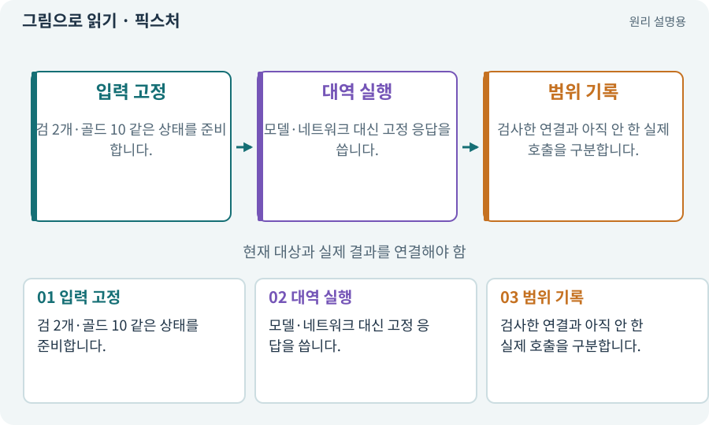

# 픽스처·Mock·Stub·테스트 더블

**분야:** 코드·데이터·저장·검사

픽스처는 검사를 위한 일정한 입력과 시작 상태입니다. Mock·Stub은 실제 서비스 대신 미리 정한 동작·응답을 제공해 연결 구조를 검사하는 대역입니다.

**찾아오는 이름:** 픽스처·Mock·Stub·테스트 더블, fixture, 픽스처, Mock, mock, Stub, 스텁, 모의 응답, 테스트 더블

## 익숙한 것에 비유하면

실제 결제 대신 연습용 카드로 단말기의 처리 순서를 시험하는 것입니다. 카드 대역이 통과했다고 실제 결제가 된 것은 아닙니다.



개념도입니다. 실제 Unity 화면이나 검사 결과가 아닙니다. 그림의 순서·색은 역할을 구분하며 실제 설정값은 프로젝트에서 확인합니다.

## 이렇게 작동합니다

### 1. 입력 고정

검 2개·골드 10 같은 상태를 준비합니다.

### 2. 대역 실행

모델·네트워크 대신 고정 응답을 씁니다.

### 3. 범위 기록

검사한 연결과 아직 안 한 실제 호출을 구분합니다.

## 우리 RPG에서는 이렇게 만나요

하네스 mock 데모는 역할 결과 전달과 후보 적용을 확인합니다. Claude 모델 품질·계정 권한·실제 Unity 연결은 따로 검사합니다.

## 이것과 혼동하지 마세요

Mock의 PASS를 실제 플랫폼 검증으로 합치지 않습니다.

## 이해했는지 한 번 생각해 보기

mock 다운로드 성공이면 오프라인 복구도 검증된 건가요?

<details><summary>답과 이유</summary>

그 대역에서 다룬 로직 범위만 검증한 것입니다. 실제 기기와 네트워크 조건은 별도입니다.

</details>

## 내 프로젝트에서 확인하고 싶다면

아래 요청은 읽기 전용으로 실제 대상을 확인하는 선택 요청입니다. 코드나 설정을 직접 편집할 필요는 없습니다.

```text
현재 프로젝트에서 픽스처·Mock·Stub·테스트 더블 관련 요소가 어떻게 사용되는지 읽기 전용으로 확인해 줘. 실제 대상과 설정을 찾아 쉬운 말과 작은 예로 설명해 줘. 특히 다음 혼동을 구분해 줘: Mock의 PASS를 실제 플랫폼 검증으로 합치지 않습니다. 아직 코드·설정·파일은 바꾸지 말고, 확인할 수 없는 내용은 따로 알려 줘.
```

## 이어지는 개념

[단위·통합·회귀 테스트](test.md) · [증거·검사 상태·미실행](evidence.md) · [공급자·어댑터·실제 호출](provider.md) · [재현성·결정성·동등성](deterministic.md)

## 이 개념을 사용하는 실습

[81 · 2D 게임을 남기고 3D 작업 시작하기](../index.html#lesson-081) · [100 · 두 버전이 같은 게임인지 비교하기](../index.html#lesson-100) · [112 · 네 역할을 순서대로 실행하기](../index.html#lesson-112) · [118 · 모의 응답 대신 실제 Claude 연결하기](../index.html#lesson-118) · [126 · 한 요청으로 필터 기능 끝내기](../index.html#lesson-126) · [129 · 기존 2D 게임에서 확장팩 시작하기](../index.html#lesson-129) · [156 · 기능 조합에서 숨은 오류 찾기](../index.html#lesson-156) · [157 · 하네스가 실패해도 기록 지키기](../index.html#lesson-157)

## 참고와 설명의 범위

기본 도구 동작은 아래 공식 자료를 참고했습니다. 비유·그림·RPG의 예시 수치와 정책은 이해를 위한 자체 예제입니다. 실제 API·지원 기능은 설치 버전과 계정에서 확인합니다.

- [Python · unittest](https://docs.python.org/3/library/unittest.html)

그림·계산 예제·조작 모형은 자체 제작한 설명입니다. 실제 Unity 화면, 서비스 생성 결과, 성능 실측 또는 게임 테스트 결과가 아닙니다. 자료 확인: 2026년 9월 26일.
