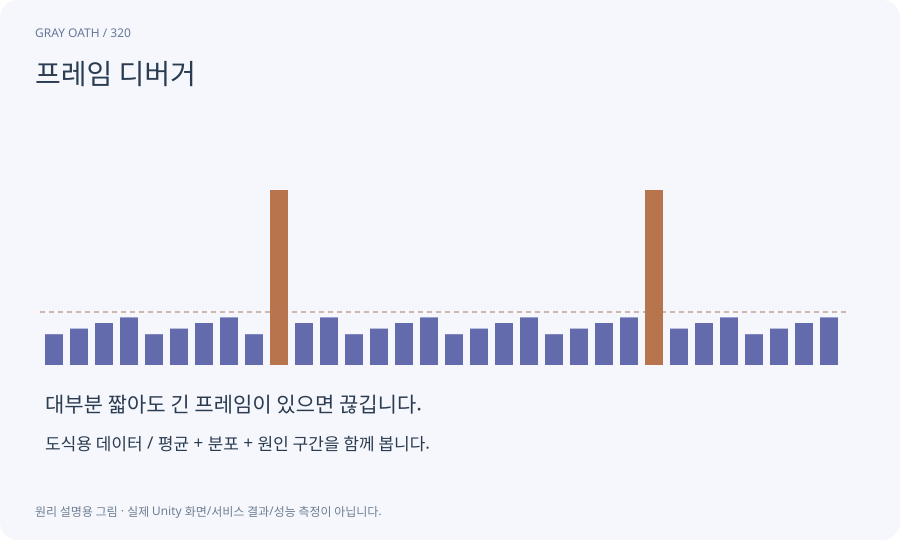

# 프레임 디버거

한 프레임이 어떤 렌더링 이벤트와 드로우 단계로 만들어지는지 살펴보는 도구입니다. 실제 GPU 실행 시간을 언제나 직접 측정해 주는 도구와는 구분합니다.

## 익숙한 비유

완성 그림에 어떤 레이어가 어떤 순서로 칠해졌는지 넘겨 보는 것입니다.



## 작동 원리

### 1. 이벤트 선택

그림자·불투명·투명·후처리 단계를 살펴봅니다.

### 2. 대상 확인

Renderer·재질·pass와 중복을 조사합니다.

### 3. 성능 대조

해당 변경의 실제 CPU/GPU 시간도 별도로 측정합니다.

## 게임 속 예

보스 연기 효과가 여러 투명 패스로 화면을 덮는지 확인한 뒤 같은 장면에서 GPU 부하를 비교합니다.

## 혼동하지 않기

드로우콜이 적다는 이유만으로 프레임 시간이 무조건 좋다고 말하지 않습니다.

## 확인 질문

이 도구의 이벤트 수가 FPS인가요?

아닙니다. 화면 구성 단계의 정보이며 시간은 적합한 계측 자료와 함께 봅니다.

## 내 프로젝트에서 확인하기

```text
현재 GrayOathRPG3D에서 프레임 디버거을 사용하는 실제 대상과 동작을 읽기 전용으로 확인해 줘. 쉬운 말과 작은 사례로 설명하고 드로우콜이 적다는 이유만으로 프레임 시간이 무조건 좋다고 말하지 않습니다. 이 문제를 어떻게 막는지 보여 줘. 코드·데이터·설정은 아직 수정하지 마.
```

## 관련 해설

[overdraw](overdraw.md) · [batching](batching.md) · [cpu-gpu](cpu-gpu.md)

## 공식 참고

- [Unity · Frame Debugger](https://docs.unity3d.com/6000.3/Documentation/Manual/FrameDebugger.html)
