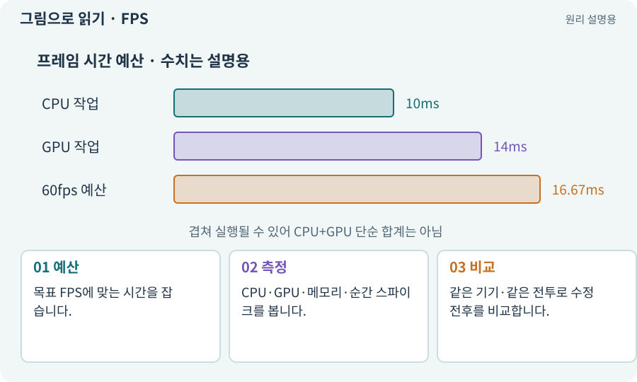

# FPS·프레임 시간·ms

**분야:** 입력·UI·소리·성능

FPS는 1초에 그린 프레임 수, 프레임 시간은 한 프레임에 걸린 시간입니다. 60FPS는 평균적으로 약 16.67ms, 30FPS는 약 33.33ms에 해당합니다. 순간 끊김은 평균만 보면 숨겨질 수 있습니다.

**찾아오는 이름:** FPS·프레임 시간·ms, FPS, fps, 프레임 시간, frame time, ms, 밀리초

## 익숙한 것에 비유하면

음악 박자가 평균은 맞아도 중간에 긴 쉼이 있으면 끊겨 들리는 것과 같습니다.



개념도입니다. 실제 Unity 화면이나 검사 결과가 아닙니다. 그림의 순서·색은 역할을 구분하며 실제 설정값은 프로젝트에서 확인합니다.

## 이렇게 작동합니다

### 1. 예산

목표 FPS에 맞는 시간을 잡습니다.

### 2. 측정

CPU·GPU·메모리·순간 스파이크를 봅니다.

### 3. 비교

같은 기기·같은 전투로 수정 전후를 비교합니다.

## FPS를 시간 예산으로 바꿔 보세요

60fps는 프레임 하나에 약 16.67ms, 30fps는 약 33.33ms에 해당합니다. 평균 FPS가 높아도 한 프레임이 크게 늦어지면 끊김을 느낄 수 있습니다. 순간 지연과 지속 성능을 함께 봅니다.

CPU와 GPU는 작업이 겹칠 수 있으므로 프로파일러의 시간들을 무조건 더해 전체 프레임이라고 계산하지 않습니다. 어디서 기다리고 어느 쪽이 병목인지 실제 타깃 측정이 필요합니다.

아래 계산기는 목표의 프레임 시간만 보여 줍니다. 현재 게임이 이 성능을 달성했다고 표시하는 벤치마크가 아닙니다.

| FPS | 프레임 시간 | 용도 |
| --- | --- | --- |
| 30 | 33.33ms | 낮은 부하 목표 예 |
| 60 | 16.67ms | 부드러운 조작 목표 예 |
| 120 | 8.33ms | 더 짧은 처리 예산 |

## 직접 값을 바꾸며 보기

[웹 해설의 조작 모형 열기](../index.html#tech-frame-time). 조작은 설명용 모형만 바꿉니다. 실제 프로젝트·AI·진행 체크·게임 테스트는 실행하거나 변경하지 않습니다.

## 우리 RPG에서는 이렇게 만나요

평균 60FPS여도 새 적을 만들 때 150ms 멈추면 타격감이 나쁩니다. 생성·가비지 수집·자산 로드의 순간 비용을 확인합니다.

## 이것과 혼동하지 마세요

1000/FPS 계산은 시간 단위 관계입니다. 실제 성능을 측정한 숫자는 아닙니다.

## 이해했는지 한 번 생각해 보기

평균 FPS가 같아도 한 버전이 더 끊길 수 있나요?

<details><summary>답과 이유</summary>

네. 긴 프레임의 분포와 순간 정지를 따로 봐야 합니다.

</details>

## 내 프로젝트에서 확인하고 싶다면

아래 요청은 읽기 전용으로 실제 대상을 확인하는 선택 요청입니다. 코드나 설정을 직접 편집할 필요는 없습니다.

```text
현재 프로젝트에서 FPS·프레임 시간·ms 관련 요소가 어떻게 사용되는지 읽기 전용으로 확인해 줘. 실제 대상과 설정을 찾아 쉬운 말과 작은 예로 설명해 줘. 특히 다음 혼동을 구분해 줘: 1000/FPS 계산은 시간 단위 관계입니다. 실제 성능을 측정한 숫자는 아닙니다. 아직 코드·설정·파일은 바꾸지 말고, 확인할 수 없는 내용은 따로 알려 줘.
```

## 이어지는 개념

[Profiler·병목·실기기 측정](profiler.md) · [CPU·GPU·RAM·VRAM](cpu-gpu.md) · [GC·할당·메모리 누수](garbage.md) · [오브젝트 풀링](pool.md)

## 이 개념을 사용하는 실습

[54 · 느낌을 근거로 밸런스 고치기](../index.html#lesson-054) · [69 · 베기와 폭발을 시트 애니메이션으로 만들기](../index.html#lesson-069) · [154 · 확장 기능을 켠 휴대폰 성능 고치기](../index.html#lesson-154)

## 참고와 설명의 범위

기본 도구 동작은 아래 공식 자료를 참고했습니다. 비유·그림·RPG의 예시 수치와 정책은 이해를 위한 자체 예제입니다. 실제 API·지원 기능은 설치 버전과 계정에서 확인합니다.

- [Unity · 프레임별 시간 처리](https://docs.unity3d.com/6000.3/Documentation/Manual/time-per-frame-updates.html)
- [Unity · 타깃 기기 프로파일링](https://docs.unity3d.com/6000.3/Documentation/Manual/profiling-target-device.html)

그림·계산 예제·조작 모형은 자체 제작한 설명입니다. 실제 Unity 화면, 서비스 생성 결과, 성능 실측 또는 게임 테스트 결과가 아닙니다. 자료 확인: 2026년 9월 26일.
