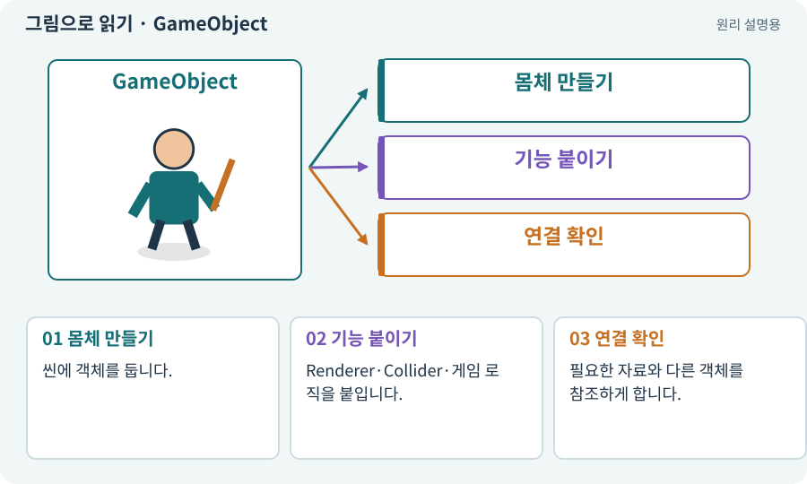

# GameObject

**분야:** 오브젝트·좌표·움직임

GameObject는 씬에 놓이는 기본 단위입니다. 이름·활성 상태와 Transform을 가지며, 실제 기능은 붙인 컴포넌트의 조합으로 결정됩니다.

**찾아오는 이름:** GameObject, 게임오브젝트, 게임 오브젝트

## 익숙한 것에 비유하면

빈 캐릭터 카드에 “그림 표시”, “체력”, “충돌” 능력 카드를 끼우는 모습을 떠올리면 됩니다. GameObject 자체가 곧 그림 파일은 아닙니다.



개념도입니다. 실제 Unity 화면이나 검사 결과가 아닙니다. 그림의 순서·색은 역할을 구분하며 실제 설정값은 프로젝트에서 확인합니다.

## 이렇게 작동합니다

### 1. 몸체 만들기

씬에 객체를 둡니다.

### 2. 기능 붙이기

Renderer·Collider·게임 로직을 붙입니다.

### 3. 연결 확인

필요한 자료와 다른 객체를 참조하게 합니다.

## 우리 RPG에서는 이렇게 만나요

플레이어와 횃불은 둘 다 GameObject지만, 플레이어는 이동·체력, 횃불은 빛·파티클을 갖습니다. 이름을 Player로 바꾼 것만으로 이동 기능이 생기지 않습니다.

## 이것과 혼동하지 마세요

빈 GameObject가 안 보이는 것은 정상입니다. 화면에 표시할 Renderer가 있어야 합니다.

## 이해했는지 한 번 생각해 보기

GameObject와 PNG 중 실제 체력을 가지는 쪽은?

<details><summary>답과 이유</summary>

프로젝트의 체력 컴포넌트가 연결된 GameObject입니다. PNG는 그림 자료입니다.

</details>

## 내 프로젝트에서 확인하고 싶다면

아래 요청은 읽기 전용으로 실제 대상을 확인하는 선택 요청입니다. 코드나 설정을 직접 편집할 필요는 없습니다.

```text
현재 프로젝트에서 GameObject 관련 요소가 어떻게 사용되는지 읽기 전용으로 확인해 줘. 실제 대상과 설정을 찾아 쉬운 말과 작은 예로 설명해 줘. 특히 다음 혼동을 구분해 줘: 빈 GameObject가 안 보이는 것은 정상입니다. 화면에 표시할 Renderer가 있어야 합니다. 아직 코드·설정·파일은 바꾸지 말고, 확인할 수 없는 내용은 따로 알려 줘.
```

## 이어지는 개념

[컴포넌트](component.md) · [Transform: 위치·회전·크기](transform.md) · [에셋과 가져오기](asset.md) · [프리팹·인스턴스·Variant](prefab.md)

## 이 개념을 사용하는 실습

[25 · 게임을 껐다 켜도 장비 유지하기](../index.html#lesson-025) · [26 · 새 게임·이어하기·마을 연결하기](../index.html#lesson-026) · [46 · 랜덤 지도 위를 실제로 걷기](../index.html#lesson-046)

## 참고와 설명의 범위

기본 도구 동작은 아래 공식 자료를 참고했습니다. 비유·그림·RPG의 예시 수치와 정책은 이해를 위한 자체 예제입니다. 실제 API·지원 기능은 설치 버전과 계정에서 확인합니다.

- [Unity · GameObject와 컴포넌트](https://docs.unity3d.com/6000.3/Documentation/Manual/GameObjects.html)

그림·계산 예제·조작 모형은 자체 제작한 설명입니다. 실제 Unity 화면, 서비스 생성 결과, 성능 실측 또는 게임 테스트 결과가 아닙니다. 자료 확인: 2026년 9월 26일.
