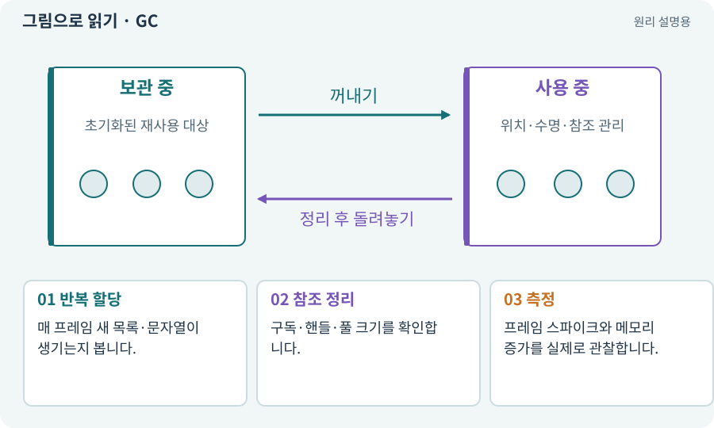

# GC·할당·메모리 누수

**분야:** 입력·UI·소리·성능

할당은 새 객체가 사용할 메모리를 준비하는 일이고 GC는 더 이상 사용하지 않는 관리 객체의 메모리를 회수하는 작업입니다. 누수는 필요 없어진 자원을 계속 붙잡는 상황을 포함합니다.

**찾아오는 이름:** GC·할당·메모리 누수, GC, Garbage Collection, 가비지, 할당, allocation, 메모리 누수, 누수

## 익숙한 것에 비유하면

새 종이를 계속 꺼내 쓰고 쓰레기통을 비우는 과정입니다. 버려야 할 종이를 계속 서랍에 보관하면 공간이 줄어듭니다.



개념도입니다. 실제 Unity 화면이나 검사 결과가 아닙니다. 그림의 순서·색은 역할을 구분하며 실제 설정값은 프로젝트에서 확인합니다.

## 이렇게 작동합니다

### 1. 반복 할당

매 프레임 새 목록·문자열이 생기는지 봅니다.

### 2. 참조 정리

구독·핸들·풀 크기를 확인합니다.

### 3. 측정

프레임 스파이크와 메모리 증가를 실제로 관찰합니다.

## 우리 RPG에서는 이렇게 만나요

적 50마리가 매 프레임 새 경로 배열을 만들면 순간 비용이 커질 수 있습니다. 재사용이 적절한지 측정하되 불필요한 복잡성을 먼저 늘리지 않습니다.

## 이것과 혼동하지 마세요

GC가 모든 Unity 네이티브 자원·Addressables 핸들을 대신 해제하지는 않습니다.

## 이해했는지 한 번 생각해 보기

씬을 오갈 때 메모리가 계속 늘면?

<details><summary>답과 이유</summary>

사용하지 않는 이벤트 구독·에셋 핸들·재질 인스턴스가 남는지 확인합니다.

</details>

## 내 프로젝트에서 확인하고 싶다면

아래 요청은 읽기 전용으로 실제 대상을 확인하는 선택 요청입니다. 코드나 설정을 직접 편집할 필요는 없습니다.

```text
현재 프로젝트에서 GC·할당·메모리 누수 관련 요소가 어떻게 사용되는지 읽기 전용으로 확인해 줘. 실제 대상과 설정을 찾아 쉬운 말과 작은 예로 설명해 줘. 특히 다음 혼동을 구분해 줘: GC가 모든 Unity 네이티브 자원·Addressables 핸들을 대신 해제하지는 않습니다. 아직 코드·설정·파일은 바꾸지 말고, 확인할 수 없는 내용은 따로 알려 줘.
```

## 이어지는 개념

[오브젝트 풀링](pool.md) · [핸들·참조 계수·Release](handle.md) · [수명주기·초기화·정리](lifecycle.md) · [Profiler·병목·실기기 측정](profiler.md)

## 이 개념을 사용하는 실습

[37 · 느려지는 원인을 측정해 고치기](../index.html#lesson-037) · [49 · 여러 근접 적의 공격 나누기](../index.html#lesson-049) · [66 · 타일 경계와 랜덤맵 외형 연결하기](../index.html#lesson-066) · [90 · 적의 판단을 3D 공간에 연결하기](../index.html#lesson-090) · [96 · 3D 카메라 가림과 터치 조작 다듬기](../index.html#lesson-096) · [98 · 3D 팩을 2D 팩과 따로 내려받기](../index.html#lesson-098) · [154 · 확장 기능을 켠 휴대폰 성능 고치기](../index.html#lesson-154) · [156 · 기능 조합에서 숨은 오류 찾기](../index.html#lesson-156)

## 참고와 설명의 범위

기본 도구 동작은 아래 공식 자료를 참고했습니다. 비유·그림·RPG의 예시 수치와 정책은 이해를 위한 자체 예제입니다. 실제 API·지원 기능은 설치 버전과 계정에서 확인합니다.

- [Unity Addressables · 메모리 관리](https://docs.unity3d.com/Packages/com.unity.addressables@2.7/manual/MemoryManagement.html)
- [Unity · 타깃 기기 프로파일링](https://docs.unity3d.com/6000.3/Documentation/Manual/profiling-target-device.html)

그림·계산 예제·조작 모형은 자체 제작한 설명입니다. 실제 Unity 화면, 서비스 생성 결과, 성능 실측 또는 게임 테스트 결과가 아닙니다. 자료 확인: 2026년 9월 26일.
