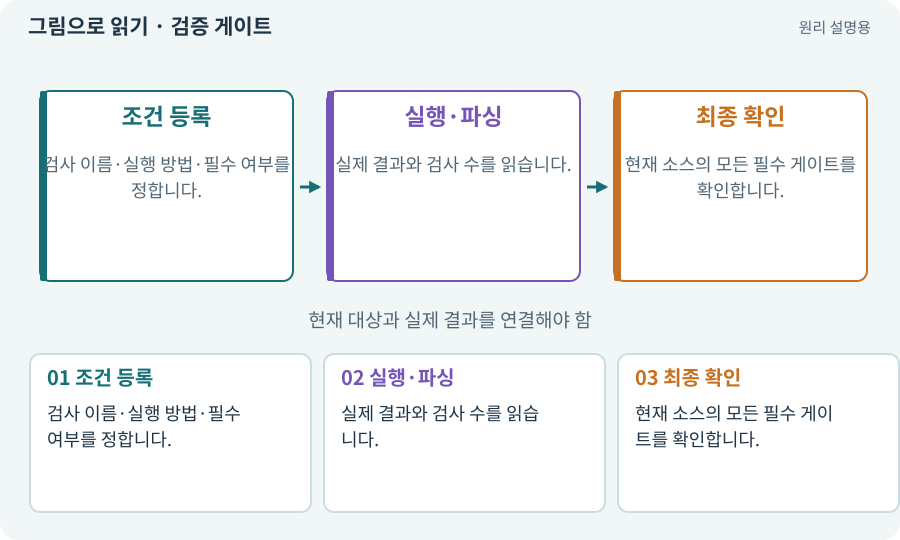

# 검증 게이트·필수 검사

**분야:** AI·스킬·훅·하네스 운영

게이트는 다음 단계로 넘어가기 위해 충족해야 하는 실제 검사 조건입니다. 컴파일·테스트·로그·시각·사람 확인 등 목적에 따라 다른 게이트를 둡니다.

**찾아오는 이름:** 검증 게이트·필수 검사, 게이트, Gate, gate, 필수 검사, acceptance gate, attest, seal/gate

## 익숙한 것에 비유하면

공장 출고 전 규격 검사·기능 검사·사람의 외관 검사를 나누는 것입니다.



개념도입니다. 실제 Unity 화면이나 검사 결과가 아닙니다. 그림의 순서·색은 역할을 구분하며 실제 설정값은 프로젝트에서 확인합니다.

## 이렇게 작동합니다

### 1. 조건 등록

검사 이름·실행 방법·필수 여부를 정합니다.

### 2. 실행·파싱

실제 결과와 검사 수를 읽습니다.

### 3. 최종 확인

현재 소스의 모든 필수 게이트를 확인합니다.

## 우리 RPG에서는 이렇게 만나요

필터 함수 테스트만 통과해도 모바일 직접 조작 게이트가 남아 있으면 전체 완료가 아닙니다. 비활성화한 게이트에 PASS 확인을 덧붙여 우회하지 않습니다.

## 이것과 혼동하지 마세요

게임 AI가 스스로 “완료”라고 쓴 문장은 게이트 통과가 아닙니다.

## 이해했는지 한 번 생각해 보기

한 역할의 테스트가 통과했으니 출시 가능할까요?

<details><summary>답과 이유</summary>

현재 통합본의 필수 검사와 사람 승인까지 확인해야 합니다.

</details>

## 내 프로젝트에서 확인하고 싶다면

아래 요청은 읽기 전용으로 실제 대상을 확인하는 선택 요청입니다. 코드나 설정을 직접 편집할 필요는 없습니다.

```text
현재 프로젝트에서 검증 게이트·필수 검사 관련 요소가 어떻게 사용되는지 읽기 전용으로 확인해 줘. 실제 대상과 설정을 찾아 쉬운 말과 작은 예로 설명해 줘. 특히 다음 혼동을 구분해 줘: 게임 AI가 스스로 “완료”라고 쓴 문장은 게이트 통과가 아닙니다. 아직 코드·설정·파일은 바꾸지 말고, 확인할 수 없는 내용은 따로 알려 줘.
```

## 이어지는 개념

[증거·검사 상태·미실행](evidence.md) · [파서·XML·결과 판정](parser.md) · [단위·통합·회귀 테스트](test.md) · [권한·승인·최소 권한](permission.md)

## 이 개념을 사용하는 실습

[114 · 테스트를 실행하고 결과 읽기](../index.html#lesson-114) · [120 · 자연어 요청을 계획으로 바꾸기](../index.html#lesson-120) · [122 · 내 게임에 맞는 검사기 추가하기](../index.html#lesson-122) · [124 · 현재 컴퓨터의 Unity 명령 등록하기](../index.html#lesson-124) · [127 · 내 반복 업무에 맞게 도구 개조하기](../index.html#lesson-127) · [130 · 첫 확장 작업을 하네스에 연결하기](../index.html#lesson-130) · [133 · 첫 기능의 실패를 고쳐 다음 기준 만들기](../index.html#lesson-133) · [147 · 용광로 감시자와 3단계 전투 만들기](../index.html#lesson-147)

## 참고와 설명의 범위

이 항목의 비유·그림·RPG 수치·운영 규칙은 개념을 이해하기 위한 자체 설계 예제입니다. 특정 도구가 이 규칙을 자동으로 구현한다는 뜻은 아닙니다.


그림·계산 예제·조작 모형은 자체 제작한 설명입니다. 실제 Unity 화면, 서비스 생성 결과, 성능 실측 또는 게임 테스트 결과가 아닙니다. 자료 확인: 2026년 9월 26일.
