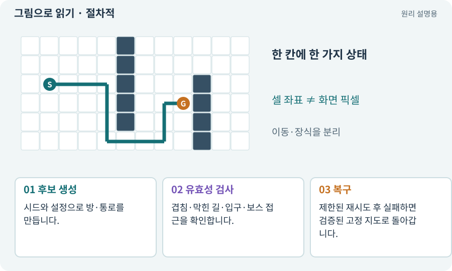

# 절차적·무작위 지형 생성

**분야:** 지도·적 AI·전투 규칙

절차적 생성은 사람이 정한 규칙을 프로그램이 실행해 콘텐츠를 만드는 방식입니다. 무작위 값을 섞을 수 있지만 아무렇게나 배치한다는 뜻은 아닙니다.

**찾아오는 이름:** 절차적·무작위 지형 생성, 절차적 생성, 무작위 지형, 랜덤맵, 랜덤 지도, 랜덤 던전, procedural generation

## 익숙한 것에 비유하면

“방은 겹치지 않고 모든 방은 연결한다”는 건축 규칙 안에서 다른 설계를 뽑는 것입니다.



개념도입니다. 실제 Unity 화면이나 검사 결과가 아닙니다. 그림의 순서·색은 역할을 구분하며 실제 설정값은 프로젝트에서 확인합니다.

## 이렇게 작동합니다

### 1. 후보 생성

시드와 설정으로 방·통로를 만듭니다.

### 2. 유효성 검사

겹침·막힌 길·입구·보스 접근을 확인합니다.

### 3. 복구

제한된 재시도 후 실패하면 검증된 고정 지도로 돌아갑니다.

## 우리 RPG에서는 이렇게 만나요

이 게임의 8개 구역은 역할을 유지하면서 배치가 달라집니다. 장식이 랜덤인 것과 실제 방·통로가 바뀌는 것을 구분합니다.

## 이것과 혼동하지 마세요

100개 시드 통과는 모든 가능한 시드의 수학적 보장이 아닙니다. 반례를 보존하고 실제 공간도 검사합니다.

## 이해했는지 한 번 생각해 보기

계속 생성에 실패하면 무한히 다시 뽑아야 하나요?

<details><summary>답과 이유</summary>

아닙니다. 재시도 한도를 두고 실패 원인과 대체 지도를 기록합니다.

</details>

## 내 프로젝트에서 확인하고 싶다면

아래 요청은 읽기 전용으로 실제 대상을 확인하는 선택 요청입니다. 코드나 설정을 직접 편집할 필요는 없습니다.

```text
현재 프로젝트에서 절차적·무작위 지형 생성 관련 요소가 어떻게 사용되는지 읽기 전용으로 확인해 줘. 실제 대상과 설정을 찾아 쉬운 말과 작은 예로 설명해 줘. 특히 다음 혼동을 구분해 줘: 100개 시드 통과는 모든 가능한 시드의 수학적 보장이 아닙니다. 반례를 보존하고 실제 공간도 검사합니다. 아직 코드·설정·파일은 바꾸지 말고, 확인할 수 없는 내용은 따로 알려 줘.
```

## 이어지는 개념

[시드·난수·PRNG](rng.md) · [논리 지도·DungeonLayout](layout.md) · [연결성·BFS·도달 가능성](connectivity.md) · [폴백·안전한 대체 경로](fallback.md)

## 이 개념을 사용하는 실습

[28 · 여덟 구역의 첫 던전 만들기](../index.html#lesson-028) · [29 · 방마다 적과 상자 배치하기](../index.html#lesson-029) · [44 · 시드로 같은 던전 다시 만들기](../index.html#lesson-044) · [46 · 랜덤 지도 위를 실제로 걷기](../index.html#lesson-046) · [47 · 실패하는 시드를 찾고 복구하기](../index.html#lesson-047) · [48 · 적이 나를 보고 놓치게 만들기](../index.html#lesson-048) · [51 · 전투 전체의 압박 조절하기](../index.html#lesson-051) · [66 · 타일 경계와 랜덤맵 외형 연결하기](../index.html#lesson-066) · [79 · 추가 기능을 하나의 게임으로 합치기](../index.html#lesson-079) · [80 · 나만의 2D RPG 완성하기](../index.html#lesson-080) · [94 · 같은 랜덤 던전을 3D로 생성하기](../index.html#lesson-094) · [104 · 2D와 3D를 두 플랫폼에서 완주하기](../index.html#lesson-104) · [143 · 새 랜덤 지역 봉인된 대장간 만들기](../index.html#lesson-143) · [156 · 기능 조합에서 숨은 오류 찾기](../index.html#lesson-156)

## 참고와 설명의 범위

이 항목의 비유·그림·RPG 수치·운영 규칙은 개념을 이해하기 위한 자체 설계 예제입니다. 특정 도구가 이 규칙을 자동으로 구현한다는 뜻은 아닙니다.


그림·계산 예제·조작 모형은 자체 제작한 설명입니다. 실제 Unity 화면, 서비스 생성 결과, 성능 실측 또는 게임 테스트 결과가 아닙니다. 자료 확인: 2026년 9월 26일.
