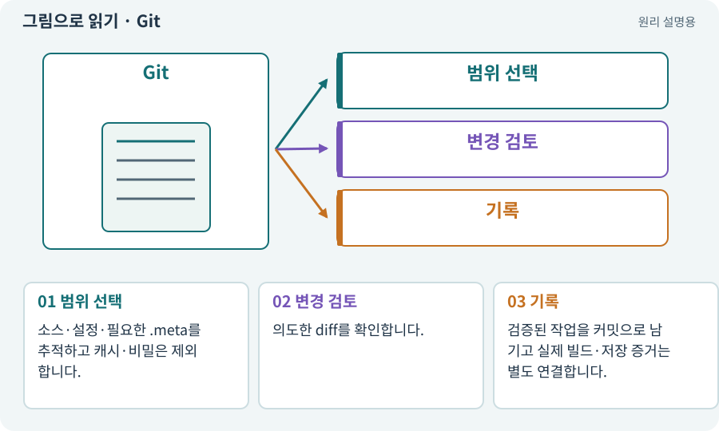

# Git·저장소·커밋

**분야:** 비동기·다운로드·빌드·버전 관리

Git은 파일 변경 이력을 기록하고 비교·복구하는 버전 관리 도구입니다. 커밋은 추적하는 파일들의 특정 상태를 설명과 함께 기록한 지점입니다. 모든 파일과 외부 계정을 자동 백업하지는 않습니다.

**찾아오는 이름:** Git·저장소·커밋, Git, git, 저장소, Repository, repo, 커밋, commit, 체크포인트

## 익숙한 것에 비유하면

개정 이력을 남기는 작업 노트입니다. 어느 변경에서 문제가 생겼는지 비교할 수 있습니다.



개념도입니다. 실제 Unity 화면이나 검사 결과가 아닙니다. 그림의 순서·색은 역할을 구분하며 실제 설정값은 프로젝트에서 확인합니다.

## 이렇게 작동합니다

### 1. 범위 선택

소스·설정·필요한 .meta를 추적하고 캐시·비밀은 제외합니다.

### 2. 변경 검토

의도한 diff를 확인합니다.

### 3. 기록

검증된 작업을 커밋으로 남기고 실제 빌드·저장 증거는 별도 연결합니다.

## 우리 RPG에서는 이렇게 만나요

Library 캐시를 저장소에 넣기보다 Assets·Packages·ProjectSettings와 맞는 메타데이터를 보존합니다. AI가 미커밋 변경을 지우거나 자동 reset해 오류를 해결하지 않게 합니다.

## 이것과 혼동하지 마세요

커밋 하나가 Android 실기기 PASS나 저장 파일의 백업을 뜻하지 않습니다.

## 이해했는지 한 번 생각해 보기

Git에 올렸으니 API 키도 안전하게 보관된 건가요?

<details><summary>답과 이유</summary>

오히려 이력에 노출될 수 있습니다. 비밀을 넣지 않는 정책이 필요합니다.

</details>

## 내 프로젝트에서 확인하고 싶다면

아래 요청은 읽기 전용으로 실제 대상을 확인하는 선택 요청입니다. 코드나 설정을 직접 편집할 필요는 없습니다.

```text
현재 프로젝트에서 Git·저장소·커밋 관련 요소가 어떻게 사용되는지 읽기 전용으로 확인해 줘. 실제 대상과 설정을 찾아 쉬운 말과 작은 예로 설명해 줘. 특히 다음 혼동을 구분해 줘: 커밋 하나가 Android 실기기 PASS나 저장 파일의 백업을 뜻하지 않습니다. 아직 코드·설정·파일은 바꾸지 말고, 확인할 수 없는 내용은 따로 알려 줘.
```

## 이어지는 개념

[diff·패치·변경 검토](diff.md) · [브랜치·병합·충돌·worktree](branch.md) · [스냅샷·기준선·baseline](snapshot.md) · [메타 파일과 GUID](meta.md)

## 이 개념을 사용하는 실습

[04 · 되돌릴 수 있는 작업 습관 만들기](../index.html#lesson-004) · [38 · 테스트 결과와 실제 플레이 구분하기](../index.html#lesson-038) · [42 · 트리에서 투자하고 저장하기](../index.html#lesson-042) · [74 · 추가 외형을 서버에서 받게 준비하기](../index.html#lesson-074) · [79 · 추가 기능을 하나의 게임으로 합치기](../index.html#lesson-079) · [81 · 2D 게임을 남기고 3D 작업 시작하기](../index.html#lesson-081) · [102 · 네 배포물을 구분해 만들기](../index.html#lesson-102) · [107 · 원본을 보호하고 허용 경로 정하기](../index.html#lesson-107) · [110 · 작업마다 필요한 자료만 준비하기](../index.html#lesson-110) · [129 · 기존 2D 게임에서 확장팩 시작하기](../index.html#lesson-129) · [133 · 첫 기능의 실패를 고쳐 다음 기준 만들기](../index.html#lesson-133)

## 참고와 설명의 범위

기본 도구 동작은 아래 공식 자료를 참고했습니다. 비유·그림·RPG의 예시 수치와 정책은 이해를 위한 자체 예제입니다. 실제 API·지원 기능은 설치 버전과 계정에서 확인합니다.

- [Git · worktree](https://git-scm.com/docs/git-worktree)

그림·계산 예제·조작 모형은 자체 제작한 설명입니다. 실제 Unity 화면, 서비스 생성 결과, 성능 실측 또는 게임 테스트 결과가 아닙니다. 자료 확인: 2026년 9월 26일.
