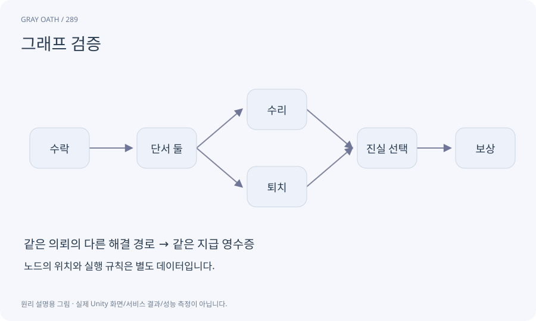

# 그래프 검증

노드·참조·연결·종료 경로가 정해진 규칙을 만족하는지 검사하는 과정입니다. 구조적 도달 가능성과 조건이 실제로 가능한지는 다른 검사입니다.

## 익숙한 비유

지도에 목적지까지 선이 있는지와 실제 길이 개방돼 있는지를 따로 확인하는 것입니다.



## 작동 원리

### 1. 형식 검사

중복 ID·없는 끝점·포트·타입을 거부합니다.

### 2. 구조 검사

시작·순환·고립·종료로 갈 수 없는 구간을 찾습니다.

### 3. 상태 검사

불가능한 조건과 보상·실제 시뮬레이션을 추가 확인합니다.

## 게임 속 예

조건이 항상 false인 길 끝에만 보상이 있다면 선은 이어져도 완료할 수 없습니다. 구조 검사 뒤 시나리오별 조건 검사가 필요합니다.

## 혼동하지 않기

DAG라는 이유만으로 퀘스트가 재미있거나 모든 상태에서 완료 가능하다고 말하지 않습니다.

## 확인 질문

시작에서 도달하지 못하는 노드를 허용하나요?

이 과정은 고립 노드를 오류로 처리하고 보류 아이디어는 활성 그래프 밖의 초안으로 보관합니다.

## 내 프로젝트에서 확인하기

```text
현재 GrayOathRPG3D에서 그래프 검증을 사용하는 실제 대상과 동작을 읽기 전용으로 확인해 줘. 쉬운 말과 작은 사례로 설명하고 DAG라는 이유만으로 퀘스트가 재미있거나 모든 상태에서 완료 가능하다고 말하지 않습니다. 이 문제를 어떻게 막는지 보여 줘. 코드·데이터·설정은 아직 수정하지 마.
```

## 관련 해설

[dependency](dependency.md) · [predicate-dsl](predicate-dsl.md) · [branch-coverage](branch-coverage.md)

## 공식 참고

- [Unity · UI Toolkit EditorWindow](https://docs.unity3d.com/6000.3/Documentation/Manual/UIE-HowTo-CreateEditorWindow.html)
