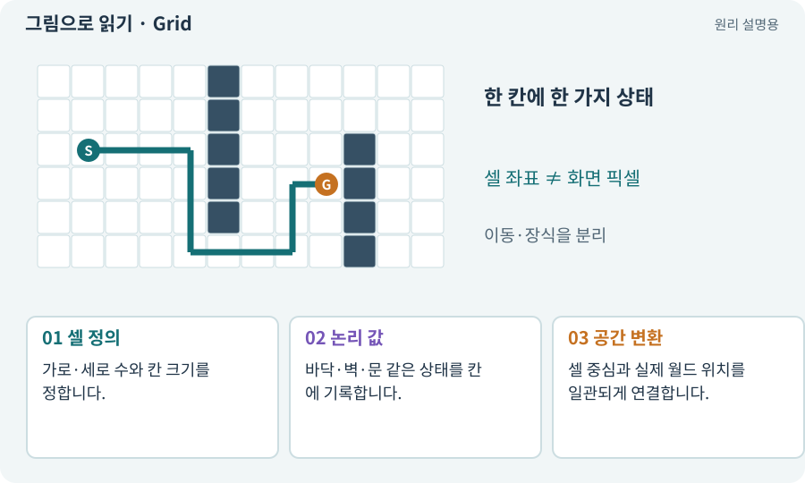

# Grid·셀·격자 좌표

**분야:** 지도·적 AI·전투 규칙

격자는 공간을 일정한 칸으로 나눈 표현입니다. 셀 좌표는 몇 번째 칸인지, 월드 좌표는 실제 위치가 어디인지 나타냅니다. 셀 크기에 따라 둘의 변환이 달라집니다.

**찾아오는 이름:** Grid·셀·격자 좌표, Grid, 격자, 셀, cellSize, cell

## 익숙한 것에 비유하면

바둑판의 “3열 4행”과 책상에서 잰 “오른쪽 30cm”를 구분하는 것입니다.



개념도입니다. 실제 Unity 화면이나 검사 결과가 아닙니다. 그림의 순서·색은 역할을 구분하며 실제 설정값은 프로젝트에서 확인합니다.

## 이렇게 작동합니다

### 1. 셀 정의

가로·세로 수와 칸 크기를 정합니다.

### 2. 논리 값

바닥·벽·문 같은 상태를 칸에 기록합니다.

### 3. 공간 변환

셀 중심과 실제 월드 위치를 일관되게 연결합니다.

## 우리 RPG에서는 이렇게 만나요

64×64 지도에 벽 칸을 기록해도 Tilemap과 충돌체가 같은 칸에 만들어졌는지 별도로 확인합니다. 시작점이 셀 모서리인지 중심인지도 맞춰야 합니다.

## 이것과 혼동하지 마세요

셀 하나가 언제나 1m인 것은 아닙니다. 프로젝트의 cellSize와 Transform 크기에 달려 있습니다.

## 이해했는지 한 번 생각해 보기

셀 (3,4)가 언제나 월드 (3,4)인가요?

<details><summary>답과 이유</summary>

아닙니다. 원점·칸 크기·Grid 변환을 적용해야 합니다.

</details>

## 내 프로젝트에서 확인하고 싶다면

아래 요청은 읽기 전용으로 실제 대상을 확인하는 선택 요청입니다. 코드나 설정을 직접 편집할 필요는 없습니다.

```text
현재 프로젝트에서 Grid·셀·격자 좌표 관련 요소가 어떻게 사용되는지 읽기 전용으로 확인해 줘. 실제 대상과 설정을 찾아 쉬운 말과 작은 예로 설명해 줘. 특히 다음 혼동을 구분해 줘: 셀 하나가 언제나 1m인 것은 아닙니다. 프로젝트의 cellSize와 Transform 크기에 달려 있습니다. 아직 코드·설정·파일은 바꾸지 말고, 확인할 수 없는 내용은 따로 알려 줘.
```

## 이어지는 개념

[XY·XZ 평면과 논리 좌표](coordinates.md) · [Tilemap·Tile·타일 팔레트](tilemap.md) · [A* 길찾기](astar.md) · [논리 지도·DungeonLayout](layout.md)

## 이 개념을 사용하는 실습

[09 · 클릭한 곳까지 벽을 돌아가기](../index.html#lesson-009) · [21 · 몬스터가 장비를 떨어뜨리게 하기](../index.html#lesson-021) · [28 · 여덟 구역의 첫 던전 만들기](../index.html#lesson-028) · [44 · 시드로 같은 던전 다시 만들기](../index.html#lesson-044) · [45 · 무작위 방과 통로 만들기](../index.html#lesson-045) · [46 · 랜덤 지도 위를 실제로 걷기](../index.html#lesson-046) · [55 · 어떤 그림도 맞춰 넣는 아트 규격 정하기](../index.html#lesson-055) · [58 · PixelLab로 방향별 픽셀 캐릭터 만들기](../index.html#lesson-058) · [66 · 타일 경계와 랜덤맵 외형 연결하기](../index.html#lesson-066) · [69 · 베기와 폭발을 시트 애니메이션으로 만들기](../index.html#lesson-069) · [70 · 피격 강조와 보스 예고 셰이더 만들기](../index.html#lesson-070) · [82 · 게임 규칙은 재사용하고 공간만 바꾸기](../index.html#lesson-082) · [84 · 같은 지도를 3D 바닥과 벽으로 만들기](../index.html#lesson-084) · [143 · 새 랜덤 지역 봉인된 대장간 만들기](../index.html#lesson-143)

## 참고와 설명의 범위

기본 도구 동작은 아래 공식 자료를 참고했습니다. 비유·그림·RPG의 예시 수치와 정책은 이해를 위한 자체 예제입니다. 실제 API·지원 기능은 설치 버전과 계정에서 확인합니다.

- [Unity · Tilemap Collider 2D](https://docs.unity3d.com/6000.3/Documentation/Manual/tilemaps/work-with-tilemaps/tilemap-collider-2d.html)

그림·계산 예제·조작 모형은 자체 제작한 설명입니다. 실제 Unity 화면, 서비스 생성 결과, 성능 실측 또는 게임 테스트 결과가 아닙니다. 자료 확인: 2026년 9월 26일.
