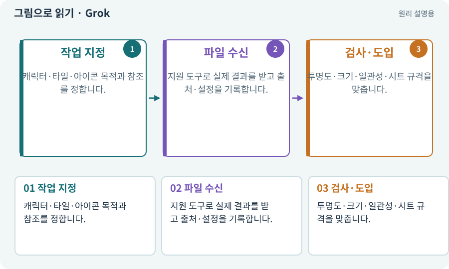

# Grok·xAI 이미지 생성·편집

**분야:** 자산 제작·렌더링 보충

Grok 또는 xAI 이미지 생성 경로로 텍스트·참조 이미지를 이용한 자산 후보를 만들 수 있습니다. 실제 모델·출력·편집 지원은 현재 공식 문서와 계정에서 확인합니다.

**찾아오는 이름:** Grok·xAI 이미지 생성·편집, Grok, xAI, grok, 그록

## 익숙한 것에 비유하면

다른 제작 창구를 사용하는 것이지 Unity가 요구하는 파일 규격이 바뀌는 것은 아닙니다.



개념도입니다. 실제 Unity 화면이나 검사 결과가 아닙니다. 그림의 순서·색은 역할을 구분하며 실제 설정값은 프로젝트에서 확인합니다.

## 이렇게 작동합니다

### 1. 작업 지정

캐릭터·타일·아이콘 목적과 참조를 정합니다.

### 2. 파일 수신

지원 도구로 실제 결과를 받고 출처·설정을 기록합니다.

### 3. 검사·도입

투명도·크기·일관성·시트 규격을 맞춥니다.

## 우리 RPG에서는 이렇게 만나요

같은 캐릭터의 좌우 방향 그림을 받아도 장비 손잡이가 뒤바뀌는지 확인합니다. 생성 API가 없는 기능을 있다고 추측해 호출하지 않습니다.

## 이것과 혼동하지 마세요

영상·그림 생성 기능이 있다는 이유로 정확한 게임 애니메이션이 보장되는 것은 아닙니다.

## 이해했는지 한 번 생각해 보기

다른 서비스 그림과 바로 섞어도 될까요?

<details><summary>답과 이유</summary>

픽셀 크기·명암·팔레트·피벗·사용 조건을 통일하고 실제 게임에서 비교합니다.

</details>

## 내 프로젝트에서 확인하고 싶다면

아래 요청은 읽기 전용으로 실제 대상을 확인하는 선택 요청입니다. 코드나 설정을 직접 편집할 필요는 없습니다.

```text
현재 프로젝트에서 Grok·xAI 이미지 생성·편집 관련 요소가 어떻게 사용되는지 읽기 전용으로 확인해 줘. 실제 대상과 설정을 찾아 쉬운 말과 작은 예로 설명해 줘. 특히 다음 혼동을 구분해 줘: 영상·그림 생성 기능이 있다는 이유로 정확한 게임 애니메이션이 보장되는 것은 아닙니다. 아직 코드·설정·파일은 바꾸지 말고, 확인할 수 없는 내용은 따로 알려 줘.
```

## 이어지는 개념

[생성형 아트·참조 이미지·후처리](image-service.md) · [아트 규격·레퍼런스·키 포즈](art-spec.md) · [라이선스·출처·사용 조건](license.md) · [스프라이트 시트](sprite-sheet.md)

## 이 개념을 사용하는 실습

[63 · Grok 이미지로 같은 자산 시험하기](../index.html#lesson-063) · [67 · 내 게임의 아트 제작 경로 선택하기](../index.html#lesson-067)

## 참고와 설명의 범위

기본 도구 동작은 아래 공식 자료를 참고했습니다. 비유·그림·RPG의 예시 수치와 정책은 이해를 위한 자체 예제입니다. 실제 API·지원 기능은 설치 버전과 계정에서 확인합니다.

- [xAI · 이미지 생성·편집](https://docs.x.ai/developers/model-capabilities/images/generation)

그림·계산 예제·조작 모형은 자체 제작한 설명입니다. 실제 Unity 화면, 서비스 생성 결과, 성능 실측 또는 게임 테스트 결과가 아닙니다. 자료 확인: 2026년 9월 26일.
