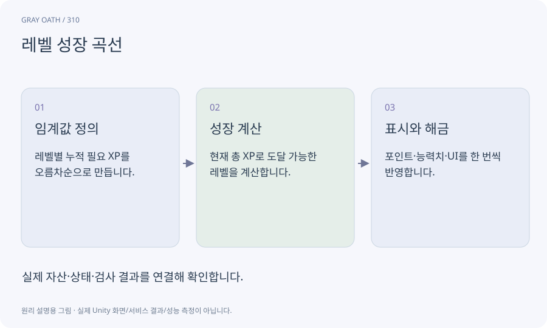

# 레벨 성장 곡선

레벨별 필요한 경험치와 능력치·해금을 정한 규칙입니다. 누적 경험치와 다음 레벨까지 남은 양을 구분해야 UI와 계산이 맞습니다.

## 익숙한 비유

계단의 각 높이를 정하는 설계도입니다. 한 번에 많은 경험치를 받으면 여러 계단을 올라갈 수 있습니다.



## 작동 원리

### 1. 임계값 정의

레벨별 누적 필요 XP를 오름차순으로 만듭니다.

### 2. 성장 계산

현재 총 XP로 도달 가능한 레벨을 계산합니다.

### 3. 표시와 해금

포인트·능력치·UI를 한 번씩 반영합니다.

## 게임 속 예

레벨1~20, 레벨업당1포인트로 총19포인트를 얻습니다. 만렙에서 남은 XP 표시와 추가 포인트 지급 정책을 명시합니다.

## 혼동하지 않기

큰 보상으로 여러 레벨이 올랐는데 한 번만 레벨업하거나 포인트를 중복 지급하면 안 됩니다.

## 확인 질문

장비를 바꾸고 레벨업하면 능력치가 누적되나요?

기본+레벨+장비+활성 스킬을 다시 계산하는 방식으로 누적 덧셈 오류를 막습니다.

## 내 프로젝트에서 확인하기

```text
현재 GrayOathRPG3D에서 레벨 성장 곡선을 사용하는 실제 대상과 동작을 읽기 전용으로 확인해 줘. 쉬운 말과 작은 사례로 설명하고 큰 보상으로 여러 레벨이 올랐는데 한 번만 레벨업하거나 포인트를 중복 지급하면 안 됩니다. 이 문제를 어떻게 막는지 보여 줘. 코드·데이터·설정은 아직 수정하지 마.
```

## 관련 해설

[stats](stats.md) · [skill-tree](skill-tree.md) · [identifier](identifier.md)

## 공식 참고

- [Unity · UI Toolkit EditorWindow](https://docs.unity3d.com/6000.3/Documentation/Manual/UIE-HowTo-CreateEditorWindow.html)
