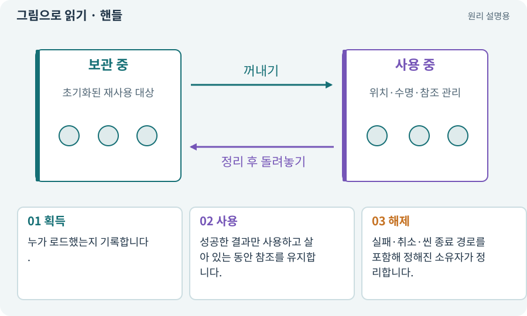

# 핸들·참조 계수·Release

**분야:** 비동기·다운로드·빌드·버전 관리

핸들은 비동기 작업이나 로드한 자원에 접근하기 위한 관리용 참조입니다. 참조 계수는 그 자원을 필요로 하는 요청 수를 추적합니다. 정확한 소유자와 해제 시점을 정해야 합니다.

**찾아오는 이름:** 핸들·참조 계수·Release, 핸들, Handle, AsyncOperationHandle, 참조 계수, Release, ref count, ReleaseInstance, LoadAssetAsync, InstantiateAsync

## 익숙한 것에 비유하면

도서 대출증을 가진 사람이 반납 책임을 맡는 것과 같습니다. 두 번 반납하거나 대출증을 잃어버리면 관리가 꼬입니다.



개념도입니다. 실제 Unity 화면이나 검사 결과가 아닙니다. 그림의 순서·색은 역할을 구분하며 실제 설정값은 프로젝트에서 확인합니다.

## 이렇게 작동합니다

### 1. 획득

누가 로드했는지 기록합니다.

### 2. 사용

성공한 결과만 사용하고 살아 있는 동안 참조를 유지합니다.

### 3. 해제

실패·취소·씬 종료 경로를 포함해 정해진 소유자가 정리합니다.

## 우리 RPG에서는 이렇게 만나요

씬을 떠날 때 VFX 풀에서 참조하는 재질을 먼저 해제하면 잘못된 표시가 날 수 있습니다. Addressables가 만든 인스턴스와 일반 Instantiate 복제본의 해제 계약을 구분합니다.

## 이것과 혼동하지 마세요

Release 호출 한 번이 곧바로 모든 GPU 메모리 감소를 보장하지 않습니다. 다른 참조·묶음·엔진 처리 시점이 영향을 줍니다.

## 이해했는지 한 번 생각해 보기

여러 곳에서 같은 핸들을 각각 해제하면 안전한가요?

<details><summary>답과 이유</summary>

소유권 계약 없이 중복 해제하면 잘못된 수명 관리가 됩니다.

</details>

## 내 프로젝트에서 확인하고 싶다면

아래 요청은 읽기 전용으로 실제 대상을 확인하는 선택 요청입니다. 코드나 설정을 직접 편집할 필요는 없습니다.

```text
현재 프로젝트에서 핸들·참조 계수·Release 관련 요소가 어떻게 사용되는지 읽기 전용으로 확인해 줘. 실제 대상과 설정을 찾아 쉬운 말과 작은 예로 설명해 줘. 특히 다음 혼동을 구분해 줘: Release 호출 한 번이 곧바로 모든 GPU 메모리 감소를 보장하지 않습니다. 다른 참조·묶음·엔진 처리 시점이 영향을 줍니다. 아직 코드·설정·파일은 바꾸지 말고, 확인할 수 없는 내용은 따로 알려 줘.
```

## 이어지는 개념

[Addressables·주소로 에셋 불러오기](addressables.md) · [오브젝트 풀링](pool.md) · [수명주기·초기화·정리](lifecycle.md) · [비동기·await·콜백](async.md)

## 이 개념을 사용하는 실습

[73 · 주소로 에셋 불러오기](../index.html#lesson-073) · [75 · 다운로드 용량과 진행률 보여 주기](../index.html#lesson-075) · [76 · 연결이 끊겨도 게임 계속하기](../index.html#lesson-076) · [81 · 2D 게임을 남기고 3D 작업 시작하기](../index.html#lesson-081) · [98 · 3D 팩을 2D 팩과 따로 내려받기](../index.html#lesson-098)

## 참고와 설명의 범위

기본 도구 동작은 아래 공식 자료를 참고했습니다. 비유·그림·RPG의 예시 수치와 정책은 이해를 위한 자체 예제입니다. 실제 API·지원 기능은 설치 버전과 계정에서 확인합니다.

- [Unity Addressables · 메모리 관리](https://docs.unity3d.com/Packages/com.unity.addressables@2.7/manual/MemoryManagement.html)

그림·계산 예제·조작 모형은 자체 제작한 설명입니다. 실제 Unity 화면, 서비스 생성 결과, 성능 실측 또는 게임 테스트 결과가 아닙니다. 자료 확인: 2026년 9월 26일.
