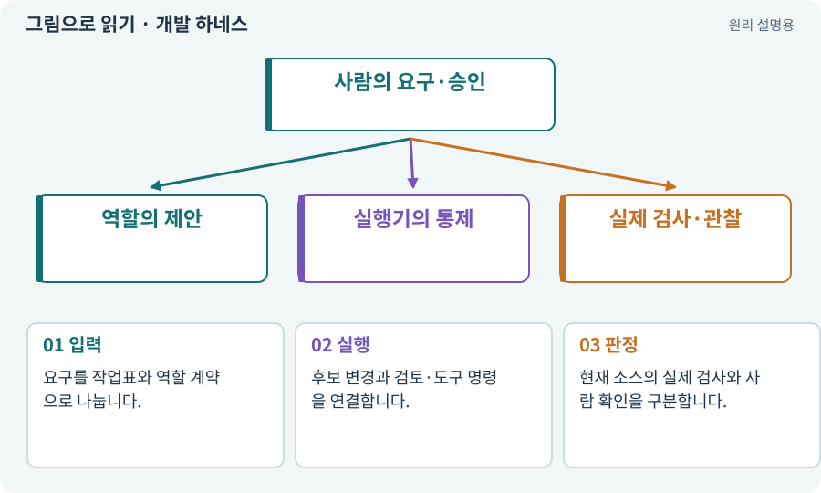

# 개발 하네스

**분야:** AI·스킬·훅·하네스 운영

하네스는 AI의 작업 입력·역할·권한·실행·검사·복구를 묶어 관리하는 프로그램입니다. 역할 프롬프트를 길게 쓰는 것과 다르게 실제 상태와 실패 조건을 코드로 관리합니다.

**찾아오는 이름:** 개발 하네스, 하네스, Harness, MyGameHarness, 개발 도구

## 익숙한 것에 비유하면

기획·작업자·검수·창고를 연결하는 작은 작업 관리 시스템입니다. “완료”라는 보고만 듣지 않고 물건과 검사표를 확인합니다.



개념도입니다. 실제 Unity 화면이나 검사 결과가 아닙니다. 그림의 순서·색은 역할을 구분하며 실제 설정값은 프로젝트에서 확인합니다.

## 이렇게 작동합니다

### 1. 입력

요구를 작업표와 역할 계약으로 나눕니다.

### 2. 실행

후보 변경과 검토·도구 명령을 연결합니다.

### 3. 판정

현재 소스의 실제 검사와 사람 확인을 구분합니다.

## 역할 프롬프트와 실행 프로그램을 나누세요

기획 역할이 작업 계획을 제안해도 실제 권한·파일 소유권·예산·완료 상태는 실행기가 검사해야 합니다. 모델이 응답 JSON에 approved:true라고 적는 것으로 사람의 권한 승인을 대신하지 않습니다.

역할들은 필요한 파일을 읽고 구조화된 변경안을 냅니다. 독립 검토 뒤 새 후보에 적용하고 Unity 통합·실제 테스트를 실행합니다. 실패하면 로그와 원본을 남긴 채 새 수정 작업으로 이어갑니다.

기본 실행기는 로컬 순차 방식입니다. 역할이 15개라는 사실만으로 병렬 워커·운영체제 격리·다른 PC에서 계속되는 실행이 생기지 않습니다. 실제 구현한 기능과 앞으로 확장할 기능을 구분합니다.

| 주체 | 책임 | 대신할 수 없는 것 |
| --- | --- | --- |
| 모델·역할 | 계획·구현·검토 제안 | 프로그램의 권한 강제 |
| 하네스 | 실행·검사·상태·증거 | 사람의 실제 플레이 판단 |
| 사람 | 요구·승인·관찰 | 실행하지 않은 검사 PASS |

## 직접 값을 바꾸며 보기

[웹 해설의 조작 모형 열기](../index.html#tech-harness). 조작은 설명용 모형만 바꿉니다. 실제 프로젝트·AI·진행 체크·게임 테스트는 실행하거나 변경하지 않습니다.

## 우리 RPG에서는 이렇게 만나요

“전리품 필터를 추가해 줘”라고 요청하면 AI가 하네스를 사용합니다. 하네스 내부 코드도 AI에게 제작을 맡깁니다. 여러분은 어떤 작업을 허용할지 결정하고 실패와 결과를 이해하며 확인합니다.

## 이것과 혼동하지 마세요

하네스가 실행 중이라고 PC를 꺼도 계속 돌아간다는 뜻은 아닙니다. 실제 실행 위치·프로세스 상태가 중요합니다.

## 이해했는지 한 번 생각해 보기

좋은 하네스의 기준은 에이전트 수인가요?

<details><summary>답과 이유</summary>

작업·권한·근거·실패 복구가 명확한지가 더 중요합니다.

</details>

## 내 프로젝트에서 확인하고 싶다면

아래 요청은 읽기 전용으로 실제 대상을 확인하는 선택 요청입니다. 코드나 설정을 직접 편집할 필요는 없습니다.

```text
현재 프로젝트에서 개발 하네스 관련 요소가 어떻게 사용되는지 읽기 전용으로 확인해 줘. 실제 대상과 설정을 찾아 쉬운 말과 작은 예로 설명해 줘. 특히 다음 혼동을 구분해 줘: 하네스가 실행 중이라고 PC를 꺼도 계속 돌아간다는 뜻은 아닙니다. 실제 실행 위치·프로세스 상태가 중요합니다. 아직 코드·설정·파일은 바꾸지 말고, 확인할 수 없는 내용은 따로 알려 줘.
```

## 이어지는 개념

[에이전트·서브에이전트·역할](agent.md) · [작업표·완료 조건·계획](task.md) · [후보·스테이징·변경 적용](candidate.md) · [검증 게이트·필수 검사](gate.md) · [run·attempt·revision·인수인계](run.md)

## 이 개념을 사용하는 실습

[02 · 내 게임을 알아듣는 개발 스킬 만들기](../index.html#lesson-002) · [21 · 몬스터가 장비를 떨어뜨리게 하기](../index.html#lesson-021) · [105 · 내 개발 도구를 빈 폴더에서 시작하기](../index.html#lesson-105) · [106 · 도구가 상태를 기억하게 만들기](../index.html#lesson-106) · [107 · 원본을 보호하고 허용 경로 정하기](../index.html#lesson-107) · [108 · 기획·구현·QA·검토 역할 만들기](../index.html#lesson-108) · [109 · 요청을 검사 가능한 작업표로 바꾸기](../index.html#lesson-109) · [110 · 작업마다 필요한 자료만 준비하기](../index.html#lesson-110) · [111 · AI 답변을 안전한 변경안으로 받기](../index.html#lesson-111) · [112 · 네 역할을 순서대로 실행하기](../index.html#lesson-112) · [113 · 검토한 후보만 승인해 적용하기](../index.html#lesson-113) · [114 · 테스트를 실행하고 결과 읽기](../index.html#lesson-114) · [115 · 지금 코드의 검사만 인정하기](../index.html#lesson-115) · [116 · “어디까지 됐어?”에 근거로 답하기](../index.html#lesson-116) · [117 · Unity 작업을 한 창구로 모으기](../index.html#lesson-117) · [118 · 모의 응답 대신 실제 Claude 연결하기](../index.html#lesson-118) · [119 · 막힌 작업을 안전하게 이어가기](../index.html#lesson-119) · [120 · 자연어 요청을 계획으로 바꾸기](../index.html#lesson-120) · [121 · 필요한 역할을 하나 추가하기](../index.html#lesson-121) · [122 · 내 게임에 맞는 검사기 추가하기](../index.html#lesson-122) · [123 · 기존 게임의 실제 파일 찾아 연결하기](../index.html#lesson-123) · [124 · 현재 컴퓨터의 Unity 명령 등록하기](../index.html#lesson-124) · [125 · 하네스로 작은 전리품 화면 만들기](../index.html#lesson-125) · [126 · 한 요청으로 필터 기능 끝내기](../index.html#lesson-126) · [127 · 내 반복 업무에 맞게 도구 개조하기](../index.html#lesson-127) · [128 · 내 도구를 대화로 운영하기](../index.html#lesson-128) · [129 · 기존 2D 게임에서 확장팩 시작하기](../index.html#lesson-129) · [130 · 첫 확장 작업을 하네스에 연결하기](../index.html#lesson-130) · [131 · 중요한 전리품만 표시하는 규칙 만들기](../index.html#lesson-131) · [132 · 필터를 실제 던전과 모바일에 연결하기](../index.html#lesson-132) · [133 · 첫 기능의 실패를 고쳐 다음 기준 만들기](../index.html#lesson-133) · [134 · 화상·냉기·표식으로 전투 확장하기](../index.html#lesson-134) · [135 · 벽을 통과하지 않는 회피 만들기](../index.html#lesson-135) · [136 · 방패병과 화염술사 정예 추가하기](../index.html#lesson-136) · [137 · 기름·폭발통·밸브로 공간 활용하기](../index.html#lesson-137) · [138 · 장비를 분해해 재료 얻기](../index.html#lesson-138) · [139 · 재료로 장비 제작하기](../index.html#lesson-139) · [140 · 개인 창고와 즐겨찾기 만들기](../index.html#lesson-140) · [141 · 소켓 한 칸에 룬 장착하기](../index.html#lesson-141) · [142 · 배운 스킬의 변형 선택하기](../index.html#lesson-142) · [143 · 새 랜덤 지역 봉인된 대장간 만들기](../index.html#lesson-143) · [144 · 이번 탐험에만 남는 유물 고르기](../index.html#lesson-144) · [145 · 지원 동료 하나 만들기](../index.html#lesson-145) · [146 · 대장장이 구조 퀘스트 만들기](../index.html#lesson-146) · [147 · 용광로 감시자와 3단계 전투 만들기](../index.html#lesson-147) · [148 · 아트 역할로 새 지역 외형 완성하기](../index.html#lesson-148) · [149 · 상태와 보스 효과를 같은 데이터로 맞추기](../index.html#lesson-149) · [150 · 소리가 없어도 읽히는 전투 만들기](../index.html#lesson-150) · [151 · 도감과 장비 비교로 새 기능 찾기](../index.html#lesson-151) · [152 · 이전 저장을 새 확장판으로 가져오기](../index.html#lesson-152) · [153 · 대장간 고해상도팩 선택 다운로드하기](../index.html#lesson-153) · [154 · 확장 기능을 켠 휴대폰 성능 고치기](../index.html#lesson-154) · [155 · 기록을 보고 제작 경제와 전투 조정하기](../index.html#lesson-155) · [156 · 기능 조합에서 숨은 오류 찾기](../index.html#lesson-156) · [157 · 하네스가 실패해도 기록 지키기](../index.html#lesson-157) · [158 · 룬 교체 버그를 역할로 수정하기](../index.html#lesson-158) · [159 · 최종 확장판 배포 후보 만들기](../index.html#lesson-159) · [160 · 대장간 보스까지 완주하고 새 기능 맡기기](../index.html#lesson-160)

## 참고와 설명의 범위

이 항목의 비유·그림·RPG 수치·운영 규칙은 개념을 이해하기 위한 자체 설계 예제입니다. 특정 도구가 이 규칙을 자동으로 구현한다는 뜻은 아닙니다.


그림·계산 예제·조작 모형은 자체 제작한 설명입니다. 실제 Unity 화면, 서비스 생성 결과, 성능 실측 또는 게임 테스트 결과가 아닙니다. 자료 확인: 2026년 9월 26일.
