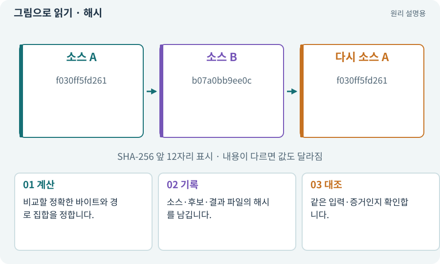

# 해시·SHA-256·체크섬

**분야:** AI·스킬·훅·하네스 운영

해시는 입력 내용을 짧은 고정 길이 값으로 요약하는 계산입니다. SHA-256 같은 값은 파일이 달라졌는지 비교하는 데 사용합니다. 암호화나 작성자 인증과는 다릅니다.

**찾아오는 이름:** 해시·SHA-256·체크섬, 해시, Hash, hash, SHA256, SHA-256, 체크섬, checksum

## 익숙한 것에 비유하면

책 전체의 내용을 대표하는 지문표에 가깝습니다. 이름표만 같아도 내용이 달라지면 지문이 달라집니다.



개념도입니다. 실제 Unity 화면이나 검사 결과가 아닙니다. 그림의 순서·색은 역할을 구분하며 실제 설정값은 프로젝트에서 확인합니다.

## 이렇게 작동합니다

### 1. 계산

비교할 정확한 바이트와 경로 집합을 정합니다.

### 2. 기록

소스·후보·결과 파일의 해시를 남깁니다.

### 3. 대조

같은 입력·증거인지 확인합니다.

## 지문 비교가 증명하는 것은 내용 일치입니다

SHA-256 값은 입력 바이트를 요약합니다. 같은 파일을 비교할 때 유용하지만 이것이 만든 사람을 인증하거나 악성 코드가 없음을 보장하지 않습니다. 서명과 목적이 다릅니다.

여러 소스를 묶어 해시할 때에는 파일 경로·정렬 순서·제외 규칙을 고정해야 합니다. 로그·캐시가 포함되면 실행할 때마다 달라질 수 있고, 중요한 설정을 제외하면 실제 변경을 놓칠 수 있습니다.

소스 고정은 파일 변경을 강제로 금지하는 장치가 아닙니다. 검사 전후 다시 계산해 같은 대상을 검사했는지 확인하고, 달라졌다면 새 검증이 필요합니다.

| 자료 | 같다고 볼 조건 | 보장하지 않는 것 |
| --- | --- | --- |
| 파일 이름 | 이름 문자열 일치 | 내용 일치 |
| 내용 해시 | 같은 바이트·범위 | 작성자·무해성 |
| 디지털 서명 | 키·서명 검증 조건 | 게임 기능의 정확성 |

## 직접 값을 바꾸며 보기

[웹 해설의 조작 모형 열기](../index.html#tech-hash). 조작은 설명용 모형만 바꿉니다. 실제 프로젝트·AI·진행 체크·게임 테스트는 실행하거나 변경하지 않습니다.

## 우리 RPG에서는 이렇게 만나요

테스트가 끝난 뒤 소스를 한 줄 바꾸면 현재 해시가 달라집니다. 예전 결과를 현재 PASS로 쓰면 안 됩니다. JSON은 의미가 같아도 공백·순서에 따라 바이트 해시가 달라질 수 있습니다.

## 이것과 혼동하지 마세요

해시만 있다고 안전한 코드·진짜 작성자·정확한 테스트임이 증명되지 않습니다.

## 이해했는지 한 번 생각해 보기

다른 파일인데 이름이 같으면 같은 결과인가요?

<details><summary>답과 이유</summary>

내용 해시와 실제 대상을 대조해야 합니다.

</details>

## 내 프로젝트에서 확인하고 싶다면

아래 요청은 읽기 전용으로 실제 대상을 확인하는 선택 요청입니다. 코드나 설정을 직접 편집할 필요는 없습니다.

```text
현재 프로젝트에서 해시·SHA-256·체크섬 관련 요소가 어떻게 사용되는지 읽기 전용으로 확인해 줘. 실제 대상과 설정을 찾아 쉬운 말과 작은 예로 설명해 줘. 특히 다음 혼동을 구분해 줘: 해시만 있다고 안전한 코드·진짜 작성자·정확한 테스트임이 증명되지 않습니다. 아직 코드·설정·파일은 바꾸지 말고, 확인할 수 없는 내용은 따로 알려 줘.
```

## 이어지는 개념

[스냅샷·기준선·baseline](snapshot.md) · [증거·검사 상태·미실행](evidence.md) · [소스 고정·seal·증거 결속](seal.md) · [앱 서명·키·자격 증명](signature.md)

## 이 개념을 사용하는 실습

[38 · 테스트 결과와 실제 플레이 구분하기](../index.html#lesson-038) · [39 · 다른 PC와 Android 에서 실행할 파일 만들기](../index.html#lesson-039) · [44 · 시드로 같은 던전 다시 만들기](../index.html#lesson-044) · [54 · 느낌을 근거로 밸런스 고치기](../index.html#lesson-054) · [73 · 주소로 에셋 불러오기](../index.html#lesson-073) · [74 · 추가 외형을 서버에서 받게 준비하기](../index.html#lesson-074) · [77 · 앱을 바꾸지 않고 외형 업데이트하기](../index.html#lesson-077) · [81 · 2D 게임을 남기고 3D 작업 시작하기](../index.html#lesson-081) · [84 · 같은 지도를 3D 바닥과 벽으로 만들기](../index.html#lesson-084) · [94 · 같은 랜덤 던전을 3D로 생성하기](../index.html#lesson-094) · [100 · 두 버전이 같은 게임인지 비교하기](../index.html#lesson-100) · [102 · 네 배포물을 구분해 만들기](../index.html#lesson-102) · [104 · 2D와 3D를 두 플랫폼에서 완주하기](../index.html#lesson-104) · [105 · 내 개발 도구를 빈 폴더에서 시작하기](../index.html#lesson-105) · [106 · 도구가 상태를 기억하게 만들기](../index.html#lesson-106) · [107 · 원본을 보호하고 허용 경로 정하기](../index.html#lesson-107) · [129 · 기존 2D 게임에서 확장팩 시작하기](../index.html#lesson-129) · [130 · 첫 확장 작업을 하네스에 연결하기](../index.html#lesson-130) · [133 · 첫 기능의 실패를 고쳐 다음 기준 만들기](../index.html#lesson-133) · [148 · 아트 역할로 새 지역 외형 완성하기](../index.html#lesson-148) · [150 · 소리가 없어도 읽히는 전투 만들기](../index.html#lesson-150) · [154 · 확장 기능을 켠 휴대폰 성능 고치기](../index.html#lesson-154) · [156 · 기능 조합에서 숨은 오류 찾기](../index.html#lesson-156) · [157 · 하네스가 실패해도 기록 지키기](../index.html#lesson-157) · [158 · 룬 교체 버그를 역할로 수정하기](../index.html#lesson-158) · [159 · 최종 확장판 배포 후보 만들기](../index.html#lesson-159) · [160 · 대장간 보스까지 완주하고 새 기능 맡기기](../index.html#lesson-160)

## 참고와 설명의 범위

기본 도구 동작은 아래 공식 자료를 참고했습니다. 비유·그림·RPG의 예시 수치와 정책은 이해를 위한 자체 예제입니다. 실제 API·지원 기능은 설치 버전과 계정에서 확인합니다.

- [Python · hashlib](https://docs.python.org/3/library/hashlib.html)

그림·계산 예제·조작 모형은 자체 제작한 설명입니다. 실제 Unity 화면, 서비스 생성 결과, 성능 실측 또는 게임 테스트 결과가 아닙니다. 자료 확인: 2026년 9월 26일.
