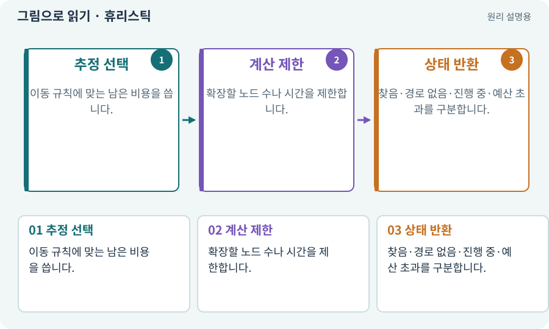

# 휴리스틱·탐색 비용·예산

**분야:** 지도·적 AI·전투 규칙

휴리스틱은 남은 비용을 빠르게 추정하는 값입니다. 탐색 예산은 한 번이나 한 프레임에 쓸 계산량을 제한하는 규칙입니다. “답 없음”과 “아직 예산 안에 못 찾음”은 다릅니다.

**찾아오는 이름:** 휴리스틱·탐색 비용·예산, 휴리스틱, heuristic, 탐색 비용, 탐색 예산, 경로 예산

## 익숙한 것에 비유하면

도서관에서 찾을 가능성이 높은 서가부터 보되 한 번에 살펴볼 책 수를 정하는 것입니다.



개념도입니다. 실제 Unity 화면이나 검사 결과가 아닙니다. 그림의 순서·색은 역할을 구분하며 실제 설정값은 프로젝트에서 확인합니다.

## 이렇게 작동합니다

### 1. 추정 선택

이동 규칙에 맞는 남은 비용을 씁니다.

### 2. 계산 제한

확장할 노드 수나 시간을 제한합니다.

### 3. 상태 반환

찾음·경로 없음·진행 중·예산 초과를 구분합니다.

## 우리 RPG에서는 이렇게 만나요

몬스터 30마리가 매 프레임 전체 지도 A*를 실행하면 느려질 수 있습니다. 갱신 간격·목표 변화·공유 정보로 계산량을 줄입니다.

## 이것과 혼동하지 마세요

예산 초과를 “길 없음”으로 처리하면 잠깐 바쁜 상황에서 적이 멈추거나 되돌아갑니다.

## 이해했는지 한 번 생각해 보기

512개 노드를 살폈는데 목표가 없으면 완전 막힌 길인가요?

<details><summary>답과 이유</summary>

탐색을 끝낸 것이 아니라 예산에 도달했을 수 있습니다. 반환 상태를 구분합니다.

</details>

## 내 프로젝트에서 확인하고 싶다면

아래 요청은 읽기 전용으로 실제 대상을 확인하는 선택 요청입니다. 코드나 설정을 직접 편집할 필요는 없습니다.

```text
현재 프로젝트에서 휴리스틱·탐색 비용·예산 관련 요소가 어떻게 사용되는지 읽기 전용으로 확인해 줘. 실제 대상과 설정을 찾아 쉬운 말과 작은 예로 설명해 줘. 특히 다음 혼동을 구분해 줘: 예산 초과를 “길 없음”으로 처리하면 잠깐 바쁜 상황에서 적이 멈추거나 되돌아갑니다. 아직 코드·설정·파일은 바꾸지 말고, 확인할 수 없는 내용은 따로 알려 줘.
```

## 이어지는 개념

[A* 길찾기](astar.md) · [Profiler·병목·실기기 측정](profiler.md) · [FPS·프레임 시간·ms](frame-time.md) · [스케줄러·순차·병렬](scheduler.md)

## 이 개념을 사용하는 실습

[09 · 클릭한 곳까지 벽을 돌아가기](../index.html#lesson-009)

## 참고와 설명의 범위

기본 도구 동작은 아래 공식 자료를 참고했습니다. 비유·그림·RPG의 예시 수치와 정책은 이해를 위한 자체 예제입니다. 실제 API·지원 기능은 설치 버전과 계정에서 확인합니다.

- [Hart·Nilsson·Raphael · A* 원 논문(1968)](https://ieeexplore.ieee.org/document/4082128/)

그림·계산 예제·조작 모형은 자체 제작한 설명입니다. 실제 Unity 화면, 서비스 생성 결과, 성능 실측 또는 게임 테스트 결과가 아닙니다. 자료 확인: 2026년 9월 26일.
