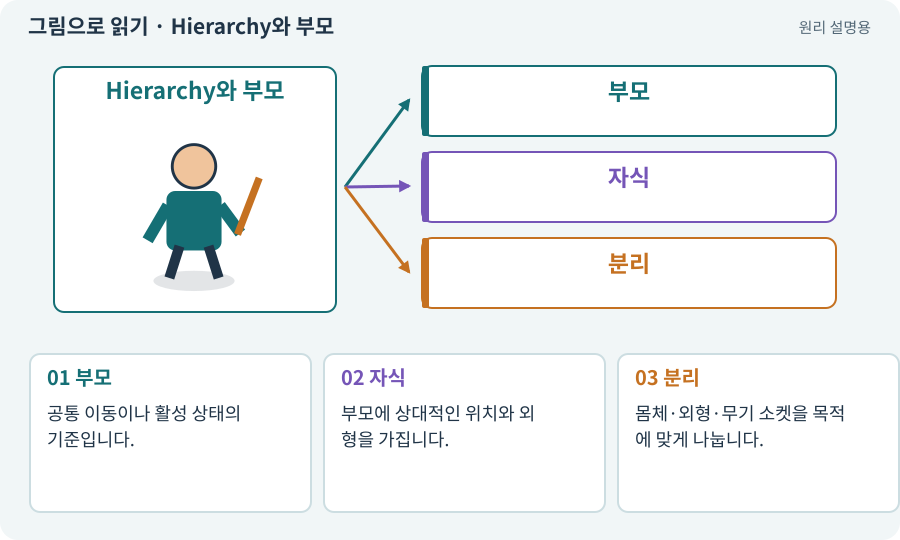

# Hierarchy와 부모·자식

**분야:** 시작·도구·작업 공간

Hierarchy는 씬의 오브젝트와 부모·자식 관계를 보여 줍니다. 부모의 이동·회전·크기는 자식의 월드 상태에 영향을 줍니다.

**찾아오는 이름:** Hierarchy와 부모·자식, Hierarchy, 계층, 부모·자식, 부모 자식, 자식 오브젝트

## 익숙한 것에 비유하면

캐릭터가 들고 있는 가방과 가방에 달린 장식입니다. 캐릭터를 옮기면 둘도 따라가지만, 장식만 바꾸는 것은 몸체 이동과 다릅니다.



개념도입니다. 실제 Unity 화면이나 검사 결과가 아닙니다. 그림의 순서·색은 역할을 구분하며 실제 설정값은 프로젝트에서 확인합니다.

## 이렇게 작동합니다

### 1. 부모

공통 이동이나 활성 상태의 기준입니다.

### 2. 자식

부모에 상대적인 위치와 외형을 가집니다.

### 3. 분리

몸체·외형·무기 소켓을 목적에 맞게 나눕니다.

## 우리 RPG에서는 이렇게 만나요

ActorRoot 아래에 VisualRoot와 무기 표시를 두면 그림만 바꿔도 실제 충돌 반경을 유지할 수 있습니다.

## 이것과 혼동하지 마세요

부모를 비활성화하면 자식의 실행도 영향을 받습니다. 그림만 숨길지 전체 캐릭터를 끌지 구분합니다.

## 이해했는지 한 번 생각해 보기

검 크기만 키우려는데 몸체 충돌도 커졌다면?

<details><summary>답과 이유</summary>

너무 위쪽 부모의 Scale을 바꿨을 수 있습니다. 외형 자식에만 적용하는지 봅니다.

</details>

## 내 프로젝트에서 확인하고 싶다면

아래 요청은 읽기 전용으로 실제 대상을 확인하는 선택 요청입니다. 코드나 설정을 직접 편집할 필요는 없습니다.

```text
현재 프로젝트에서 Hierarchy와 부모·자식 관련 요소가 어떻게 사용되는지 읽기 전용으로 확인해 줘. 실제 대상과 설정을 찾아 쉬운 말과 작은 예로 설명해 줘. 특히 다음 혼동을 구분해 줘: 부모를 비활성화하면 자식의 실행도 영향을 받습니다. 그림만 숨길지 전체 캐릭터를 끌지 구분합니다. 아직 코드·설정·파일은 바꾸지 말고, 확인할 수 없는 내용은 따로 알려 줘.
```

## 이어지는 개념

[Transform: 위치·회전·크기](transform.md) · [월드 좌표와 로컬 좌표](local-world.md) · [ActorRoot·VisualRoot·ModelRoot](actor-root.md) · [수명주기·초기화·정리](lifecycle.md)

## 이 개념을 사용하는 실습

[47 · 실패하는 시드를 찾고 복구하기](../index.html#lesson-047) · [88 · 3D 모델에 걷기와 공격 연결하기](../index.html#lesson-088) · [115 · 지금 코드의 검사만 인정하기](../index.html#lesson-115)

## 참고와 설명의 범위

기본 도구 동작은 아래 공식 자료를 참고했습니다. 비유·그림·RPG의 예시 수치와 정책은 이해를 위한 자체 예제입니다. 실제 API·지원 기능은 설치 버전과 계정에서 확인합니다.

- [Unity · Transform](https://docs.unity3d.com/6000.3/Documentation/Manual/class-Transform.html)

그림·계산 예제·조작 모형은 자체 제작한 설명입니다. 실제 Unity 화면, 서비스 생성 결과, 성능 실측 또는 게임 테스트 결과가 아닙니다. 자료 확인: 2026년 9월 26일.
