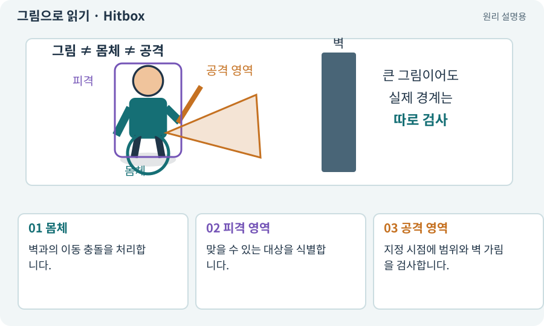

# Hitbox·Hurtbox·Body

**분야:** 오브젝트·좌표·움직임

Hitbox는 공격이 맞는 범위, Hurtbox는 피해를 받을 수 있는 대상 범위, Body는 이동을 막는 몸체 범위를 뜻하는 설계 용어입니다. 같은 Collider로 합칠 수도 있지만 목적은 다릅니다.

**찾아오는 이름:** Hitbox·Hurtbox·Body, Hitbox, Hurtbox, Body, 피격 영역, 공격 판정, 피격 판정

## 익숙한 것에 비유하면

검이 닿는 영역, 맞을 수 있는 몸, 문을 통과할 때 필요한 발폭을 각각 그리는 것입니다.



개념도입니다. 실제 Unity 화면이나 검사 결과가 아닙니다. 그림의 순서·색은 역할을 구분하며 실제 설정값은 프로젝트에서 확인합니다.

## 이렇게 작동합니다

### 1. 몸체

벽과의 이동 충돌을 처리합니다.

### 2. 피격 영역

맞을 수 있는 대상을 식별합니다.

### 3. 공격 영역

지정 시점에 범위와 벽 가림을 검사합니다.

## 우리 RPG에서는 이렇게 만나요

한 몬스터에 Hurtbox가 세 개 있어도 한 번의 베기에서 ActorId 하나에 한 번만 피해를 줍니다. Collider 수대로 피해를 곱하지 않습니다.

## 이것과 혼동하지 마세요

시각 효과의 큰 불꽃 전체를 실제 공격 범위로 간주하지 않습니다. 예고·판정·효과의 관계를 명시합니다.

## 이해했는지 한 번 생각해 보기

한 번 휘둘렀는데 같은 적이 세 번 맞는 이유는?

<details><summary>답과 이유</summary>

여러 Hurtbox 결과를 같은 적으로 묶지 않았을 수 있습니다. 공격 ID와 대상 ID로 중복을 막습니다.

</details>

## 내 프로젝트에서 확인하고 싶다면

아래 요청은 읽기 전용으로 실제 대상을 확인하는 선택 요청입니다. 코드나 설정을 직접 편집할 필요는 없습니다.

```text
현재 프로젝트에서 Hitbox·Hurtbox·Body 관련 요소가 어떻게 사용되는지 읽기 전용으로 확인해 줘. 실제 대상과 설정을 찾아 쉬운 말과 작은 예로 설명해 줘. 특히 다음 혼동을 구분해 줘: 시각 효과의 큰 불꽃 전체를 실제 공격 범위로 간주하지 않습니다. 예고·판정·효과의 관계를 명시합니다. 아직 코드·설정·파일은 바꾸지 말고, 확인할 수 없는 내용은 따로 알려 줘.
```

## 이어지는 개념

[Collider와 몸체 경계](collider.md) · [피해 계산·스냅샷·피해 사건](damage.md) · [공격 ID·사건 ID·중복 피해 방지](event-id.md) · [공격 예고·선행동작·회복](telegraph.md)

## 이 개념을 사용하는 실습

[07 · 캐릭터와 벽이 있는 공간 만들기](../index.html#lesson-007) · [08 · WASD로 벽에 부딪히며 이동하기](../index.html#lesson-008) · [09 · 클릭한 곳까지 벽을 돌아가기](../index.html#lesson-009) · [13 · 적을 클릭해 접근하고 공격하기](../index.html#lesson-013) · [14 · 나를 발견하고 공격하는 적 만들기](../index.html#lesson-014) · [18 · 베기·마력탄·회전 공격 만들기](../index.html#lesson-018) · [28 · 여덟 구역의 첫 던전 만들기](../index.html#lesson-028) · [33 · 기본 캐릭터·몬스터·타일 아트 만들기](../index.html#lesson-033) · [87 · 같은 캐릭터를 실제 3D 모델로 만들기](../index.html#lesson-087) · [89 · 같은 전투 규칙을 3D에 연결하기](../index.html#lesson-089)

## 참고와 설명의 범위

기본 도구 동작은 아래 공식 자료를 참고했습니다. 비유·그림·RPG의 예시 수치와 정책은 이해를 위한 자체 예제입니다. 실제 API·지원 기능은 설치 버전과 계정에서 확인합니다.

- [Unity · Physics2D.CircleCast](https://docs.unity3d.com/6000.3/Documentation/ScriptReference/Physics2D.CircleCast.html)

그림·계산 예제·조작 모형은 자체 제작한 설명입니다. 실제 Unity 화면, 서비스 생성 결과, 성능 실측 또는 게임 테스트 결과가 아닙니다. 자료 확인: 2026년 9월 26일.
