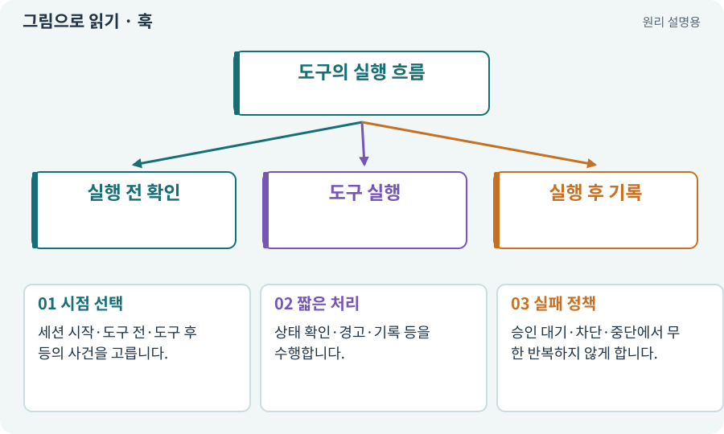

# 훅·사전/사후 이벤트

**분야:** AI·스킬·훅·하네스 운영

훅은 특정 도구·세션 사건이 생길 때 정해진 코드를 실행하는 연결점입니다. 사전 훅과 사후 훅은 할 수 있는 일이 다르며 지원 범위는 실제 도구 설정에 따릅니다.

**찾아오는 이름:** 훅·사전/사후 이벤트, 훅, Hook, Hooks, PreToolUse, PostToolUse, SessionStart, Stop hook

## 익숙한 것에 비유하면

공장 문이 열리기 전 확인하는 센서와 작업이 끝난 뒤 기록하는 센서는 다른 역할입니다.



개념도입니다. 실제 Unity 화면이나 검사 결과가 아닙니다. 그림의 순서·색은 역할을 구분하며 실제 설정값은 프로젝트에서 확인합니다.

## 이렇게 작동합니다

### 1. 시점 선택

세션 시작·도구 전·도구 후 등의 사건을 고릅니다.

### 2. 짧은 처리

상태 확인·경고·기록 등을 수행합니다.

### 3. 실패 정책

승인 대기·차단·중단에서 무한 반복하지 않게 합니다.

## 실행 시점을 알아야 안전하게 사용할 수 있어요

도구 실행 전 훅은 알려진 요청을 확인하고 지원하는 범위에서 허용·차단 결정을 도울 수 있습니다. 실행 후 훅은 이미 끝난 작업을 관찰하는 시점이므로 이미 바뀐 파일을 미리 막았다고 볼 수 없습니다.

세션 시작에는 현재 작업 상태를 읽게 안내하고, 도구 종료 후에는 소스 변경 가능성을 알려 이전 증거가 유효한지 다시 계산하게 할 수 있습니다. 모든 훅에서 긴 빌드나 모델 호출을 시작하면 중복 작업과 비용 문제가 생길 수 있습니다.

Stop 계열 훅은 지원하는 동작과 반환값을 실제 설치본에서 확인합니다. 승인 대기·BLOCKED·중단 상태에서는 끝없이 재시작시키지 않는 정책이 필요합니다.

| 시점 | 할 수 있는 일 | 혼동하지 않을 것 |
| --- | --- | --- |
| 실행 전 | 요청 확인·지원 범위의 통제 | OS 전체의 보안 경계는 아님 |
| 실행 후 | 변경·실패 기록 | 이미 한 일을 사전 차단할 수 없음 |
| 응답 종료 | 누락 안내·중단 판단 | 무한 작업 강제 금지 |

## 직접 값을 바꾸며 보기

[웹 해설의 조작 모형 열기](../index.html#tech-hook). 조작은 설명용 모형만 바꿉니다. 실제 프로젝트·AI·진행 체크·게임 테스트는 실행하거나 변경하지 않습니다.

## 우리 RPG에서는 이렇게 만나요

도구 실행 후 훅은 변경 가능성을 알리고 이전 검사 결과를 재사용하지 않도록 도울 수 있습니다. 이미 수행된 변경을 사전에 막았다고 말할 수는 없습니다.

## 이것과 혼동하지 마세요

훅마다 전체 빌드·유료 모델 호출을 시작하면 무한 반복과 비용 문제가 생길 수 있습니다.

## 이해했는지 한 번 생각해 보기

PostToolUse가 실행되면 테스트가 통과한 건가요?

<details><summary>답과 이유</summary>

아닙니다. 사건이 발생한 것일 뿐 테스트 결과는 따로 확인해야 합니다.

</details>

## 내 프로젝트에서 확인하고 싶다면

아래 요청은 읽기 전용으로 실제 대상을 확인하는 선택 요청입니다. 코드나 설정을 직접 편집할 필요는 없습니다.

```text
현재 프로젝트에서 훅·사전/사후 이벤트 관련 요소가 어떻게 사용되는지 읽기 전용으로 확인해 줘. 실제 대상과 설정을 찾아 쉬운 말과 작은 예로 설명해 줘. 특히 다음 혼동을 구분해 줘: 훅마다 전체 빌드·유료 모델 호출을 시작하면 무한 반복과 비용 문제가 생길 수 있습니다. 아직 코드·설정·파일은 바꾸지 말고, 확인할 수 없는 내용은 따로 알려 줘.
```

## 이어지는 개념

[AI 스킬과 SKILL.md](skill-agent.md) · [증거·검사 상태·미실행](evidence.md) · [잠금·경합·경쟁 상태](lock.md) · [비용 한도·예약·실사용량](budget.md)

## 이 개념을 사용하는 실습

[02 · 내 게임을 알아듣는 개발 스킬 만들기](../index.html#lesson-002) · [105 · 내 개발 도구를 빈 폴더에서 시작하기](../index.html#lesson-105) · [107 · 원본을 보호하고 허용 경로 정하기](../index.html#lesson-107) · [110 · 작업마다 필요한 자료만 준비하기](../index.html#lesson-110) · [115 · 지금 코드의 검사만 인정하기](../index.html#lesson-115) · [116 · “어디까지 됐어?”에 근거로 답하기](../index.html#lesson-116) · [117 · Unity 작업을 한 창구로 모으기](../index.html#lesson-117) · [118 · 모의 응답 대신 실제 Claude 연결하기](../index.html#lesson-118) · [119 · 막힌 작업을 안전하게 이어가기](../index.html#lesson-119) · [128 · 내 도구를 대화로 운영하기](../index.html#lesson-128)

## 참고와 설명의 범위

기본 도구 동작은 아래 공식 자료를 참고했습니다. 비유·그림·RPG의 예시 수치와 정책은 이해를 위한 자체 예제입니다. 실제 API·지원 기능은 설치 버전과 계정에서 확인합니다.

- [Claude Code · Hooks](https://code.claude.com/docs/en/hooks)

그림·계산 예제·조작 모형은 자체 제작한 설명입니다. 실제 Unity 화면, 서비스 생성 결과, 성능 실측 또는 게임 테스트 결과가 아닙니다. 자료 확인: 2026년 9월 26일.
