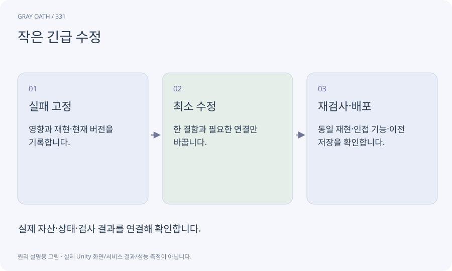

# 작은 긴급 수정

이미 검증하거나 배포한 제품의 특정 결함을 작은 변경으로 고치는 작업입니다. 빠르게 처리하더라도 소스·실패·저장 호환과 재검사를 보존합니다.

## 익숙한 비유

운행 중인 버스의 부품 하나를 교체하되 작동과 안전 검사를 다시 하는 것입니다.



## 작동 원리

### 1. 실패 고정

영향과 재현·현재 버전을 기록합니다.

### 2. 최소 수정

한 결함과 필요한 연결만 바꿉니다.

### 3. 재검사·배포

동일 재현·인접 기능·이전 저장을 확인합니다.

## 게임 속 예

보상 지급 중 재시작해 중복 지급되는 결함을 receipt 원자성으로 수정합니다. 다른 퀘스트의 보상과 구버전 저장도 검사합니다.

## 혼동하지 않기

이전 앱으로 되돌렸다고 새 schema 세이브까지 자동으로 읽을 수 있는 것은 아닙니다.

## 확인 질문

긴급하면 테스트를 줄여도 되나요?

영향에 맞게 우선순위를 둘 수 있지만 실행하지 않은 검사는 통과로 표시하지 않고 위험과 승인 범위를 남깁니다.

## 내 프로젝트에서 확인하기

```text
현재 GrayOathRPG3D에서 작은 긴급 수정을 사용하는 실제 대상과 동작을 읽기 전용으로 확인해 줘. 쉬운 말과 작은 사례로 설명하고 이전 앱으로 되돌렸다고 새 schema 세이브까지 자동으로 읽을 수 있는 것은 아닙니다. 이 문제를 어떻게 막는지 보여 줘. 코드·데이터·설정은 아직 수정하지 마.
```

## 관련 해설

[rollback](rollback.md) · [review](review.md) · [migration](migration.md)

## 공식 참고

- [Unity · CLI reference](https://docs.unity.com/en-us/unity-cli/unity-cli-reference)
