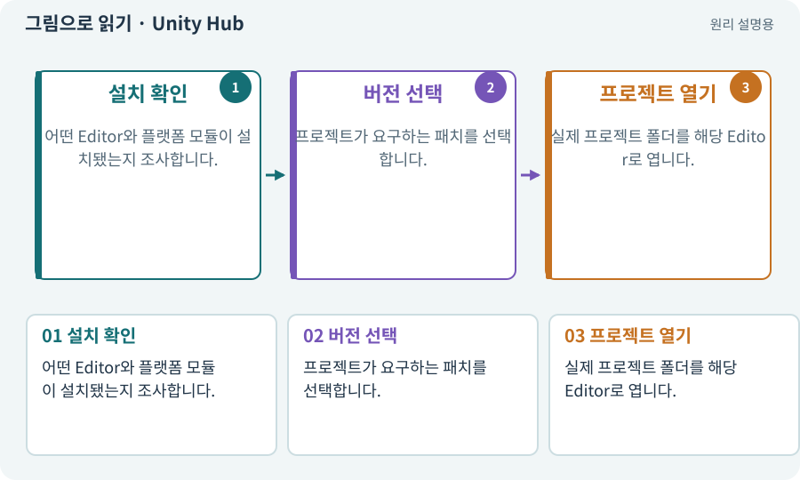

# Unity Hub

**분야:** 시작·도구·작업 공간

여러 Unity Editor 버전을 설치하고 프로젝트를 열어 주는 관리 프로그램입니다. 게임 장면을 직접 편집하는 창은 Editor입니다.

**찾아오는 이름:** Unity Hub, Hub

## 익숙한 것에 비유하면

Hub는 영화관 매표소, Editor는 실제 상영관에 가깝습니다. 매표소가 열렸다고 영화가 재생 중인 것은 아닙니다.



개념도입니다. 실제 Unity 화면이나 검사 결과가 아닙니다. 그림의 순서·색은 역할을 구분하며 실제 설정값은 프로젝트에서 확인합니다.

## 이렇게 작동합니다

### 1. 설치 확인

어떤 Editor와 플랫폼 모듈이 설치됐는지 조사합니다.

### 2. 버전 선택

프로젝트가 요구하는 패치를 선택합니다.

### 3. 프로젝트 열기

실제 프로젝트 폴더를 해당 Editor로 엽니다.

## 우리 RPG에서는 이렇게 만나요

AI가 Hub 설치 성공을 보고해도 Android Build Support가 없다면 APK 빌드는 아직 준비되지 않았습니다. 설치된 모듈까지 따로 확인합니다.

## 이것과 혼동하지 마세요

Hub 버전과 Editor 버전은 다른 번호입니다. 둘 중 하나만 기록하면 재현할 환경을 확정할 수 없습니다.

## 이해했는지 한 번 생각해 보기

Hub가 있는데 게임 씬이 안 보이는 건 오류일까요?

<details><summary>답과 이유</summary>

반드시 오류는 아닙니다. Hub에서 프로젝트를 실제 Editor로 열었는지 확인합니다.

</details>

## 내 프로젝트에서 확인하고 싶다면

아래 요청은 읽기 전용으로 실제 대상을 확인하는 선택 요청입니다. 코드나 설정을 직접 편집할 필요는 없습니다.

```text
현재 프로젝트에서 Unity Hub 관련 요소가 어떻게 사용되는지 읽기 전용으로 확인해 줘. 실제 대상과 설정을 찾아 쉬운 말과 작은 예로 설명해 줘. 특히 다음 혼동을 구분해 줘: Hub 버전과 Editor 버전은 다른 번호입니다. 둘 중 하나만 기록하면 재현할 환경을 확정할 수 없습니다. 아직 코드·설정·파일은 바꾸지 말고, 확인할 수 없는 내용은 따로 알려 줘.
```

## 이어지는 개념

[Unity Editor](editor.md) · [플랫폼 모듈·SDK·NDK·JDK](module.md) · [버전·패치·LTS](lts.md) · [프로젝트와 프로젝트 루트](project.md)

## 이 개념을 사용하는 실습

[01 · 빈 2D 프로젝트 만들기](../index.html#lesson-001)

## 참고와 설명의 범위

기본 도구 동작은 아래 공식 자료를 참고했습니다. 비유·그림·RPG의 예시 수치와 정책은 이해를 위한 자체 예제입니다. 실제 API·지원 기능은 설치 버전과 계정에서 확인합니다.

- [Unity · 2D 게임 제작 흐름](https://docs.unity3d.com/6000.3/Documentation/Manual/2d-game-creation-wokflow.html)
- [Unity · Android SDK·NDK·JDK 준비](https://docs.unity3d.com/6000.3/Documentation/Manual/android-sdksetup.html)

그림·계산 예제·조작 모형은 자체 제작한 설명입니다. 실제 Unity 화면, 서비스 생성 결과, 성능 실측 또는 게임 테스트 결과가 아닙니다. 자료 확인: 2026년 9월 26일.
